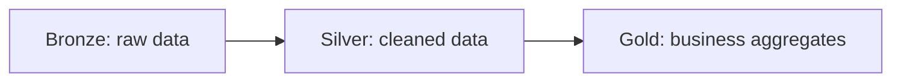

# Skill verification evidence

Verification date: 2026-10-10 (Asia/Saigon). This report covers the local skill setup and manual routing smoke tests. It does not certify authenticated Databricks execution or automatic selection in a fresh Codex session.

## Environment and installation

The workspace initially contained zero entries and had no Git repository, course files, or existing agent configuration. Node v24.18.0, npm/npx 11.16.0, Python 3.12, and Git were available. Databricks CLI was absent. `npm.ps1` was blocked by PowerShell policy; `.cmd` commands worked without changing policy.

`npx.cmd --yes skills --help` confirmed current command syntax. `npx.cmd --offline skills --version` reported 1.7.2. Initial project/global `skills list --json` inventories both returned `[]`. Built-in/plugin skills are separate from this project installation.

Source repositories were cloned into a temporary review directory. Commits were read with `git rev-parse HEAD`, and the requested skill files and dependencies were inspected. The official skill-installer helper installed the eight requested packages with explicit paths, pinned commits, and project destination. The Mermaid ZIP extraction initially failed on a long unrelated Windows path; a sparse git retry succeeded.

## Checks and scope

| Command/check | Result | Evidence boundary |
|---|---|---|
| `npx.cmd --offline skills list --agent codex --json` | Eight entries, project scope, agent Codex | CLI discovery of on-disk packages; source fields are null because installation used the helper, so provenance lives in the manifest |
| `python scripts/verify_skills.py` | Eight skill checks, zero failures | Exact file inventory/hashes, UTF-8 manifests, name/description, installed parent, linked SKILL.md local references, runtime relative TS imports, required documentation |
| `npm.cmd install --ignore-scripts --no-audit --no-fund` | Five packages installed | Pinned tsx runner and package lock; no lifecycle scripts executed |
| `python scripts/smoke_skills.py` | Four CLI help checks, save/consolidate and blocked-publication checks, zero failures | Local fixture with source URL, readable Markdown/JSON output, no cloud auth or network |
| Manual mini-task routing | Four routes passed | Matching skill bodies read and small outputs inspected; no fresh-session automatic routing evaluation |
| Pinned upstream comparison | 70 files match source | Compared installed bytes to `git show <commit>:<path>`, permitting LF/CRLF differences; excluded only preserved license additions and three documented research adaptation files |
| Local documentation links | All resolve | AGENTS.md, SKILLS.md, SKILLS_LOCK.md, and this report |
| `npm.cmd ls --depth=0` | tsx@4.20.6, no dependency errors | Local runner installation |

The first research fixture used a wrapped `{"results": [...]}` object. Upstream consolidation reads a plain object as one row, so the source attribution assertion failed. After using the supported top-level array, JSON retained the URL but upstream Markdown still omitted it. A local formatting patch adds a Source URLs section to every output format; the final assertion passes. Normalize host tool responses into `[{"title": "...", "url": "...", "content": "..."}]` before saving. A successful command alone does not prove attribution preservation.

The Unity Catalog manifest links to ten sibling product skills outside this installation scope. They are explicit optional-route exceptions in the verifier, rather than missing files inside the installed package. The declared databricks-core parent and installed databricks-jobs sibling resolve normally.

## Mini-task 1: Lakeflow Jobs terminology

Prompt: “Explain current Databricks Lakeflow Jobs terminology.”

Selected: `databricks-core`, `databricks-jobs`, `research-online`. The question needs current terminology, so research is required. Read the installed core/jobs manifests and research workflow; fetched the official Jobs page using host web tools.

Mini-output: Lakeflow Jobs coordinates workflow execution. A job groups tasks, a task performs a unit of work, a trigger starts a job, and runs record executions. Tasks can have dependencies represented as a DAG. This terminology is supported by [official Lakeflow Jobs documentation](https://docs.databricks.com/aws/en/jobs/) fetched on 2026-10-10. The skill routes to the same product area. PASS for manual routing and sourced terminology; no job was created.

## Mini-task 2: Unity Catalog hierarchy

Prompt: “Design Unity Catalog hierarchy for dev/staging/prod.”

Selected: `databricks-core`, `databricks-unity-catalog`. Read both manifests and the Unity Catalog reference index. Additional official-source verification was used for the governance recommendation.

Mini-output: For this example, use catalogs `learning_dev`, `learning_staging`, and `learning_prod`; each can contain `bronze`, `silver`, and `gold` schemas with tables beneath them. Assign environment-specific account groups and production service principals appropriate access. Workspace bindings can provide additional catalog isolation. This is an illustrative design, not a universal requirement to create three metastores. See [Unity Catalog best practices](https://docs.databricks.com/aws/en/data-governance/unity-catalog/best-practices), fetched on 2026-10-10. PASS for manual routing and conceptual hierarchy; no grants or catalogs were changed.

## Mini-task 3: Medallion diagram

Prompt: “Create Mermaid diagram for Bronze → Silver → Gold.”

Selected: `mermaid-diagrams`. Read its manifest and flowchart syntax guidance. The flowchart uses distinct IDs, quoted labels, and directional edges:

PASS for manual routing and syntax review. No Mermaid renderer or GitHub Pages build was run; rendering is outside this routing smoke test.

## Mini-task 4: Setup completion

Prompt: “Verify repository setup is complete.”

Selected: `verification-before-completion`. Read the full manifest, identified proof commands, ran the catalog/integrity/script checks, inspected results, and recorded limitations. The verification claim is limited to this skill setup; the repository has no course or Pages setup yet. PASS for evidence-based manual routing.

## Dependency and execution limitations

The four Databricks skills need CLI >= 1.0.0, a selected authenticated profile, and relevant workspace permissions for live operations. Those prerequisites are documented; installation, credential setup, REST calls, deployments, job runs, and data processing were not performed.

Research scripts need Node and the pinned tsx package. The missing shared upstream publish helper is replaced by a local adapter documented in [SKILLS.md](SKILLS.md#research-scripts-and-local-adaptation). Firecrawl and sibling skills are optional or unavailable. Default publication now fails before git/network actions; the repository npm wrapper passes `--no-publish`. HTML archival, site crawling, provider auth, and research finalization were not exercised.

Writing and verification guidance need no runtime package. Technical-writing references unavailable sibling skills; this stack uses its base rules and manual review. Mermaid has local reference guides; exporting a rendered asset would need a renderer or compatible documentation frontend.

Installed skill manifests are on disk in the documented Codex project discovery path, and the CLI reports them. The current turn's tool-supplied catalog is a prior snapshot. Skills should be available on the next turn; reload the workspace if necessary. A manual routing smoke test is not proof of automatic model skill selection on every prompt.

## Iteration 4 re-verification - 2026-10-11

Historical setup/routing records above remain unchanged. Current catalog exposes the eight repository skills. `python scripts/verify_skills.py` passed all eight, zero failures; optional sibling links unchanged. `python scripts/smoke_skills.py` passed four CLI-help checks, archive→consolidate source preservation and default-publication rejection before git/network action. Collector date now comes from session metadata; research adapter/skill bytes and four npm dependency pins were retained. `npm.cmd ci --ignore-scripts --no-fund --no-audit` reinstalled249 packages.

Handbook/build/runtime verification is recorded separately in PROGRESS.md; setup-era statements above do not describe the current course. No skill upgrades, authenticated Databricks operations or publication were performed during Iteration4.
