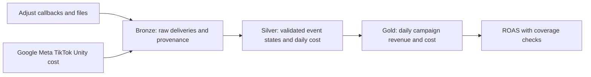

# 09 · Medallion Architecture

<ChapterMeta>

[01 · Grain](/foundations/01-grain-keys-fanout), [08 · Delta](/storage/08-delta-fundamentals). Tiếp: [10 · Incremental boundaries](/ingestion/10-incremental-boundaries).

</ChapterMeta>

## Why this matters

ROAS sai khi duplicated callbacks được cộng nhiều lần hoặc daily cost được join vào từng transaction. Layer names chỉ hữu ích khi mỗi boundary có contract kiểm được.

## Scenario

Adjust callback/file cùng mô tả purchase E1. Callback bị retry, file hôm sau sửa revenue. Google Ads, Meta, TikTok và Unity cung cấp daily campaign cost. Consumer muốn khoảng 15-minute freshness; attribution có thể sửa 72h trong bài tập. Các con số này cần source owner xác nhận khi production.

Raw payload sống ở đâu? Delivery duplicate khác business update thế nào? Cost join ở grain nào? ROAS thuộc lớp nào? Trả lời trước đặt tên tables.

## Learner reasoning

<details><summary>Đối chiếu responsibility boundaries</summary>

Giữ source payload/ingestion provenance để replay. Silver xác định event-state identity và revision, validate/normalize trước giữ state mới nhất. Gold aggregate revenue về cùng grain với cost rồi join. Missing campaign giữ UNKNOWN bucket và quality flag; không silently bỏ revenue.

</details>

## Mental model



[Databricks medallion guidance][medallion] mô tả progressive structure/quality và là recommended pattern, không là requirement. Bronze/Silver/Gold là responsibilities; số physical tables được chọn theo replay, ownership và consumer needs.

## Core concepts

| Boundary | Contract trong running case | Gate |
|---|---|---|
| Bronze | One delivery; source-faithful payload, source/file/batch ID, arrival, raw schema | Payload retained, ingestion count/provenance |
| Silver events | One state `(source_system, app_id, event_id)`; newest source revision | Key/schema validity, conflicting revision reject |
| Silver cost | One `(date, platform, account_id, app_id, campaign_id, currency)` | Daily cost unique; completeness flags |
| Gold | Same daily key as cost, aggregated event-time revenue | Sum/key coverage; no fan-out |

Silver có validation, normalization, dedup, business keys, conformed dimensions khi cần. Bronze append-first lưu audit/replay trong retention policy, không có nghĩa lưu vô hạn hoặc ingest secrets tùy ý. Schema enforcement ở Silver không enforce mọi business uniqueness.

## Example data

Lab fixtures: 5 deliveries gồm duplicate E1/revision 1, E1/revision 2 revenue 100, E2 revenue 50 và E3 missing campaign revenue 20. Silver có 3 states. Cost gồm Google 50, Meta 40, TikTok 30, Unity 20. Units: integer USD cents, dates UTC, không FX conversion.

Gold giữ revenue 170 và cost 140, gồm cost-only campaigns và UNKNOWN revenue bucket. Undefined denominator có ROAS NULL, không tự coi missing cost là verified zero. Callback/file delivery channel không nằm trong identity; event namespace và app nằm trong identity.

## How it works

Bronze giữ original missing campaign và duplicate delivery. Silver canonicalize UNKNOWN, loại repeated equivalent deliveries, update mutable state theo source revision. Equal-revision disagreement cần quarantine/source decision; không random first/last row.

Conformed campaign lookup cần unique namespace và đúng validity period nếu history-dependent. Business joins có thể thuộc Silver để enrich event-level data; metric aggregation/serving contract thuộc Gold. Aggregate revenue trước join daily cost, dùng coverage-preserving join và kiểm mỗi metric riêng.

Hai lớp đủ khi validated event representation là consumer-ready và không cần physical Gold mart. Thêm lớp chỉ hợp lý khi ownership, reuse hoặc publish boundary cần nó. Three folders không cung cấp automatic quality, và multi-table pipeline không thành một transaction chỉ vì gọi Medallion.

## Databricks implementation

Map responsibilities sang governed schemas/tables theo owner và permissions. [Official AWS guidance][medallion] dùng layered lakehouse pattern; lab giữ Python model cho design/conservation, không deploy Unity Catalog hoặc pipeline service.

## Production failure

Hai transactions C1 revenues 40/60 join cùng daily cost 50 → joined cost 100. Gold aggregate về C1 trước join → cost 50. Engine thành công nhưng contract sai. [Lab 09](/labs/09-medallion-design) yêu cầu learner viết grain/key và kiểm failure này.

## Debugging

| Symptom | Investigation | Treatment |
|---|---|---|
| Revenue doubled | Delivery vs event identity | Dedup revisions theo business contract |
| Cost doubled | Detail-to-daily cardinality | Aggregate compatible grain trước join |
| Missing campaign mất revenue | Null/lookup coverage | Preserve UNKNOWN, repair mapping/reconcile |
| Không replay được | Raw retention/provenance | Retain replay unit và schema/source context |

## BigQuery / Airflow mapping

BigQuery staging/curated/marts và dbt model layers là useful analogies. Airflow task boundaries không tự enforce grain hoặc multi-table atomicity. Một table có thể phục vụ nhiều responsibilities nếu contract vẫn rõ.

## Code

```powershell
python scripts/run_correctness.py --lab 09
python -m unittest discover -s tests -v
```

`labs/correctness/model.py::medallion` kiểm conservation; `delta_labs.py::lab09` lưu Bronze payloads, Silver states và grain contracts. Đây là design/model lab, không giả claim Bronze/Silver/Gold đã được deploy bằng Delta.

## Common mistakes

Dedup Bronze làm mất delivery evidence; groupBy campaign trước xác định event identity có thể collapse legitimate events. Inner join missing lookup làm giảm metric silently. Naming tables không thay validation.

## Production notes

Raw retention, currency, timezone và source completeness cần owner. 15-minute freshness không bảo đảm data finality 72h. File comparator phải đọc comparable source scope/cutoff; callback/file không được sum như hai independent revenue sources.

## Interview checkpoint

1. Callback retry và file correction đi qua boundary nào?
2. Two-layer design đủ trong điều kiện nào?
3. Cost daily, revenue transaction: join nào giữ conservation?
4. Missing campaign ảnh hưởng revenue và ROAS denominator ra sao?

## How to explain this in an interview

“Tôi đặt raw/replay evidence ở Bronze, event identity và validation ở Silver, serving grain/metrics ở Gold. Số tables theo responsibilities và reuse. Trước tính ROAS, tôi đưa revenue và cost về compatible grain, kiểm sums và coverage.” Giải thích từ failure case, không học thuộc lời mẫu.

## PASS criteria

| PASS | NOT YET |
|---|---|
| Định nghĩa grain/key và gate cho mọi dataset | Chỉ liệt kê Bronze/Silver/Gold |
| Giữ 170 revenue/140 cost và missing-key coverage | Chỉ kiểm combined ROAS |
| Nêu when 2 layers đủ, ownership/retention limits | Yêu cầu đúng 3 tables cho mọi workload |

## Official references

Verified 2026-10-11, Databricks AWS; lab model semantics độc lập vendor API guarantees.

- [Medallion architecture][medallion].
- [Delta batch writes](https://docs.delta.io/delta-batch/) cho table/schema boundaries.

[medallion]: https://docs.databricks.com/aws/en/lakehouse/medallion
