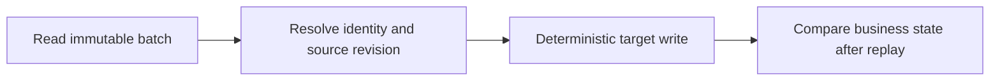

# 11 · Idempotency

<ChapterMeta>

[08 · Delta](/storage/08-delta-fundamentals), [10 · Incremental](/ingestion/10-incremental-boundaries). Tiếp: [Chapter 12](/correctness/12-merge-correctness).

</ChapterMeta>

## Why this matters

Producer không nhận acknowledgment nên gửi E123, revenue 100 ba lần. Pipeline có thể retry; business result vẫn phải 100. Idempotency nghĩa là lặp lại cùng operation hoặc input không làm thay đổi kết quả kinh doanh ngoài tác động đã định.

## Scenario

Adjust callback và file cùng chứa một purchase. Cost API cũng có retry. ROAS cần freshness khoảng 15 phút và xử lý mutable attribution 72h; đây là giả định running case, chưa phải guarantees của vendors.

## Learner reasoning

Trước khi chọn GROUP BY, hãy hỏi E123 thuộc source/app nào, là event độc lập hay state có thể sửa? Nếu hai payload cùng revision khác nhau, “take first” có chứng minh được truth không?

## Mental model

Identity và content là hai contract khác nhau. Identity giữ nguyên khi event được redeliver hoặc attribution thay đổi; revision quyết định state mới hơn. Delivery metadata dùng audit, không làm tăng số business events.



## Core concepts

Idempotency key là stable business/event identity. Fixture dùng `(source_system, app_id, event_id)` cho latest event state. Deterministic fingerprint phát hiện content disagreement, không tạo identity. SHA-256 có conceptual collision risk; dùng canonical content comparison cho equal-version source conflict. Arrival order không là source version.

## Example data

E123 revision 1 revenue 100 được gửi 3 lần: raw giữ 3 deliveries, Silver giữ 1 state. E123 ở appB là event khác. E123 revision 2 revenue 120 thay state cũ; E124 revenue 100 là additive event riêng. GROUP BY event_id có thể collapse hai apps hoặc che conflict 100/200.

## How it works

Resolve source theo đầy đủ key, kiểm tra equal-revision conflict, chọn highest source_revision, rồi cập nhật target khi source revision cao hơn. Equal revision khác committed content bị reject; stale revision không overwrite. Canonical business-state hash bỏ ingestion/processing timestamps nhưng giữ key, revision, revenue, event time, dimensions và tombstone.

## Databricks implementation

Lab 11 dùng actual Delta MERGE với explicit schema trên pinned Spark 4.0.4/Delta 4.0.1. Insert-only cần identity đã có được bỏ qua; upsert cần deterministic replacement; overwrite-by-partition cần complete partition input. Các cách này đều cần source contract, không có method tự bảo đảm mọi replay.

## Production failure

Append cả 3 callbacks tạo revenue 300. MERGE cộng `target.revenue + source.revenue` cũng tăng qua replay. Nondeterministic transformation như random business ID hoặc processing date làm repeated run sinh state khác. Sửa sink và transform contract trước khi retry.

## Debugging

So sánh sorted business state và hash trước/sau replay, đồng thời đọc DESCRIBE HISTORY. History version có thể thay đổi dù business state không đổi. Kiểm tra source/target duplicate keys, equal-version disagreement và scope trước khi quy lỗi Delta.

## BigQuery / Airflow mapping

BigQuery MERGE hoặc dbt unique_key có cùng câu hỏi identity/update semantics. Airflow retries task, không tự bảo đảm business idempotency. Partition overwrite có thể làm mất valid rows nếu input chỉ là delta của partition.

## Code

Chạy `python scripts/run_correctness.py --lab 11`. `delta_labs.py::lab11` lưu once/replay/history, bad append, reconciliation và retry sau simulated failure. `tests/test_correctness.py` kiểm tra cursor/write fault model; integration suite chạy Delta thật.

```powershell
python scripts/run_correctness.py --lab 11
```

## Common mistakes

GROUP BY event_id không là định nghĩa idempotency. Incomplete keys mất legitimate events; equal-ID conflicting rows chưa có generic winner; mutable state không được SUM mọi revisions. Content hash gồm mutable revenue không nên làm business key.

Nếu source reuse event ID cho một purchase mới trong cùng app, current key contract không còn đủ. Cần source-provided incarnation/transaction identity hoặc authoritative resolution; tăng revision không tự chứng minh đây là correction của purchase cũ. Không dùng payload hash để tự đoán hai business identities.

## Production notes

Invariant: apply batch X một lần hay hai lần cho cùng T; replay D-1 không tăng revenue; failure sau read/trước write và sau commit/trước ack đều retry đến same business state. Lab inject Python exceptions ở boundaries; chưa kiểm chứng process kill hay distributed cursor transaction.

## Interview checkpoint

Giải thích vì sao callback/file không thuộc event key; nêu trường hợp insert-only/upsert/overwrite phù hợp; phân biệt business-state stability với transaction history; chỉ ra điều kiện cần để replay D-1 an toàn.

## How to explain this in an interview

“Vì ingestion retry được, tôi giả định input có thể xuất hiện nhiều lần. Tôi xác định identity và version contract, chọn deterministic target operation, rồi chứng minh replay giữ business state. Transaction version có thể tăng; điều cần bảo vệ là event count và metrics.”

## PASS criteria

PASS khi xác định đầy đủ identity, reject ambiguous equal revisions, và đưa invariant có expected state. NOT YET nếu chỉ nói “dedup bằng GROUP BY” hoặc “MERGE là idempotent” mà không giải thích update semantics.

## Official references

[Delta MERGE semantics](https://docs.delta.io/delta-update/), [batch writes](https://docs.delta.io/delta-batch/). Verified 2026-10-11; local runtime được kiểm bằng execution, không suy ra mọi Databricks Runtime giống OSS.

