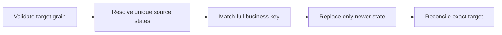

# 12 · Delta MERGE Correctness

<ChapterMeta>

[01 · Grain](/foundations/01-grain-keys-fanout), [08 · Delta](/storage/08-delta-fundamentals), [11 · Idempotency](/correctness/11-idempotency). Tiếp: [Chapter 13](/correctness/13-time-semantics).

</ChapterMeta>

## Why this matters

MERGE chỉ thực hiện match/insert/update theo rules bạn viết. Correctness phụ thuộc target grain, ON key, source uniqueness và update semantics. Nó không là magic dedup command.

## Scenario

Yesterday E123 revenue 0, today E123 revenue 100. Một purchase được sửa attribution, không có hai purchases. E124 revenue 100 riêng phải còn nguyên; replay cùng batch không được tăng E123 thêm 100.

## Learner reasoning

Source E123 revenue 100 và E123200: nếu revisions bằng nhau, không có generic winner. Nếu ordered revisions 1/2, source contract cho phép chọn revision 2. Cần trả lời câu hỏi này trước khi SQL chạy.

## Mental model

Target grain là one latest state per `(source_system, app_id, event_id)`. ON dùng đầy đủ key, không dùng revenue, revision hay updated_at vì chúng thay đổi. Revision guard nằm trong WHEN MATCHED.



## Core concepts

Source preprocessing phải tạo tối đa một intended row mỗi target key; target cũng cần unique key checks vì Delta table không tự là business primary-key constraint. Tombstone giữ latest deletion state, tránh stale replay làm sống lại event. Schema enforcement khác dedup và semantic validation.

## Example data

Matrix: insert E123 revenue 0; update rev 2→100; replay→100; stale rev 1→100; newer rev 3→120 cùng E124 revenue 100→hai rows. Equal-revision 100/200 bị reject. Bad additive update tạo 100→200→300.

## How it works

Validate source/target contracts rồi chạy WHEN MATCHED AND s.revision > t.revision UPDATE SET revenue=s.revenue và các mutable columns; WHEN NOT MATCHED INSERT. Equal revision disagrees with target bị reject trước SQL; same content là no business change. DELETE cần source contract riêng, không infer từ missing page.

## Databricks implementation

[Databricks docs](https://docs.databricks.com/aws/en/delta/merge) mô tả duplicate-match detection: DBR16.0+ xét ON và WHEN MATCHED conditions; DBR15.4LTS trở xuống xét ON. Lab kiểm OSS Delta 4.0.1 trực tiếp, không gán DBR semantics cho nó. Explicit fixed schema; không bật auto schema evolution. UPDATE SET * đòi column/schema compatibility theo [OSS docs](https://docs.delta.io/delta-update/).

## Production failure

Duplicate source cùng match target gây ambiguous update. Lab bypass preprocessing để actual engine trả DELTA_MULTIPLE_SOURCE_ROW_MATCHING_TARGET_ROW_IN_MERGE, không có commit mới. Duplicate keys chưa match target có thể đều insert; integration test chứng minh 2 rows. Vì vậy engine failure không thay thế source uniqueness checks.

## Debugging

Kiểm source count vs distinct full keys; target duplicates; exact ON predicate; source revision; schema/casts. Đọc DESCRIBE HISTORY version/operation/metrics và `_delta_log`. Lỗi ambiguity được mong đợi trong test, không là unexplained passing failure.

## BigQuery / Airflow mapping

BigQuery MERGE cũng cần grain và source semantics. dbt unique_key là match configuration, không tự xác nhận source unique. Airflow retry replay lại SQL; additive update vẫn cộng lại dù scheduler retry đúng.

## Code

```sql
MERGE INTO target t USING unique_source s
ON t.source_system=s.source_system AND t.app_id=s.app_id AND t.event_id=s.event_id
WHEN MATCHED AND s.revision > t.revision THEN
  UPDATE SET revenue=s.revenue, revision=s.revision, updated_at=s.updated_at
WHEN NOT MATCHED THEN INSERT *;
```

Snippet rút gọn minh họa key/revision guard, không phải complete serving update: runnable lab cập nhật mọi mutable columns bằng explicit assignments. `unique_source` phải pass source conflict/uniqueness gates; explicit schema phải compatible, không bật auto evolution để bỏ qua validation.

Chạy `python scripts/run_correctness.py --lab 12`; integration `python scripts/test_correctness.py`. `merge()` thực hiện bounded fixture preflight, explicit SQL MERGE và exact states/history. Preflight collect dùng dataset nhỏ, chưa là distributed dedup implementation.

```powershell
python scripts/run_correctness.py --lab 12
```

## Common mistakes

ON chứa revision làm correction thành insert; ON thiếu app_id collapse namespaces; cộng mutable revenue qua retries; chọn arbitrary ROW_NUMBER winner khi không có total version order; coi successful command là unique-key proof.

## Production notes

Mỗi source cần version/deletion semantics. Nếu không có ordered revision, updated_at chỉ đủ khi tie/conflict guarantees rõ; otherwise quarantine hoặc authoritative snapshot comparison. Schema evolution phải là policy có validation, không sửa lab bằng cách auto-merge mọi fields.

## Interview checkpoint

Giải thích insert/update/replay/stale/newer exact states; phân biệt two additive events với two states của một event; mô tả source conflict policy và vì sao duplicate unmatched rows vẫn nguy hiểm.

## How to explain this in an interview

“Tôi bắt đầu từ target grain và source state semantics. MERGE match đúng key, replace bằng version mới hơn và reject ambiguity; replay không cộng mutable value. Tôi kiểm cả source uniqueness lẫn target uniqueness vì MERGE không là primary-key enforcement.”

## PASS criteria

PASS khi ON khớp grain, source/target uniqueness được kiểm, updates deterministic và stale được giữ ngoài. NOT YET nếu chỉ nhớ cú pháp MERGE hoặc đề xuất SUM 100/200 cho ambiguous state.

## Official references

[Databricks MERGE](https://docs.databricks.com/aws/en/delta/merge), [OSS MERGE/schema rules](https://docs.delta.io/delta-update/), [concurrency](https://docs.delta.io/concurrency-control/). Verified 2026-10-11; actual ambiguity behavior lưu trong evidence.

