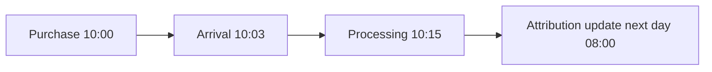

# 13 · Event, Ingestion, Processing & Update Time

<ChapterMeta>

[10 · Incremental](/ingestion/10-incremental-boundaries), [12 · MERGE](/correctness/12-merge-correctness). Tiếp: [Chapter 14](/correctness/14-late-lookback-reconciliation).

</ChapterMeta>

## Why this matters

Một timestamp không trả lời mọi câu hỏi. Chọn processing time làm report date khiến yesterday purchase đến hôm nay bị chuyển revenue sang ngày khác; pipeline vẫn chạy thành công.

## Scenario

Purchase 10:00, callback arrives 10:03, pipeline processes 10:15, attribution updates next day 08:00. ROAS dùng business date của purchase; update retrieval cần nhìn thấy correction muộn.

## Learner reasoning

Dashboard muốn đo ngày mua hay ngày job chạy? Source cursor muốn nhận event mới hay mọi mutations? SLA muốn đo source delivery delay hay pipeline processing delay? Mỗi câu hỏi cần đúng clock.

## Mental model

Event time là business occurrence; ingestion/arrival time là nhận delivery ở boundary đã định nghĩa; processing time là computation; update time là source mutation. Luôn ghi owner của timestamp và timezone.



## Core concepts

Reporting dùng event time theo business timezone policy. Incremental retrieval dùng source change position/updated_at nếu đủ guarantees, hoặc durable ingestion position cho captured deliveries. Monitoring dùng arrival/processing lag. Late-data reasoning so event time, arrival và mutation time với retrieval/state policies.

## Example data

Fixture L1 event 2026-10-01T23:59Z, arrives 2026-10-02T00:03Z, processed 00:15Z, source update 08:00Z. Correct report dateOct 1; wrong processing-date reportOct 2. Lab 13 minh họa UTC; thực tế timezone business có thể khác và cần explicit conversion.

## How it works

Giữ nguyên event_time của purchase khi source attribution correction đến, thay business fields/version. Arrival delay = ingestion-event trong cùng clock contract; processing delay = processing-ingestion. Clock skew hoặc invalid future times cần validation, không giả định mọi negative lag là lỗi code.

## Databricks implementation

Fixture schema lưu ISO UTC strings để dễ audit trong bounded labs. Production nên dùng typed timestamps và explicit Spark session timezone/parser policy. Structured Streaming event-time operators dùng designated event-time column; [Spark 4.0.4 docs](https://spark.apache.org/docs/4.0.4/streaming/apis-on-dataframes-and-datasets.html) mô tả event-time execution. Lab 13 là bounded time-semantics model; [Chapter 19](/streaming/19-windows-watermarks) có actual streaming event-time state và late-data lab.

## Production failure

GROUP BY date(processed_at) chuyển 100 revenue sangOct 2. Files comparator grouping theo export date cũng có thể lệch callback event date. Chọn cùng event-date/cutoff/currency/grain trước khi kết luận hai sources lệch.

## Debugging

Trace một event qua event_time, updated_at, ingested_at, processed_at, source version và target version. Tách event-to-arrival và arrival-to-process distributions. Source clock, timezone và update backdating có thể khiến simple MAX timestamp cursor không đủ.

## BigQuery / Airflow mapping

Airflow logical date/data interval không tự là event time. BigQuery DATE(timestamp, business_timezone) và Spark date conversion cần cùng timezone contract. Warehouse load timestamp phục vụ observability, không tự thay business occurrence.

## Code

Chạy `python scripts/run_correctness.py --lab 13`. `model.py::time_semantics` ghi exact correct/wrong day metrics; portable contract tests và integration suite kiểm Oct 1 vsOct 2. Đây là deterministic model exercise, không tạo streaming state.

```powershell
python scripts/run_correctness.py --lab 13
```

## Common mistakes

Overwrite event time bằng NOW; so timestamps thiếu timezone; dùng export creation date thay purchase date; dùng updated_at để group revenue chỉ vì nó tiện cho cursor. Timestamp field names cần owner/meaning bên cạnh type.

## Production notes

Running case freshness 15 phút và attribution 72h là requirement assumptions. Arrival lateness khác late mutation: correction có thể đổi event cũ dù callback ban đầu không late. Giữ audit timestamps để phân biệt và thiết kế [lookback](/correctness/14-late-lookback-reconciliation).

## Interview checkpoint

Từ four timestamps, chọn report date, retrieval boundary và lag metric; giải thích event cũ xử lý hôm nay; chỉ ra timezone/cutoff cần đồng nhất với file comparator.

## How to explain this in an interview

“Tôi dùng event time cho business occurrence, source update position để tìm mutations nếu source hỗ trợ, và ingestion/processing times để đo delivery và pipeline lag. Correction hôm nay vẫn thuộc event date cũ; timestamp choice phải theo câu hỏi đang trả lời.”

## PASS criteria

PASS khi giải thích four clock meanings và giữ purchase đúng business date qua corrections. NOT YET nếu dùng một timestamp cho reporting, cursor và monitoring mà không có source/business contract.

## Official references

[Spark 4.0.4 event time / watermarks](https://spark.apache.org/docs/4.0.4/streaming/apis-on-dataframes-and-datasets.html), [Databricks watermarks](https://docs.databricks.com/aws/en/structured-streaming/watermarks). Verified 2026-10-11; report-date policy là explicit running-case decision.

