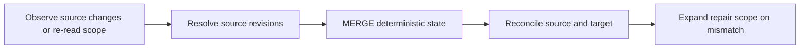

# 14 · Late Data, Lookback & Reconciliation

<ChapterMeta>

[10 · Incremental](/ingestion/10-incremental-boundaries), [13 · Time](/correctness/13-time-semantics), [12 · MERGE](/correctness/12-merge-correctness). Tiếp: [Chapter 15](/correctness/15-backfill-reconciliation).

</ChapterMeta>

## Why this matters

Pipeline chạy 15 phút nhưng attribution có thể sửa 72h history trong running case. Query only previous_end→current_end theo event time bỏ corrections của old events. Cadence và mutability window là hai dimensions riêng.

## Scenario

E1 at T0 revenue 0; T+1 day 100; T+2 days 120. Đây là states của cùng purchase. Target phải 120, không 220 và không 0. Correct update detection là điều kiện trước deterministic MERGE.

## Learner reasoning

Source có trustworthy updated_at hoặc change sequence không? Nếu chỉ export current snapshot, retrieval nào có thể thấy E1 đổi? Nếu correction đến ngoài 72h assumption, mechanism nào phát hiện/report coverage gap?

## Mental model

Batch cursor quyết định source data đọc tiếp; lookback là overlapping historical retrieval; reconciliation kiểm target còn khớp truth; streaming watermark điều khiển event-time lateness/state trong stateful operations. Re-reading history không do watermark thực hiện.



| Concept | Main question |
|---|---|
| Batch high-water mark | Đọc source data nào tiếp? |
| Lookback window | Re-read recent history nào? |
| Reconciliation | Target còn khớp source/truth không? |
| Streaming watermark | Event-time late threshold/state retention thế nào? |

## Core concepts

Updated-at strategy cần mutation/tie/delete/completeness contract. Rolling lookback 2h/6h/72h phải theo measured source behavior và business tolerance. Tiered D-1/D-3/D-7 reconciliation mở coverage beyond fast loop. Comparable complete snapshot diff cần same scope/key/cutoff.

## Example data

Lab 14 giữ snapshots của E1 revisions 1/2/3 với revenues 0/100/120. Event time vẫn là ngày 1/10; source updates đến ngày 2/10 và 3/10. Naive 15-minute event-time retrieval ngày 3/10 không thấy corrections; event-time 72h source re-read chứa 3 revisions trong synthetic fixture.

## How it works

Retrieve source scope, resolve newest state, MERGE, compare key/content/metrics với authoritative snapshot. Replaying all snapshots vẫn 120. Reconciliation gặp corrupted 220 phải fail dù job success. Không chọn window bằng số đẹp: derive từ mutation latency, API retention/limits và acceptable residual error.

## Databricks implementation

Actual Delta MERGE/replay và history dùng pinned runtime. Retrieval ở lab là deterministic synthetic snapshots, không là proof API trả mọi 72h changes. [Watermark docs](https://docs.databricks.com/aws/en/structured-streaming/watermarks) nói longer threshold giữ state lâu hơn; too-short thresholds có thể làm mất valid late inputs trong operation phù hợp.

## Production failure

Updated_at backdated vì clock skew, source delete không đổi timestamp hoặc correction quá lookback đều có thể mất. Tiered/full reconciliation phải report residual coverage và repair scope; không quảng cáo 72h là completeness guarantee khi source chưa cam kết.

## Debugging

Kiểm expected-vs-target keys, revisions, event dates, day totals và source cutoff. Nếu sums bằng nhau nhưng keys khác, vẫn fail. Kiểm missing campaign/cost coverage riêng để ROAS không che ingestion gaps. Lưu reconciliation mismatch và replay hash.

## BigQuery / Airflow mapping

dbt lookback filter rereads recent source then upserts; không là streaming watermark. Airflow scheduled historical reruns có thể repair old partitions nhưng cần idempotency và source comparability. BigQuery full snapshot comparisons đổi cost lấy coverage.

## Code

Chạy `python scripts/run_correctness.py --lab 14`. Evidence có timeline, `t0`/`t1`/`t2` snapshots, Delta versions, replay hash và mismatch-reconciliation. Lab asserts E1=120; tests xác nhận final state và mismatch detection.

```powershell
python scripts/run_correctness.py --lab 14
```

## Common mistakes

Append mutable snapshots rồi SUM; chỉ xem total revenue; gọi lookback 72h là watermark; tin updated_at không kiểm ties/deletes; infer missing-from-partial-response là deletion.

## Production notes

Chọn strategy theo correctness, API/compute cost, latency và complexity: updated cursor thường nhỏ scope nhưng phụ thuộc contract; 72h rolling reread rộng hơn; tiered recon chậm phát hiện older gaps; snapshot diff tăng storage/comparison và cần complete snapshot. Ghi alert/repair owner khi nguồn vượt assumptions.

## Interview checkpoint

Thiết kế fast 15 min và reconciliation scopes; giải thích vì sao final 120; phân biệt late arrival/late mutation; trả lời watermark có tự lấy lại API data không.

## How to explain this in an interview

“Tôi chọn retrieval theo source mutations và completeness. Nếu cần, fast loop rereads overlap rồi deterministic upsert; reconciliation kiểm outside-window drift. Lookback lấy dữ liệu, watermark quản lý event-time state, nên hai policies không thể thay thế nhau.”

## PASS criteria

PASS khi strategy dựa source guarantees, replay giữ 120 và reconciliation phát hiện wrong state/keys/day. NOT YET nếu nói “watermark 72h sẽ sửa history” hoặc SUM mọi revisions.

## Official references

[Databricks watermarks](https://docs.databricks.com/aws/en/structured-streaming/watermarks), [Spark 4.0.4 guarantees](https://spark.apache.org/docs/4.0.4/streaming/apis-on-dataframes-and-datasets.html), [Delta MERGE](https://docs.delta.io/delta-update/). Verified 2026-10-11; outside watermark delay có thể được xử lý, không có guarantee chung always drop.

