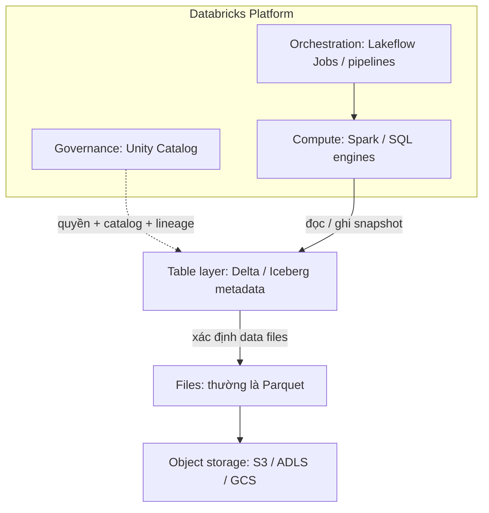
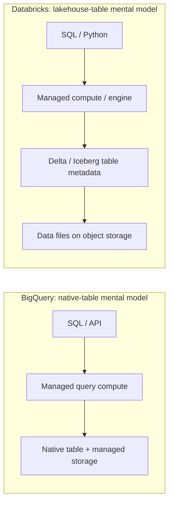

<div class="eyebrow">Foundation / Chapter 00</div>

# 00 · Databricks & Lakehouse Mental Model

<ChapterMeta>

Python, SQL và kinh nghiệm vận hành BigQuery/Airflow. Xem [cách học](/guide/how-to-learn) và [learning path](/guide/learning-path).

</ChapterMeta>

## Why this matters

Một pipeline chạy thành công vẫn có thể xuất revenue sai. Nếu nhầm folder chứa files với trạng thái của một table, bạn có thể đọc lại dữ liệu cũ sau compaction. Nếu nhầm platform với compute, bạn có thể tìm lỗi storage bằng cách tăng kích thước cluster.

Chương này giúp bạn trả lời “thành phần nào chịu trách nhiệm?” trước khi chọn cách sửa. Nó là nền tảng để học Spark, Delta và production recovery.

## Scenario

Bạn nhận một pipeline quảng cáo từ team khác. Airflow gọi Spark để đọc files, tổng hợp revenue và ghi Gold table. Sau một lần compaction, dashboard tăng từ **350 lên 650**, dù không có revenue mới. Job vẫn xanh.

Team nói: “Databricks lưu dữ liệu, Parquet là table, Spark sẽ đọc mọi file trong folder.” Hãy chọn giả thuyết trước khi đọc đáp án:

| Giả thuyết | Điều cần kiểm tra |
|---|---|
| Duplicate business events | Business key có xuất hiện nhiều lần trong table snapshot? |
| Reader đọc cả files cũ và files mới | Reader dùng table metadata hay glob đường dẫn? |
| Compute thiếu tài nguyên | Có lỗi execution, task failure hoặc timeout? |

**Câu hỏi:** một file vẫn tồn tại có đồng nghĩa nó thuộc table hiện tại không? Tăng compute có sửa được số 650 không?

## Learner reasoning

<details>
<summary>Đối chiếu giả thuyết</summary>

Nếu reader glob tất cả files, nó có thể đọc cả bản cũ lẫn bản đã compact. Thay đổi physical layout không phải revenue mới. Trước khi tăng compute, kiểm tra cách reader xác định **active files** và table snapshot.

Đây là tình huống minh họa lỗi reader, chưa đủ bằng chứng kết luận incident thật. Duplicate event cũng có thể tạo triệu chứng tương tự; cần kiểm tra keys và commit history.

</details>

## Mental model

Tách năm lớp: **platform điều phối**, **compute thực thi**, **table metadata quyết định trạng thái**, **file format biểu diễn dữ liệu**, **storage giữ bytes**. Governance kiểm soát việc truy cập các đối tượng; nó không phải một file format.



**Mô hình này hữu ích** khi phân loại failure, bàn về ownership và phân biệt lifecycle của compute với data. **Nó chưa đầy đủ** cho topology thật: control plane, compute plane, networking, cache, engines khác Spark, federation và loại table khác nhau. Unity Catalog là lớp governance xuyên suốt, không chỉ một bước đọc file. Databricks cũng hỗ trợ workloads ngoài Lakehouse trong sơ đồ này. [Architecture][architecture] và [Unity Catalog][uc] xác định các boundary của platform.

::: warning Đừng biến sơ đồ thành lời đảm bảo
“Storage tách compute” không có nghĩa mọi byte nằm trong bucket do bạn quản lý. AWS classic compute và serverless compute có placement khác nhau; serverless workspaces có thể dùng default storage do Databricks quản lý. Kiểm tra kiến trúc cloud/workspace đang dùng, thay vì suy ra từ hình đơn giản. [High-level architecture][architecture].
:::

## Core concepts

### Databricks là gì, và boundary nằm ở đâu?

Databricks là platform để xây, chạy và quản trị data/AI workloads. Trong phạm vi Data Engineering, bạn dùng compute, orchestration, table management và governance. Notebook là một giao diện authoring; **notebook không đại diện cho toàn bộ platform**. [Databricks architecture][architecture] mô tả workspace cùng các plane của hệ thống.

| Thành phần | Vai trò | Không nên suy ra |
|---|---|---|
| Databricks | Platform quản lý nhiều năng lực | Không đồng nhất với Spark, một database hay một cluster |
| Spark | Distributed compute engine; driver điều phối tasks trên executors | Không phải object store, catalog hay nguồn bảo đảm business correctness |
| Delta Lake | Table/storage layer với transaction metadata trên data files | Không phải cách nén Parquet, và không tự deduplicate business events |
| Apache Iceberg | Open table format với snapshots và metadata | Không tự làm mọi engine hỗ trợ cùng features |
| Parquet | Column-oriented **file format** | Một folder Parquet chưa tự có table transactions |
| S3 / ADLS / GCS | Object storage | Không phải query engine; không biết campaign grain |
| Unity Catalog | Catalog, permissions, discovery và governance | Không thay thế grain contract hay data quality checks |

Nguồn theo lớp: [Spark cluster overview][spark], [Delta introduction][delta], [Parquet overview][parquet], [Iceberg specification][iceberg] và [Unity Catalog][uc].

### Lake, warehouse và lakehouse

Trước đây team có thể để raw files trong data lake, rồi load một bản curated khác vào warehouse để BI đọc ổn định. Điều đó tạo thêm boundary cho freshness, permissions và reconciliation. Lakehouse đưa table-management và governance tới dữ liệu trên storage có thể phục vụ nhiều workloads. Đây là động cơ kiến trúc; **không phải lời hứa rằng mọi hệ thống đều chỉ còn một bản dữ liệu**. [Lakehouse overview][lakehouse].

| Mô hình | Trọng tâm | Trách nhiệm cần thiết kế |
|---|---|---|
| Data lake | Lưu nhiều loại dữ liệu trên storage; engines xử lý khi cần | Metadata, discoverability, schema và chất lượng |
| Data warehouse | Analytical tables và query service cho SQL/BI | Grain, model, ingestion, cost và SLA |
| Lakehouse | Kết hợp table semantics, governance và engines trên lake storage | Table lifecycle, compute, quality và serving contracts |

Data lake vẫn có thể có catalog và governance. Warehouse hiện đại vẫn có thể đọc external data. Đây là các mô hình để phân tích responsibility, không phải ba hộp sản phẩm loại trừ nhau.

## Example data

Grain của dữ liệu mẫu là **một revenue event**; `event_id` là key trong bài tập. Amount dùng đơn vị tiền tệ nguyên cho dễ kiểm tra, không phải khuyến nghị dùng floating point cho tiền.

| event_id | campaign | revenue |
|---|---|---:|
| e1 | A | 100 |
| e2 | A | 200 |
| e3 | B | 50 |

Giả sử table được compact và vẫn giữ files lịch sử. Metadata của snapshot mới chỉ tham chiếu `current.csv`:

| Physical file | Rows | Tổng revenue | Thuộc snapshot hiện tại? |
|---|---|---:|---|
| old.csv | e1, e2 | 300 | Không |
| current.csv | e1, e2, e3 | 350 | Có |

**Glob directory:** 300 + 350 = **650**. **Đọc active snapshot:** **350**. CSV ở đây là mô phỏng dễ mở bằng mắt; table Delta thực tế dùng metadata cùng data files, không dùng manifest CSV của lab.

## How it works

Một table-aware reader đọc metadata để xác định phiên bản và data files hợp lệ, rồi compute scan những files đó. Reader tự glob storage có thể bỏ qua quy tắc này. Delta transaction log và Iceberg snapshot metadata có cơ chế khác nhau, nhưng đều giúp tách **table state** khỏi “mọi object đang tồn tại”. [Delta][delta] và [Iceberg spec][iceberg].

| Bước | Trách nhiệm | Failure cần nghĩ tới |
|---|---|---|
| Resolve table | Tên, catalog, quyền và provider | Sai environment hoặc thiếu quyền |
| Resolve snapshot | Table metadata của phiên bản được đọc | Metadata/protocol không tương thích |
| Plan và execute | Engine xác định scan/joins/aggregations | Skew, shuffle lớn, spill |
| Read files | Storage, network, file format | Missing files, permissions, corrupt input |
| Publish output | Table commit và consumer contract | Write thành công nhưng model/key sai |

Table transactions bảo vệ table state; business idempotency vẫn phải được thiết kế. Nếu source gửi cùng một revenue event ba lần và bạn append cả ba, table có thể transactionally hợp lệ nhưng dashboard vẫn sai.

## Databricks implementation

| Nhu cầu | Năng lực platform | Boundary |
|---|---|---|
| Author transformations | Notebooks, Python/SQL và Spark compute | Chọn engine/compute theo workload, không theo thói quen |
| SQL/BI serving | Databricks SQL, SQL warehouses | Databricks có warehouse workloads; không chỉ ETL |
| Task orchestration | Lakeflow Jobs | Task DAG và retry chưa đảm bảo dữ liệu idempotent |
| Declarative data graph | Spark Declarative Pipelines on Lakeflow | Dataset dependencies khác task DAG tổng quát |
| Governance | Unity Catalog | Permissions và lineage khác business tests |
| Incremental file discovery | Auto Loader | File discovery không thay thế business-key deduplication |

Tên sản phẩm được đối chiếu ngày **2026-10-10** theo AWS docs: [Jobs][jobs], [pipelines][pipelines], [SQL][sql], [Auto Loader][autoloader]. Docs hiện phân biệt Apache Spark Declarative Pipelines với Lakeflow pipelines có thêm production features; bạn có thể gặp tên Lakeflow Spark Declarative Pipelines hoặc Delta Live Tables trong tài liệu cũ. Tra [terminology ledger](/guide/sources#terminology) khi chuyển từ tutorial cũ.

Databricks có hỗ trợ Iceberg, nhưng phải phân biệt managed tables với foreign tables và các cơ chế interoperability. Foreign Iceberg tables có hạn chế, bao gồm read-only trong Databricks theo nguồn đã kiểm tra. Không suy ra feature parity từ việc cùng gọi là “Iceberg support”. [Iceberg in Databricks][db-iceberg].

::: info Chưa cần tạo workspace
Chương này không yêu cầu authentication hoặc resource cloud. Lab local bên dưới đủ để quan sát vì sao file tồn tại không đồng nghĩa dữ liệu thuộc snapshot hiện tại. Thực hành catalog, serverless hoặc Jobs sẽ cần workspace và permissions ở chapter tương ứng.
:::

## Production failure

| Failure | Dấu hiệu | Invariant bị phá |
|---|---|---|
| Reader glob underlying files | Revenue tăng sau compaction | Một logical event bị đọc từ nhiều physical versions |
| Duplicate callback được append | Job xanh, số events tăng sau retry | Một business key bị tính nhiều lần |
| Gold join khác grain | Chi phí campaign bị nhân lên | Cardinality của join khác contract |
| Query chạy nhầm catalog | Output có vẻ hợp lệ nhưng environment sai | Dev/staging/prod boundary |

Các transaction guarantee không giải quyết tự động bốn lỗi này. Compaction failure ở scenario khác business duplicate, nên **đừng chữa bằng `DISTINCT` trước khi xác định nguyên nhân**; phép đó có thể xóa các events hợp lệ nếu chọn sai key.

## Debugging

| Symptom | Investigation | Diagnosis | Fix |
|---|---|---|---|
| 350 thành 650 sau maintenance | Reader dùng table name/provider hay glob path? File nào active? | Đọc cả old và current files | Dùng table-aware read; validate aggregate trước phục vụ |
| Retry làm revenue tăng | So keys trước/sau replay, kiểm tra write pattern | Business duplicate hoặc append không idempotent | Xác định keys, replay boundary và upsert strategy |
| Access denied | Xác định actor, catalog/schema, storage path | Catalog privilege hoặc storage access | Sửa đúng lớp permissions, không bypass governance |
| Query chậm | Plan, scan bytes, task distribution, shuffle/spill | Layout hay compute execution bottleneck | Đo trước khi đổi compute/layout |

Đừng tự xóa files “cũ” trong table-managed storage. Maintenance/retention có thể liên quan concurrent readers và historical snapshots. Hành động repair cần dựa trên table provider và runbook, không dựa trên tên file.

## BigQuery / Airflow mapping

### Hai mental models, cùng mục tiêu analytical data



**BigQuery cũng tách compute và storage**. Sự khác biệt hữu ích để học ở đây là surface bạn vận hành và khả năng tiếp xúc với files/table-format metadata, không phải “một bên tách storage, một bên không”. Với native BigQuery tables, bạn chủ yếu thao tác service-managed analytical tables. Databricks lakehouse workloads thường khiến bạn cần hiểu provider, file layout và compute choices. BigQuery có external/federated workloads; Databricks có managed storage/serverless, nên hình không bao trùm mọi configuration. [BigQuery overview][bq] và [storage overview][bq-storage].

| Existing model | Bridge sang Databricks | Chỗ không 1:1 |
|---|---|---|
| BigQuery table | Governed Delta/Iceberg table | Khác provider, metadata và execution surface |
| BigQuery MERGE | Delta MERGE | Cùng ý tưởng upsert; phải kiểm tra semantics/runtime và source keys |
| Dataset | Catalog/schema organization | UC hierarchy/privileges không trùng IAM/resource hierarchy |
| Airflow DAG | Lakeflow Job task DAG | Scheduler, deployment và integrations có boundary khác |
| dbt model | SQL transformation/modeling layer | dbt có thể tiếp tục dùng; pipelines không tự thay toàn bộ dbt workflow |
| GCS files | Object-storage objects | Files có thể raw hoặc thuộc table; hai cách đọc khác nhau |

### Chọn theo workload

| Tình huống | Model đáng đánh giá | Điều cần kiểm chứng |
|---|---|---|
| Team GCP đã có SQL/BI workflows ổn định | BigQuery native-table operating model | Data volume, latency, cost controls và integrations |
| Shared data cần Python/distributed transformations và nhiều consumers | Databricks lakehouse model | Engine needs, governance, operations và interoperability |
| Pipeline nhỏ, SQL đủ dùng, không có yêu cầu lakehouse rõ | Giữ hệ thống hiện tại cũng là lựa chọn | Lợi ích phải lớn hơn migration/operating cost |

Đây là recommendation theo giả định workload, không phải benchmark hoặc kết luận sản phẩm nào tốt hơn. Cần đo trên data và constraints thật trước khi quyết định.

## Code

Ví dụ dưới chạy bằng Python standard library. Nó giải thích file membership, không gọi Databricks hoặc mô phỏng transaction engine hoàn chỉnh:

```python
files = {"old.csv": [100, 200], "current.csv": [100, 200, 50]}
active_files = ["current.csv"]
glob_total = sum(sum(rows) for rows in files.values())
snapshot_total = sum(sum(files[name]) for name in active_files)
assert (glob_total, snapshot_total) == (650, 350)
```

[Lab 00](/labs/00-files-and-tables) viết files thật, đọc manifest và kiểm tra invariant. Chạy nó trước khi trả lời checkpoint.

## Common mistakes

| Giả định sai | Hệ quả | Cách nghĩ đúng |
|---|---|---|
| Parquet đã là transactional table | Reader bỏ qua table state | File format và table format là hai trách nhiệm |
| Databricks = Spark cluster | Không thấy SQL/governance/orchestration | Platform bao gồm nhiều engines và services |
| ACID = business data luôn đúng | Retry/joins có thể double count | Cần key, grain, quality và reconciliation contracts |
| Lakehouse = phải streaming/Kafka | Chi phí và state complexity tăng | Chọn theo latency, source và recovery needs |
| Serverless = không còn chi phí/vận hành | Không đo scan, state hoặc SLA | Infrastructure management giảm; responsibility vẫn còn |

## Production notes

| Trước khi thiết kế | Câu hỏi phải trả lời |
|---|---|
| Table contract | Grain, key và event time là gì? Ai owner? |
| Read/write path | Reader hiểu provider/snapshot không? Có bypass catalog? |
| Compute boundary | Classic hay serverless? Region, permissions và cost owner? |
| Correctness | Replay cùng input có đổi số liệu không? Late data sửa bằng cách nào? |
| Observability | Freshness, completeness, duplicate rate và aggregates có được đối soát? |

Freshness của dashboard phụ thuộc cả upstream delay lẫn processing/serving. Không thể bảo đảm SLA 15 phút chỉ bằng đặt schedule chạy mỗi 15 phút; cần tính runtime, retries, source availability và consumer refresh.

## Interview checkpoint

1. Dashboard tăng sau compaction nhưng source không đổi. Bạn kiểm tra gì trước, và bằng chứng nào phân biệt physical-file duplicate với business duplicate?
2. Producer retry một callback ba lần. ACID table có tự ngăn revenue bị tính ba lần không? Bạn cần contract gì?
3. Team nói “BigQuery không tách compute/storage”. Bạn sửa mental model đó thế nào?
4. Khi nào giữ BigQuery/Airflow đáng cân nhắc hơn migration? Nêu hai constraints cần đo.
5. Explain Databricks, Spark, Delta, Parquet, object storage và Unity Catalog trong 90 giây, bao gồm một giới hạn của sơ đồ.
6. SLA freshness 15 phút có buộc phải Kafka/streaming không? Bạn cần biết thêm điều gì?

## PASS criteria

| PASS nếu bạn làm được | NOT YET nếu |
|---|---|
| Đặt sáu thành phần đúng lớp và trách nhiệm | Đồng nhất Spark, Databricks và storage |
| Tính đúng 650/350, giải thích active-file membership | Chỉ gọi tên Delta mà chưa giải thích snapshot |
| Phân biệt table transaction với business idempotency | Cho rằng ACID tự deduplicate mọi event |
| So sánh BigQuery/Databricks theo workload và ops | Chỉ trả lời “sản phẩm A tốt hơn B” |
| Nêu classic/serverless/default-storage boundary | Khẳng định mọi compute/data luôn ở customer account |

Khi đạt checkpoint, học [Chapter 01](/foundations/01-grain-keys-fanout): grain, keys và fan-out trước khi học Spark mechanics.

## Official references

Kiểm tra ngày **2026-10-10**. Databricks sources trong chương dùng **AWS docs**; không suy ra Azure/GCP feature parity. Spark/Delta/Iceberg “latest” là tài liệu upstream, không phải version của một Databricks Runtime cụ thể.

- [Databricks high-level architecture][architecture]: placement và managed-storage boundary.
- [Lakehouse architecture][lakehouse]: vai trò của table layer và governance.
- [Spark cluster overview][spark]: driver/executor mental model.
- [Delta Lake introduction][delta], [Parquet overview][parquet], [Iceberg specification][iceberg]: table/file responsibilities.
- [Unity Catalog][uc], [Databricks SQL][sql], [Lakeflow Jobs][jobs], [Spark Declarative Pipelines / Lakeflow][pipelines]: platform mapping.
- [BigQuery overview][bq] và [storage overview][bq-storage]: native-table comparison.
- [Databricks Iceberg support][db-iceberg]: managed/foreign capabilities và limits.

[architecture]: https://docs.databricks.com/aws/en/getting-started/high-level-architecture
[lakehouse]: https://docs.databricks.com/aws/en/lakehouse/
[spark]: https://spark.apache.org/docs/latest/cluster-overview.html
[delta]: https://docs.delta.io/latest/delta-intro.html
[parquet]: https://parquet.apache.org/docs/overview/
[iceberg]: https://iceberg.apache.org/spec/
[uc]: https://docs.databricks.com/aws/en/data-governance/unity-catalog/
[sql]: https://docs.databricks.com/aws/en/sql/
[jobs]: https://docs.databricks.com/aws/en/jobs/
[pipelines]: https://docs.databricks.com/aws/en/ldp/concepts/spark-declarative-pipelines
[autoloader]: https://docs.databricks.com/aws/en/ingestion/cloud-object-storage/auto-loader/
[db-iceberg]: https://docs.databricks.com/aws/en/iceberg/
[bq]: https://cloud.google.com/bigquery/docs/introduction
[bq-storage]: https://cloud.google.com/bigquery/docs/storage_overview
