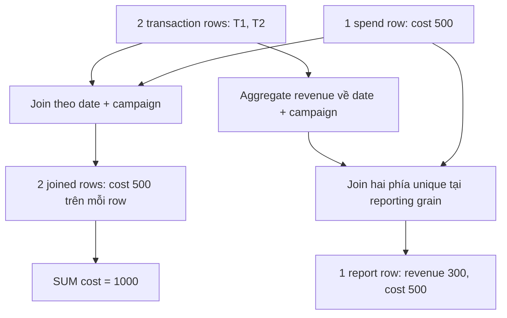

# 01 · Grain, Keys & Fan-out

<ChapterMeta>

[Chapter 00](/foundations/00-mental-model), SQL joins và GROUP BY. Bài này xác định dữ liệu trước khi học Spark execution.

</ChapterMeta>

## Why this matters

Một join chạy nhanh, không lỗi và không thiếu rows vẫn có thể nhân đôi chi phí. Grain contract cho biết một row đại diện cho gì. Bạn cần contract đó để chọn join keys và kiểm tra metrics trước khi publish Gold.

## Scenario

Dashboard báo campaign A có revenue 300, cost 1000. Ads API trả cost 500. Airflow xanh, dbt model compile thành công, source không gửi duplicate.

Team join transactions với daily spend theo `date, campaign`, rồi SUM cả revenue và cost. Trước khi sửa, hãy dự đoán join sinh bao nhiêu rows. Cost 500 xuất hiện ở mấy rows?

## Learner reasoning

| Giả thuyết | Bằng chứng cần lấy |
|---|---|
| API trả duplicate spend | Đếm rows trên `(date, campaign)` ở spend trước join |
| Join lặp lại một spend row | Hiển thị transaction_id và cost trên từng joined row |
| SUM sai do engine | Tính tổng bằng tay trên joined rows trước khi đổi engine |

<details>
<summary>Giả thuyết cần kiểm tra trước</summary>

Hai transaction rows cùng match một spend row. SQL tạo một output row cho mỗi cặp match, nên giá trị 500 đi vào SUM hai lần. Spend source vẫn unique. Lỗi xuất hiện khi cộng metric ở grain nhỏ hơn grain gốc của metric đó.

</details>

## Mental model

Viết câu “mỗi row là một ...” cho từng input và output. Sau đó đếm số matches trên **join keys**, không chỉ nhìn tên table.



Hình giải thích fixture này, không quy định mọi join phải 1:1. Một-to-many join hợp lệ khi output contract cần child rows. Việc SUM parent metric sau join đó mới cần một policy rõ.

## Core concepts

| Concept | Trong report này | Contract cần kiểm tra |
|---|---|---|
| Grain | Transaction: một transaction; spend: một campaign/ngày | Câu mô tả row phải thống nhất cả table |
| Business key | ID được nghiệp vụ dùng để nhận diện entity/event | Scope nguồn, account và thời gian có cần đưa vào key? |
| Natural key | Thuộc tính nguồn/nghiệp vụ có thể nhận diện row, như `(date, campaign_id)` của daily spend | Key có ổn định, non-null và unique trong scope đã chọn? |
| Surrogate key | ID do hệ thống tạo, như `campaign_sk = 41` | Phải giữ mapping từ business identity; thêm ID không sửa duplicate business rows |
| Uniqueness | Không có hai rows cùng key trong table scope | GROUP BY key HAVING COUNT(*) > 1 và null check |
| Fact grain | Revenue theo transaction; cost theo campaign/ngày | Hai facts có thể có grain khác nhau |
| Dimension grain | Một campaign, hoặc một phiên bản campaign nếu giữ lịch sử | Join phải chọn đúng entity/version |

Business key và natural key có thể trùng nhau; đây không phải ba loại key luôn loại trừ nhau. Source ID chỉ unique trong account thì key cần account. Tên campaign dễ đổi và dễ trùng, nên fixture dùng `A` như một ID đơn giản, không khuyến nghị join theo display name.

Microsoft [star-schema guidance][star] hỗ trợ consistent fact grain và surrogate keys. Business identity/key scope trong bảng trên là contract của example; owner nghiệp vụ phải xác nhận trước production.

### Cardinality theo keys được join

| Matches trong một key group | Rows output của inner join | Hệ quả nếu cộng metrics |
|---|---:|---|
| 1 trái, 1 phải | 1 | Không có fan-out trong group |
| 1 trái, 3 phải | 3 | Metric phía trái lặp ba lần |
| 2 trái, 1 phải | 2 | Metric phía phải lặp hai lần |
| 2 trái, 3 phải | 6 | Metrics cả hai phía bị nhân |
| Có rows trái, không có phải | 0 | Inner join làm mất coverage |

Với inner equijoin, group có `m` rows trái và `n` rows phải tạo `m × n` pairs. Đây là mechanics của fixture SQL trong [Lab 01](/labs/01-grain-fanout). Fan-out không đồng nghĩa source có duplicate records.

## Example data

`transactions`, grain một transaction; `transaction_id` unique trong source scope của lab:

| date | campaign | transaction_id | revenue |
|---|---|---|---:|
| 2026-10-01 | A | T1 | 100 |
| 2026-10-01 | A | T2 | 200 |

`ad_spend`, grain một ngày/campaign:

| date | campaign | cost |
|---|---|---:|
| 2026-10-01 | A | 500 |

Joined rows trước SUM:

| date | campaign | transaction_id | revenue | cost |
|---|---|---|---:|---:|
| 2026-10-01 | A | T1 | 100 | 500 |
| 2026-10-01 | A | T2 | 200 | 500 |

Revenue 300 vẫn đúng; cost 1000 sai. Một metric đúng không chứng minh cả report đúng. ROAS sai từ 0.6 xuống 0.3 nếu dùng revenue/cost trên report này.

### Thêm creative, country và platform

Giả sử spend chi tiết có ba rows, mọi rows cùng date/campaign A:

| creative | country | platform | cost |
|---|---|---|---:|
| C1 | VN | ios | 120 |
| C1 | US | ios | 80 |
| C2 | VN | android | 300 |

Grain mới là `(date, campaign, creative, country, platform)`, không còn chỉ date/campaign. C1 có hai country rows, nên key chỉ thêm creative vẫn thiếu. Tổng cost vẫn 500.

Nếu join hai transactions chỉ theo date/campaign, ta nhận **6 rows**, revenue **900**, cost **1000**. Muốn report campaign/ngày, aggregate cả hai facts về grain đó. Muốn report creative/country/platform, cần revenue attribution ở cùng grain hoặc allocation rule được nghiệp vụ chấp nhận.

::: warning Không suy ra chi tiết từ tổng
Thêm columns không tự phân bổ revenue 300 xuống ba spend slices. Nếu không có attribution, giữ campaign report và spend-detail report riêng. Một thuộc tính campaign cố định có thể chỉ là enrichment; một thuộc tính có nhiều values trên cùng key có thể làm thay đổi grain.
:::

### Many-to-many cần policy

Một transaction revenue 100 được gắn C1 và C2 qua bridge. Join rồi cộng raw revenue tạo 200. Nếu rule nghiệp vụ cho C1 weight 0.6 và C2 weight 0.4, allocated revenue là 60 và 40. Kiểm tra tổng weights bằng 1 cho mỗi transaction và tổng allocated revenue bằng input. Weights là giả định của bài tập, không phải attribution algorithm mặc định.

## How it works

Để tạo daily campaign report, aggregate transactions trước join. Spend đã ở reporting grain nhưng vẫn phải kiểm tra uniqueness; nếu spend là chi tiết creative, aggregate nó theo reporting grain nữa.

```sql
WITH revenue_daily AS (
  SELECT date, campaign, SUM(revenue) AS revenue
  FROM transactions GROUP BY date, campaign
)
SELECT r.date, r.campaign, r.revenue, s.cost
FROM revenue_daily r JOIN ad_spend s USING (date, campaign);
```

Input fixture đầy đủ coverage nên inner join cho revenue 300, cost 500. Trong production, một campaign có spend nhưng chưa có transaction vẫn cần xuất report nếu contract yêu cầu. Lúc đó chọn key spine hoặc full outer join phù hợp engine; xác định zero và unknown trước COALESCE.

| Gate | Điều cần chứng minh | Ví dụ failure |
|---|---|---|
| Key | Unique và non-null tại reporting grain | Hai spend rows cùng date/campaign |
| Coverage | Không mất reporting keys do join | Campaign B thiếu spend bị inner join bỏ |
| Conservation | Tổng metrics giữ nguyên ở scope đã chọn | Cost tăng sau join |
| Reconciliation | Report khớp source cùng currency/date/cutoff | Một bên UTC, một bên local date |

## Databricks implementation

Dùng Spark SQL/DataFrame để aggregate và join, nhưng correctness contract không đổi. Kiểm tra key groups và metrics trước write Gold. DataFrame grain không được infer từ column names.

Databricks [constraint docs][db-keys] phân biệt enforced `NOT NULL`/`CHECK` với informational keys. Primary/foreign keys không tự enforce uniqueness. Availability theo provider/Unity Catalog/runtime; không dùng DDL để thay thế kiểm tra duplicate groups. Bài này chỉ có local SQLite, không tạo table/workspace.

## Production failure

| Trigger | Kết quả | Invariant bị phá |
|---|---|---|
| Spend API chuyển từ campaign total sang country detail | Một key group có nhiều rows | Spend không còn unique tại join grain |
| Dimension thêm historical versions | Transaction match nhiều campaign versions | Lookup phải xác định version theo event time |
| Hai platforms reuse campaign_id | Trộn hai entities | Business-key scope thiếu platform/account |
| Dùng SUM(DISTINCT cost) để chữa fan-out | Hai campaigns đều cost 500 bị tính một lần | Equal values không đồng nghĩa cùng business fact |

Lab test thêm campaign B cũng cost 500. Report phải có total cost **1000**; `SUM(DISTINCT cost)` cho **500** và làm mất metric hợp lệ.

## Debugging

| Symptom | Investigation | Diagnosis | Fix |
|---|---|---|---|
| Cost tăng, revenue giữ nguyên | Đếm spend key groups; xem joined rows | Parent cost bị lặp theo transactions | Aggregate revenue về reporting grain |
| Cả hai metrics tăng | Đếm matches ở cả hai phía | Many-to-many theo join keys | Align grains hoặc define allocation |
| Revenue giảm sau fix | Anti-join các key bị thiếu | Inner join loại missing counterpart | Quyết định coverage policy, giữ unknown rõ |
| Lỗi xuất hiện khi thêm dimension | Kiểm tra rows per key và version validity | Lookup không unique | Sửa identity/version contract |

Đo row count và metric totals trước/sau từng join boundary. Đừng chỉ nhìn final dashboard vì nhiều lỗi có thể bù số cho nhau.

## BigQuery / Airflow mapping

| Bạn đã dùng | Áp dụng ở Databricks | Boundary |
|---|---|---|
| dbt uniqueness/not-null tests | Assertions trên governed tables | Runtime/tool khác; grain contract vẫn do model owner quyết định |
| BigQuery GROUP BY/join | Spark SQL/DataFrame aggregate/join | Dialect, null/type và execution khác |
| Airflow task xanh | Lakeflow task success | Success phản ánh execution, không chứng minh metrics |

BigQuery cũng có [unenforced key constraints][bq-keys]. Việc đổi platform không sửa fan-out. Hãy chuyển cả tests/reconciliation contracts khi migration.

## Code

Chạy diagnostic trước khi mở solution:

```sh
python labs/foundations/grain_fanout.py
```

[Lab 01](/labs/01-grain-fanout) cho phép submit SQL từ file để kiểm tra report. `solution()` reject null/duplicate keys và missing spend coverage thay vì cho kết quả trông hợp lệ.

## Common mistakes

| Cách sửa vội | Vì sao thất bại | Contract cần viết |
|---|---|---|
| DISTINCT joined rows | Transaction IDs khác nhau nên rows vẫn khác | Grain và multiplicity của từng metric |
| MAX(cost) trên toàn report | Chỉ lấy một campaign cost | Aggregate đúng reporting keys |
| Sinh surrogate ID cho mỗi duplicate | Mỗi row có ID unique nhưng facts vẫn duplicate | Business uniqueness, không chỉ physical ID |
| Thêm dimension vào GROUP BY | Không có revenue attribution cho dimension đó | Data availability hoặc allocation policy |

## Production notes

Currency, account scope, timezone và attribution window thuộc grain contract. Money dùng integer minor units hoặc decimal phù hợp; lab dùng integer units. ROAS tổng tính từ tổng revenue/tổng cost cùng scope, không lấy trung bình các row ratios.

Đặt alert cho key violations, unmatched-key counts và metric delta sau join. Dimension SCD2 cần validity windows không overlap; chi tiết implementation được để cho chapter modeling/correctness. Không xóa historical dimension versions chỉ để tạo uniqueness giả.

## Interview checkpoint

1. Revenue đúng nhưng cost gấp đôi. Bạn lấy ba bằng chứng nào trước khi sửa SQL?
2. Spend thêm country và platform. Vì sao chỉ thêm columns vào model không đủ?
3. Hai campaigns đều có cost 500. Tại sao SUM(DISTINCT cost) làm sai total?
4. Surrogate ID unique trên mỗi row có bảo đảm business uniqueness không?
5. Sau aggregate, inner join làm mất một campaign. Bạn chọn policy nào và đối soát ra sao?
6. Transaction gắn hai creatives. Cần contract gì để publish creative-level revenue?

## PASS criteria

| PASS | NOT YET |
|---|---|
| Viết grain/key scope cho hai facts và report | Chỉ liệt kê columns |
| Tính joined rows và chỉ ra vì sao cost thành 1000 | Gọi mọi duplication là source retry |
| Sửa report bằng aggregate đúng và kiểm tra coverage | Chữa bằng DISTINCT/MAX không có scope |
| Giải thích scenario 2 × 3 và allocation boundary | Tự chia revenue theo dimension không có policy |
| Submit query pass, reject duplicate/null/missing-key cases | Chỉ đạt số đúng trên một fixture |

Physical execution bridge: [06 ? Joins, broadcast & skew](/spark/06-joins-broadcast-skew) ki?m c?ng correctness contracts v? t?ch ch?ng kh?i join strategy.

## Official references

Đối chiếu **2026-10-10**. Microsoft source là modeling guidance; Databricks source dùng AWS docs. Số liệu và join experiments là fixture của handbook, không phải vendor benchmarks.

- [Microsoft star schema][star]: grain, facts/dimensions và surrogate keys.
- [Databricks constraints][db-keys]: enforced và informational constraints.
- [BigQuery primary/foreign keys][bq-keys]: optimizer assumptions và trách nhiệm của owner.
- [Spark SQL guide][spark-sql]: structured transformations; execution được học ở [Chapter 03](/spark/03-architecture-dataframes-sql).

[star]: https://learn.microsoft.com/en-us/power-bi/guidance/star-schema
[db-keys]: https://docs.databricks.com/aws/en/tables/constraints
[bq-keys]: https://docs.cloud.google.com/bigquery/docs/primary-foreign-keys
[spark-sql]: https://spark.apache.org/docs/latest/sql-programming-guide.html
