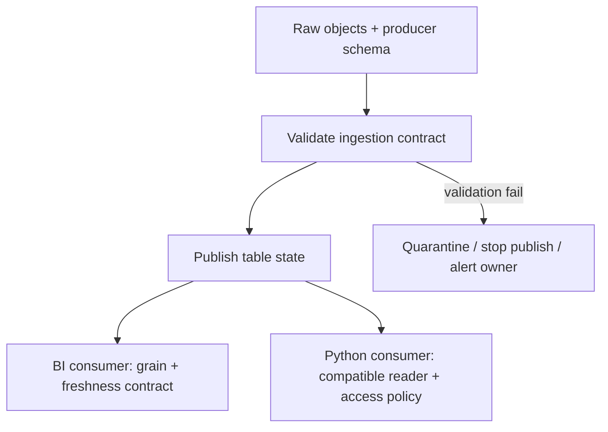

# 02 · Lake, Warehouse, Lakehouse & BigQuery Bridge

<ChapterMeta>

[Chapter 00](/foundations/00-mental-model) và [Chapter 01](/foundations/01-grain-keys-fanout). Đã vận hành GCS + BigQuery + Airflow + dbt.

</ChapterMeta>

## Why this matters

Chọn platform ảnh hưởng ai chịu trách nhiệm cho table state, execution, access và recovery. Một migration chỉ đổi engine có thể giữ nguyên lỗi grain, đồng thời thêm hai nơi phải reconciliation. Chương này dùng consumer contracts để đánh giá operating model; sơ đồ các lớp đã có ở Chapter 00.

## Scenario

Team đang ingest Ads files vào GCS, load BigQuery, chạy dbt qua Airflow và phục vụ BI. Revenue daily đúng và SLA hiện tại đạt yêu cầu. Một nhóm khác muốn dùng raw events cho Python transformations và thử nghiệm model.

Đề xuất là chuyển tất cả sang Databricks vì “lakehouse không cần copy và rẻ hơn warehouse”. Hãy hỏi trước: workload nào chưa được đáp ứng? Consumer nào phải đổi? Ai giữ quyền write table và đối soát trong migration?

## Learner reasoning

| Bằng chứng cần có | Nếu chưa có |
|---|---|
| Latency/volume/runtime theo workload | Không thể chọn batch/streaming hoặc sizing có cơ sở |
| Năng lực thiếu trong hệ thống hiện tại | Chưa chứng minh migration tạo lợi ích |
| Reader/writer compatibility | “Cùng object store” chưa chứng minh đọc cùng table state |
| Cost và operational ownership | Giá compute đơn lẻ chưa phải tổng chi phí |

<details>
<summary>Đối chiếu quyết định</summary>

Giữ BI path đang đạt SLA là một phương án hợp lệ. Có thể thử workload mới trên một dataset có contract rõ trước migration toàn bộ. Quyết định phụ thuộc phép đo và ownership, không phụ thuộc tên kiến trúc. Đây là reasoning của scenario, không phải kết luận benchmark vendor.

</details>

## Mental model

So sánh ba models bằng **trách nhiệm bạn phải thực hiện**, thay vì xếp hạng sản phẩm:

| Model | Bạn đưa vào | Consumer dựa vào | Trách nhiệm nổi bật |
|---|---|---|---|
| Lake | Objects/files đa dạng | Path, schema và reader convention | File completeness, schema, discovery, permissions |
| Warehouse | Analytical tables | Managed table/query service | Grain, loading, query cost, access và quality |
| Lakehouse | Files + table metadata + compatible engines | Table snapshot và governed names | Metadata/protocol compatibility, writer policy, compute và serving |

Lake có thể có catalog và schema enforcement ở pipeline. Warehouse có external-table capabilities. Lakehouse vẫn có thể materialize nhiều bản để phục vụ consumers. Chọn model không loại bỏ data contracts.

## Core concepts

### Data lake: flexibility cần reader contract

Object storage giữ files mà không bắt mọi file có cùng schema. Bạn có thể giữ raw payload phục vụ replay hoặc consumers khác. Đổi lại, folder tự nó không nói file nào complete, schema nào đúng hay snapshot nào consumer phải đọc. [Databricks lakehouse overview][lakehouse] mô tả lý do bổ sung table-management cho lake data.

### Warehouse: giảm infrastructure surface, vẫn cần vận hành dữ liệu

Managed tables và query service giúp team tập trung vào structured analytics. Với BigQuery native tables, team không điều phối Spark executors cho từng query. Vẫn cần ingestion/reconciliation, IAM, reservations hoặc scan controls, và consumer SLA. BigQuery hỗ trợ SQL/Python cùng workloads ngoài BI; đừng giới hạn sản phẩm thành “chỉ SQL”. [BigQuery overview][bq].

### Lakehouse: table state ngoài danh sách files

Table formats bổ sung metadata để mô tả schema và snapshots, cùng semantics cho writes/readers tương thích. Delta cung cấp transactional capabilities trên table; không suy ra raw files đọc trực tiếp cũng có guarantee đó. [Delta documentation][delta].

| Capability | Câu hỏi vận hành | Giới hạn |
|---|---|---|
| Metadata | Reader resolve state bằng gì? | Catalog name và table-format metadata khác trách nhiệm |
| Transactions | Write nào được publish cho readers? | Table transaction không sửa grain/key sai |
| Schema | Schema changes được accept thế nào? | Add column không tự sửa downstream contracts |
| Snapshots | Consumer đọc state/version nào? | Retention và compatibility ảnh hưởng lịch sử |
| Multi-engine access | Engine/version nào hiểu protocol/features? | Cùng support tên format chưa bảo đảm cùng feature set |

Databricks [table overview][tables] phân biệt managed/external table lifecycle. Catalog governance không mặc nhiên áp dụng cho một reader bypass catalog truy cập trực tiếp storage. Cần kiểm tra access path cụ thể.

## Example data

Lab có hai files thuộc cùng snapshot, grain một transaction:

| File | Schema | Rows | Revenue |
|---|---|---:|---:|
| part-1.csv | transaction_id, revenue | T1, T2 | 300 |
| part-2.csv | transaction_id, revenue | T3 | 50 |

Consumer contract yêu cầu unique transaction_id và integer revenue. Nếu producer đổi `revenue` thành `amount` trong file thứ hai, dữ liệu vật lý vẫn tồn tại nhưng consumer không còn đọc được theo contract.

| Reader behavior | Kết quả | Có thể publish? |
|---|---|---|
| Validate exact schema trên active files | Baseline 3 rows, 350; schema đổi thì lỗi rõ | Chỉ khi validation pass |
| Ignore file không đọc được | Có thể trả 300 như partial revenue | Không, completeness bị phá |
| Tự gán missing revenue = 0 | Có thể trả 300 và che mất lỗi | Không có policy để diễn giải 0 |

Không có platform nào tự biết `amount` có cùng currency/meaning với `revenue`. Schema compatibility và semantic compatibility cần kiểm tra riêng.

## How it works



Hình thể hiện responsibility boundaries, không cam kết một engine/protocol. Một table-aware engine có thể quản lý transactions; publisher vẫn phải validate keys, expected partitions và consumer semantics.

## Databricks implementation

### Operating model comparison

Scope: **BigQuery native-table workflows** so với **Databricks lakehouse workloads**, đối chiếu ngày 2026-10-10. Databricks sources dùng AWS. Đây không phải feature matrix toàn bộ sản phẩm.

| Dimension | BigQuery model quen thuộc | Databricks lakehouse bridge | Quyết định phải kiểm tra |
|---|---|---|---|
| Storage | Native managed storage; external tables cũng có | Managed/external tables trên lake storage | Owner, lifecycle, location, format compatibility |
| Compute | Managed query compute, tách storage | SQL warehouses; serverless/classic options tùy workload | Runtime/availability/cost theo cloud |
| Table abstraction | Dataset/table và service API | Catalog/schema/table + provider metadata | Names không ánh xạ hierarchy/privileges 1:1 |
| Transformation | SQL/dbt; Python ecosystem | SQL/DataFrames/Python workflows | Có workload cần distributed compute không? |
| Orchestration | Airflow, scheduled workflows và integrations | Lakeflow Jobs/pipelines hoặc Airflow integrations | Task DAG khác declarative dataset graph |
| Governance | IAM, policies, lineage/metadata capabilities | Unity Catalog cùng storage/compute access boundaries | Chuyển access policy bằng tests, không copy role names |
| Workloads | Analytics, BI và nhiều năng lực data/AI | Engineering, SQL/BI, data science/AI | Benchmark workload thật, không gắn nhãn độc quyền |
| Operations | Ít cluster management; vẫn có source/query/SLA ownership | Managed services giảm infrastructure work; runtime/table/compute choices vẫn cần owner | Runbook, on-call, compatibility và migration cost |
| Cost reasoning | Storage + on-demand data processed hoặc capacity compute | Compute/service usage + storage và các cloud charges liên quan | So cùng freshness/quality, include idle, retries và copies |

Nguồn: [BigQuery overview][bq], [storage][bq-storage], [external tables][external], [pricing model][pricing]; [Databricks tables][tables], [compute][compute] và [architecture][architecture]. BigQuery **cũng tách compute/storage**. Serverless/default-storage placement của Databricks không được suy ra từ customer-bucket mental model.

## When BigQuery is already enough

Nếu SQL/dbt giải quyết transformations, BI đạt SLA và team đã có cost/access/recovery controls, migration toàn bộ cần lợi ích đo được. Workload nhỏ chưa cần distributed Python không tự tạo yêu cầu Spark.

| Evidence giữ hệ thống hiện tại | Thử nghiệm trước khi quyết định |
|---|---|
| Consumer freshness và reconciliation đạt contract | Đo runtime/bytes/capacity ở workload đại diện |
| Team xử lý replay/backfill đáng tin cậy | Chạy recovery drill trên pipeline hiện tại |
| GCP governance/BI integrations đáp ứng nhu cầu | Kiểm tra requirement mới cụ thể, không chỉ wishlist |

“Enough” là kết luận theo constraints hiện tại, không có nghĩa sản phẩm không thể mở rộng. BigQuery có external/open-format capabilities; cần tra đúng table mode trước khi gọi lakehouse là năng lực chỉ của một bên. [External-table docs][external].

## Why a company may still introduce Databricks

Một team có thể cần distributed transformations theo Spark ecosystem, thống nhất engineering/data science workflows, hoặc một operating model cho governed lake tables. Các động cơ này chỉ đáng chọn khi có owner và bằng chứng lợi ích.

| Requirement mới | Pilot có thể kiểm chứng | Chi phí/trade-off |
|---|---|---|
| Pipeline Python/distributed processing chưa phù hợp stack hiện tại | Chạy một workload có cùng input/output contract | Runtime, packaging, skills và operations |
| Nhiều consumers dùng lake tables | Test compatible readers trên features thực tế | Protocol, write ownership và access path |
| Platform consolidation | Đo reduction của số boundaries cần support | Migration, coexistence và lock-in ở service layer |

Đừng bắt đầu pilot bằng di chuyển mọi dashboards. Giữ baseline và đối soát outputs cùng cutoff/currency để tránh so hai kết quả khác scope.

## Production failure

| Failure | Symptom | Contract bị phá |
|---|---|---|
| Producer rename column, reader skip file | Report có vẻ đúng nhưng hụt revenue | Schema + completeness |
| Hai engines cùng ghi mà chưa validate interoperability | Write/read lỗi hoặc nhìn state khác | Supported writer/protocol policy |
| Raw access bypass governed table path | Reader thấy data ngoài access policy dự kiến | Governance boundary |
| Migration giữ hai published copies nhưng không có reconciliation | BI khác Python report | Consumer/source-of-truth contract |

Lab cố tình rename một column và phải fail. Nó chứng minh validation gate trên files, không chứng minh ACID hoặc multi-engine compatibility.

## Debugging

| Symptom | Investigation | Diagnosis | Fix |
|---|---|---|---|
| Hai consumers cho totals khác | Cùng snapshot/cutoff/schema/grain? | Khác state hoặc contract | Align state, reconciliation và semantic contract |
| Access denied chỉ ở một engine | Actor, catalog/storage path và privileges | Reader dùng access path khác | Sửa đúng policy, kiểm thử với reader identity |
| Cost tăng sau migration | Compute time/idle, scan, retries, storage/copies | Workload thay đổi hoặc added operations | Đo cùng contract, xử lý nguồn chi phí thật |
| Schema change làm partial report | Input inventory, rejected files, validation logs | Consumer bỏ dữ liệu lỗi | Fail publish hoặc quarantine theo policy |

## BigQuery / Airflow mapping

| Stack đã biết | Mental equivalent | Không 1:1 |
|---|---|---|
| GCS raw objects | S3/ADLS/GCS objects trong ingestion path | Raw paths không tương đương governed table |
| BigQuery dataset/table | UC catalog/schema/table | Hierarchy, IAM và table lifecycle khác |
| dbt model/tests | SQL modeling + quality contracts; có thể tiếp tục dùng dbt | Pipelines không tự thay toàn bộ model/test workflow |
| Airflow DAG | Lakeflow task DAG cho orchestrated tasks | Integrations, retries và deployment semantics cần review |
| BigQuery native query | SQL warehouse/query surface | Không tự chuyển mọi Python/Spark workloads thành cùng engine |

Bridge giúp tái dùng kiến thức về contracts. Configuration/authentication được để cho các platform chapters; không tạo workspace trong bài này.

## Code

```sh
python labs/foundations/layout_contract.py
```

Kết quả baseline: `Contract rows/revenue: (3, 350)`. [Lab 02](/labs/02-layout-contract) yêu cầu rename column rồi dùng `--inspect-only`. Contract phải raise `Schema mismatch`, không trả partial total.

## Common mistakes

| Giả định | Failure cụ thể | Cách kiểm chứng |
|---|---|---|
| Open format = engine nào cũng đọc/ghi | Reader không hỗ trợ feature/protocol | Compatibility test với exact versions/features |
| Managed = không cần owner | Backfill/reconciliation không ai xử lý | Assign data/platform owners và runbook |
| Không copy data = không có cost | Scan/compute/egress vẫn tồn tại | Usage evidence trên workload thật |
| Warehouse và lakehouse loại trừ nhau | Migration bắt buộc dù current SLA đạt | So requirements và coexistence cost |

## Production notes

So tổng chi phí theo một đơn vị công việc: report đạt cùng freshness và quality. Ghi input volume, query frequency, compute/runtime, retry rate, storage/copies và support effort. Pricing page dùng để hiểu charging model; bài này không đưa rates hoặc dự báo savings.

Pilot cần một writer policy, một authoritative output và rollback criteria. Nếu coexistence cần hai copies, define reconciliation cùng cutoff. Table format không thay consumer contract hoặc SLA monitoring.

## Interview checkpoint

1. BigQuery/dbt/Airflow đang đạt SLA. Bạn cần evidence nào trước khi đề nghị Databricks?
2. Hai engines đọc cùng bucket nhưng totals khác. Vì sao bucket không phải đủ bằng chứng cùng table state?
3. Producer đổi revenue thành amount. Schema change nào có thể accept và ai quyết định semantics?
4. Chi phí compute giảm nhưng tổng bill tăng. Bạn điều tra những boundaries nào?
5. Mapping dataset sang catalog/schema có thể sai ở permissions/lifecycle thế nào?

## PASS criteria

| PASS | NOT YET |
|---|---|
| So ba models bằng responsibility và consumer contracts | Chỉ nói model mới hơn là tốt hơn |
| Chọn giữ BigQuery hoặc pilot Databricks với evidence cần đo | Chọn vendor từ slogan |
| Nêu ít nhất ba mappings không 1:1 | Đổi tên services như tương đương hoàn toàn |
| Reproduce schema failure và reject partial report | Gán missing revenue = 0 mà không có policy |
| Tính cost scope và explain multi-engine limits | Coi storage separation/open format là lợi thế độc quyền |

Storage bridge: [07 ? Parquet](/storage/07-parquet) gi?i th?ch file layout; [08 ? Delta](/storage/08-delta-fundamentals) x?c ??nh table transactions/snapshots.

## Official references

Đối chiếu **2026-10-10**. AWS Databricks docs; BigQuery GCP docs. Workload choices là scenario reasoning, không phải measured performance comparison. Rate/feature availability cần kiểm tra lại tại deployment.

- [BigQuery overview][bq], [storage][bq-storage], [external tables][external], [pricing][pricing].
- [Databricks lakehouse][lakehouse], [tables][tables], [compute][compute], [architecture][architecture].
- [Delta Lake docs][delta]: transactional/table features; chi tiết log ở chapter sau.

[bq]: https://docs.cloud.google.com/bigquery/docs/introduction
[bq-storage]: https://docs.cloud.google.com/bigquery/docs/storage_overview
[external]: https://docs.cloud.google.com/bigquery/docs/external-tables
[pricing]: https://cloud.google.com/bigquery/pricing
[lakehouse]: https://docs.databricks.com/aws/en/lakehouse/
[tables]: https://docs.databricks.com/aws/en/tables/
[compute]: https://docs.databricks.com/aws/en/compute/
[architecture]: https://docs.databricks.com/aws/en/getting-started/high-level-architecture
[delta]: https://docs.delta.io/
