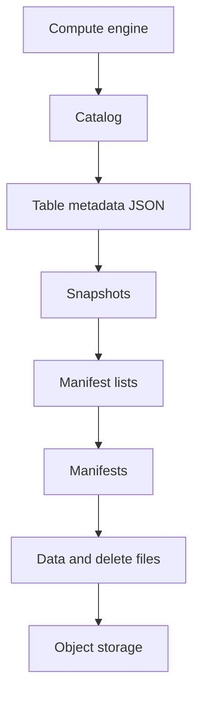

# 46 · Why Apache Iceberg exists

<ChapterMeta>

[Prerequisite](/production/45-release-rollback) · [Lab 46](/labs/46-why-iceberg) · [evidence and boundaries](/labs/iceberg-evidence).

</ChapterMeta>

## Why this matters

Raw Parquet giải quyết lưu trữ columnar. Khi cần thay đổi hàng, snapshot nhất quán và nhiều engines, đội vận hành cần một table contract vượt quá directory layout.

## Scenario

Lake có /events/date=2026-10-01/*.parquet và thư mục ngày tiếp theo. Một writer sửa attribution bằng file mới, writer khác append; dashboard glob cả file cũ và mới. Revenue tăng gấp đôi dù mỗi file hợp lệ. Bạn cần UPDATE, DELETE, schema/history và thay partition layout.

## Learner reasoning

Trước khi đọc tiếp, ghi hypothesis và một observation có thể bác bỏ nó.

<details>
<summary>Compare your reasoning</summary>

Hãy dự đoán file nào thuộc state đang phục vụ trước khi gọi đây là một table. File listing không chứa quyết định commit. Iceberg là table format/specification, không phải database, compute engine, storage service, data platform hoặc catalog tự thân.

</details>

## Mental model



Đây là learning model; physical/API details cần source và runtime-specific evidence.

## Core concepts

| Layer | Responsibility |
|---|---|
| Engine | Execute SQL and write files |
| Catalog | Resolve identifier and coordinate metadata commits |
| Iceberg | Define schema, partition specs and snapshots |
| Storage | Persist metadata and data/delete files |

## Example data

Grain: one synthetic event, id BIGINT. Hai hàng id1 revenue100, id2 revenue200 có tổng300 cents. Sửa một hàng phải tạo state mới, không cộng cả old/new file.

## How it works

Reader loads a committed snapshot through catalog resolution, then uses its manifest list and manifests to plan files. Writer produces immutable files and metadata, validates assumptions, then commits through the catalog. Failed attempts can leave orphan files. Atomic table state depends on compatible engine and catalog/storage implementation; multi-table transactions are a separate platform capability.

## Databricks implementation

Databricks quản lý cả Delta và Iceberg qua Unity Catalog. UC managed Iceberg và foreign Iceberg có ownership khác nhau; [current boundaries](/iceberg/current-platform-support) owns cloud/version details. LOCAL ICEBERG dùng Spark và Hadoop catalog riêng, không Unity Catalog.

Cloud execution: PENDING USER WORKSPACE. Không cấu hình credentials, tạo resources hoặc suy ra cloud readiness từ local evidence.

## Production failure

Một batch ghi Parquet thành công nhưng metadata commit thất bại. Glob path thấy uncommitted files, table reader giữ committed snapshot. Đừng chạy orphan cleanup bằng tuổi file tùy ý khi writers còn hoạt động.

## Debugging

| Symptom | Evidence | Fix |
|---|---|---|
| Double revenue | Compare glob paths with metadata files | Query table snapshot; reconcile grain |
| Missing table | Catalog name and warehouse | Resolve correct catalog before file debugging |

## BigQuery / Airflow mapping

BigQuery table name cũng đi qua control plane. BigQuery native storage không lộ Iceberg hierarchy mặc định; Airflow chỉ orchestration, không tự tạo transactional table semantics.

## Code

[Lab 46](/labs/46-why-iceberg) owns the exercise. Runtime commands and selected artifacts: [Iceberg evidence](/labs/iceberg-evidence).


```powershell
python scripts/verify_iceberg.py
python scripts/test_iceberg.py
```

## Common mistakes

Gọi Iceberg là database/compute service sẽ che khuất ai vận hành engine và catalog. File Parquet đọc được chưa chứng minh một committed table state. Một format specification cũng không tự cung cấp IAM hoặc scheduler.

## Production notes

Start with table semantics, then catalog architecture. Không cần Kafka/Kubernetes/REST server để chứng minh create/query. Concurrent writers, cloud durability và distributed performance chưa được đo trong local lab.

## Interview checkpoint

1. Vì sao Parquet file hợp lệ vẫn có thể làm dashboard sai?
2. Layer nào quyết định current state và layer nào thực thi query?
3. Commit thất bại nhưng files tồn tại: reader và cleanup nên làm gì?

## How to explain this in an interview

Tôi xem Iceberg là metadata và transaction contract trên immutable files. Catalog giúp engine tìm committed state; object storage giữ files, engine thực thi workload.

Use your scenario, assumptions and evidence; do not memorize the wording.

## PASS criteria

PASS: complete the lab, defend the layer boundaries and submit a falsifiable acceptance decision. NOT YET: unsupported execution claims, no rejected alternative, or unresolved correctness/governance risk.

## Official references

Verified 2026-10-11. Apache latest docs identify1.12.0; local Spark 4.0.4/Scala 2.13, Iceberg formatv2. Databricks sources are AWS; Google is GCP; Snowflake/Fabric limitations depend on deployment and client.

- [spec](https://iceberg.apache.org/spec/).
- [databricks](https://docs.databricks.com/aws/en/iceberg/).
