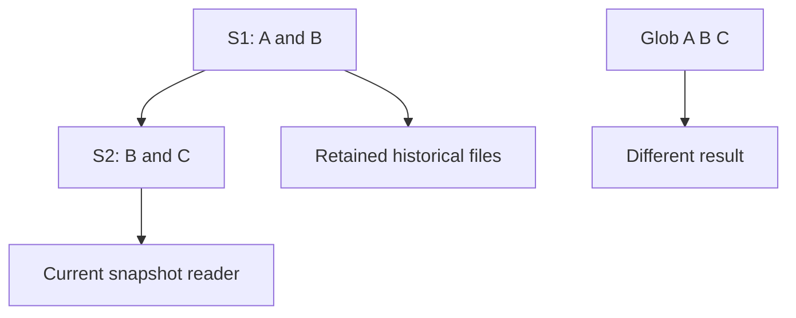

# 47 · Iceberg metadata, snapshots and history

<ChapterMeta>

[Prerequisite](/iceberg/46-why-iceberg) · [Lab 47](/labs/47-metadata-snapshots) · [evidence and boundaries](/labs/iceberg-evidence).

</ChapterMeta>

## Why this matters

Snapshot xác định tập files và schema/spec references dùng cho một table state. Đọc metadata giúp phân biệt data được commit với files còn nằm trong storage.

## Scenario

S1 references A.parquet and B.parquet. S2 references B.parquet and C.parquet after rewriting A. All three files still exist. A reader globbing A/B/C disagrees with a table query. Which state should finance use?

## Learner reasoning

Trước khi đọc tiếp, ghi hypothesis và một observation có thể bác bỏ nó.

<details>
<summary>Compare your reasoning</summary>

S1 totals A+B; S2 totals B+C. Sharing B avoids copying unchanged data. Snapshot S2 parent S1 records lineage, but snapshot history is bounded by retention. Learning diagram shows relationships; metadata JSON also owns schemas, specs, properties and refs.

</details>

## Mental model



Đây là learning model; physical/API details cần source và runtime-specific evidence.

## Core concepts

| Artifact | Carries |
|---|---|
| Metadata JSON | Current snapshot ID, schemas, specs, snapshot references |
| Snapshot | ID, parent, operation and manifest-list location |
| Manifest list | Manifest locations and summary information |
| Manifest Avro | File entries, status, partition and statistics |
| Data/delete files | Encoded rows or row removals |

## Example data

Actual fixture S1: id1=100, id2=200. Append id3=50 produces S2 with3 rows; VERSION AS OF S1 returns2. A later insert after schema change produces4 rows. IDs are runtime-generated, not sequential Delta version numbers.

## How it works

SELECT from .snapshots and .history shows state and lineage. .manifests and .files decode useful metadata via the engine. Lab also inspects actual metadata JSON and verifies every selected manifest-list, manifest and data-file path exists. This does not manually decode every Avro byte or prove all spec clauses.

## Databricks implementation

Foreign Iceberg historical access in Databricks has additional constraints, including snapshots previously read there. UniForm generated Iceberg snapshots need not align one-to-one with Delta versions. See [support ledger](/iceberg/current-platform-support).

Cloud execution: PENDING USER WORKSPACE. Không cấu hình credentials, tạo resources hoặc suy ra cloud readiness từ local evidence.

## Production failure

Copy a table folder to a new path and retain absolute metadata references: reader can still point at the old location or fail. Expire snapshots/remove required data too early: historical queries become unavailable.

## Debugging

| Symptom | Inspect | Action |
|---|---|---|
| Old snapshot unavailable | Retained metadata and referenced files | Restore retained source or backup |
| Reader sees old data | Current catalog pointer vs pinned metadata path | Refresh approved catalog/path binding |

## BigQuery / Airflow mapping

Delta sequential table versions and BigQuery time travel provide useful historical-state analogies. Their metadata identifiers, retention and external-reader refresh contracts differ.

## Code

[Lab 47](/labs/47-metadata-snapshots) owns the exercise. Runtime commands and selected artifacts: [Iceberg evidence](/labs/iceberg-evidence).


```powershell
python scripts/verify_iceberg.py
python scripts/test_iceberg.py
```

## Common mistakes

Snapshot ID không phải business cutoff hay số version tuần tự của Delta. Giữ metadata nhưng xóa referenced files không bảo toàn time travel. Table history hữu hạn không thay thế backup.

## Production notes

Snapshot/history is not an unlimited backup. Record reader snapshot ID and source cutoff for reconciliation. Metadata summaries can aid planning, but a snapshot containing a duplicate business event is still a valid format state.

## Interview checkpoint

1. S2 references B/C but A remains: should A be read?
2. Why is a snapshot ID different from a business cutoff?
3. Which files must survive to query S1 later?

## How to explain this in an interview

Tôi trace catalog tới metadata JSON, snapshot và manifest hierarchy. Tôi chọn files theo snapshot, kiểm tra retention và reconcile business keys riêng.

Use your scenario, assumptions and evidence; do not memorize the wording.

## PASS criteria

PASS: complete the lab, defend the layer boundaries and submit a falsifiable acceptance decision. NOT YET: unsupported execution claims, no rejected alternative, or unresolved correctness/governance risk.

## Official references

Verified 2026-10-11. Apache latest docs identify1.12.0; local Spark 4.0.4/Scala 2.13, Iceberg formatv2. Databricks sources are AWS; Google is GCP; Snowflake/Fabric limitations depend on deployment and client.

- [spec](https://iceberg.apache.org/spec/).
- [queries](https://iceberg.apache.org/docs/latest/spark-queries/).
- [uniform](https://docs.databricks.com/aws/en/delta/iceberg-reads).
