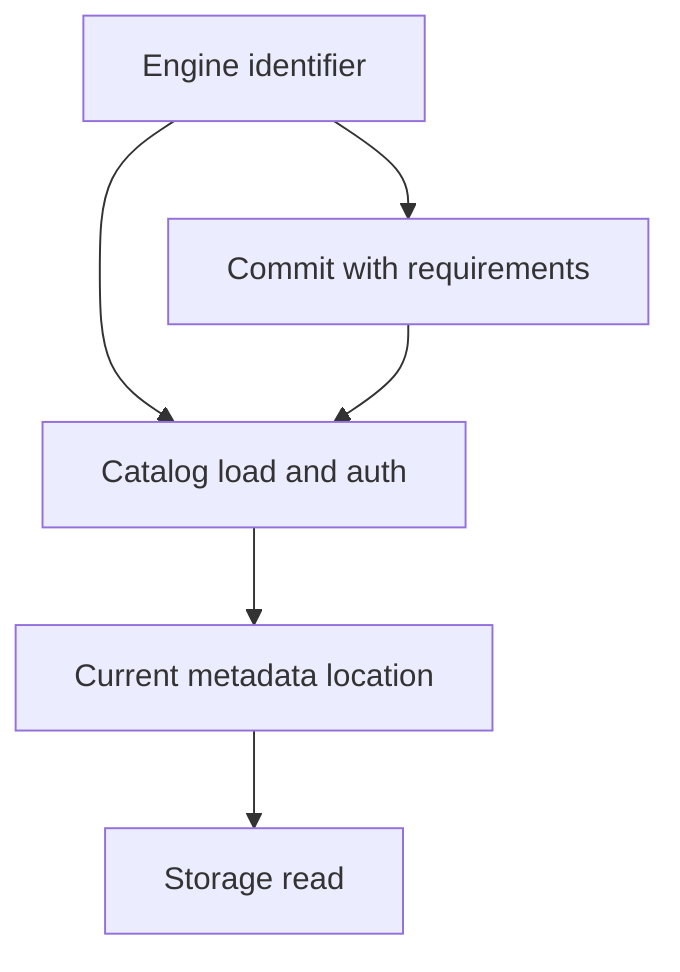

# 48 · Catalogs and Iceberg REST resolution

<ChapterMeta>

[Prerequisite](/iceberg/47-metadata-snapshots) · [Lab 48](/labs/48-catalogs) · [evidence and boundaries](/labs/iceberg-evidence).

</ChapterMeta>

## Why this matters

Table format interoperability vẫn phụ thuộc catalog resolution, commit protocol, identity và storage access. Biết tên prod.marketing.events chưa đủ để query hoặc write.

## Scenario

Spark knows prod.marketing.events. Storage has five metadata JSON files. Which file is current, who may commit, and how does a BI engine get credentials?

## Learner reasoning

Trước khi đọc tiếp, ghi hypothesis và một observation có thể bác bỏ nó.

<details>
<summary>Compare your reasoning</summary>

Catalog resolves identifiers to current table metadata and coordinates supported create/drop/rename/commit operations. Capabilities vary by catalog implementation: HadoopCatalog does not provide every operation such as rename. Format defines metadata semantics; storage persists files; compute executes work.

</details>

## Mental model



Đây là learning model; physical/API details cần source và runtime-specific evidence.

## Core concepts

| Catalog family | Useful model | Responsibility to verify |
|---|---|---|
| Hadoop/path-based | Filesystem warehouse | Atomic filesystem operations, unsupported operations |
| Hive Metastore | Existing metastore service | Availability and commit locking |
| REST | Standard HTTP interface | Auth, extensions, retries and credential vending |
| UC / Horizon / Glue | Managed catalog control plane | Permissions, features, region and maintenance ownership |

## Example data

Local identifier local.course.events resolves within the run-local warehouse. An architecture exercise replaces local with prod.marketing.events and keeps storage owner, catalog service and reader identity explicit.

## How it works

REST protocol standardizes requests including config/load/create and commit updates with requirements. Server must enforce those requirements atomically. Engine writes candidate files, commits against expected state, and retries or rejects conflicts. REST does not automatically standardize all governance policies or make arbitrary multi-engine operations compatible.

## Databricks implementation

Current UC Iceberg REST endpoint supports writes to managed Iceberg, read-only foreign Iceberg and enabled Delta Iceberg reads. Legacy read-only endpoint still exists. Credential vending/client version/row-filter enforcement require explicit acceptance; no real credentials configured.

Cloud execution: PENDING USER WORKSPACE. Không cấu hình credentials, tạo resources hoặc suy ra cloud readiness từ local evidence.

## Production failure

Two writers use different catalog registrations for the same data path. Both believe they own current state. Open files do not prevent split-brain catalog pointers; maintenance can delete files another catalog needs.

## Debugging

| Symptom | Inspect | Fix |
|---|---|---|
| Commit conflict | Expected pointer and catalog requirements | Retry after refresh, reconcile intent |
| Load succeeds, scan denied | Catalog authorization vs object storage IAM | Grant scoped supported access |
| Two current states | Catalog ownership and registration | Establish one commit authority |

## BigQuery / Airflow mapping

BigQuery dataset/table catalog and Airflow connection names are distinct. Airflow submits a writer; catalog commit authority belongs to the table control plane.

## Code

[Lab 48](/labs/48-catalogs) owns the exercise. Runtime commands and selected artifacts: [Iceberg evidence](/labs/iceberg-evidence).


```powershell
python scripts/verify_iceberg.py
python scripts/test_iceberg.py
```

## Common mistakes

REST protocol không tự đồng nhất mọi policy hoặc storage credential. Một path chia sẻ không tạo commit authority chung. Hadoop catalog local không chứng minh cùng config an toàn trên object storage.

## Production notes

Core local lab requires only Hadoop catalog on local filesystem. REST execution is optional and omitted here to keep runtime minimal. Production object storage needs an appropriate catalog; copying Hadoop settings to S3 is not an acceptance test.

## Interview checkpoint

1. How does Spark resolve the current metadata file?
2. Why can load-table succeed while data scan fails?
3. What does REST standardize and what remains vendor-specific?

## How to explain this in an interview

Tôi tách identifier resolution, commit authority và storage IAM. REST giảm custom catalog client logic; tôi vẫn kiểm tra version, auth, governance và concurrent commit behavior.

Use your scenario, assumptions and evidence; do not memorize the wording.

## PASS criteria

PASS: complete the lab, defend the layer boundaries and submit a falsifiable acceptance decision. NOT YET: unsupported execution claims, no rejected alternative, or unresolved correctness/governance risk.

## Official references

Verified 2026-10-11. Apache latest docs identify1.12.0; local Spark 4.0.4/Scala 2.13, Iceberg formatv2. Databricks sources are AWS; Google is GCP; Snowflake/Fabric limitations depend on deployment and client.

- [rest](https://iceberg.apache.org/rest-catalog-spec/).
- [ucRest](https://docs.databricks.com/aws/en/external-access/iceberg).
- [spec](https://iceberg.apache.org/spec/).
- [HadoopCatalog implementation reference](https://iceberg.apache.org/javadoc/nightly/org/apache/iceberg/hadoop/HadoopCatalog.html), dated nightly Javadoc read 2026-10-11; no nightly runtime execution is claimed.
