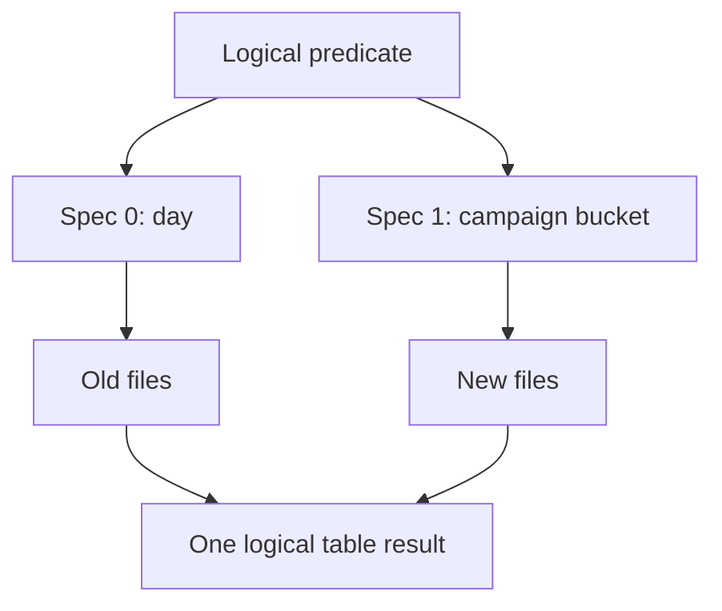

# 49 · Schema evolution and hidden partitioning

<ChapterMeta>

[Prerequisite](/iceberg/48-catalogs) · [Lab 49](/labs/49-schema-partition-evolution) · [evidence and boundaries](/labs/iceberg-evidence).

</ChapterMeta>

## Why this matters

Field IDs preserve column identity through supported schema changes. Partition spec IDs let one logical table read old and new layouts without requiring an immediate full rewrite.

## Scenario

An events table initially partitions by day. New workloads filter campaign; country and creative_id are added. Must every old file be rewritten before new writes or queries can work?

## Learner reasoning

Trước khi đọc tiếp, ghi hypothesis và một observation có thể bác bỏ nó.

<details>
<summary>Compare your reasoning</summary>

Schema and partition evolution are separate metadata decisions. Rename retains a field ID; a new optional field reads NULL in old files. Changing partition spec governs new writes; old files keep the spec that interprets their partition values.

</details>

## Mental model



Đây là learning model; physical/API details cần source và runtime-specific evidence.

## Core concepts

| Concept | Meaning |
|---|---|
| Field ID | Identity independent of column name/position |
| Spec ID | Interpretation of a file partition tuple |
| days(timestamp) | Derive date partitions from logical predicates |
| bucket(N, column) | Hash transform, not raw directory value |
| truncate(W, column) | Coarsen values by defined transform |

## Example data

Real lab: two day-partitioned rows total300; replace days(event_time) with bucket(4, campaign), append50. Three rows total350 remain queryable with two spec IDs, and old file paths remain referenced. Rename campaign to campaign_id retains ID; old country=NULL.

## How it works

Engine translates a predicate using each relevant partition spec. Query writer filters logical campaign/event_time, without enumerating paths. ALTER does not promise old data now has the new physical layout. Rewrite maintenance can be a later measured choice when old files cause excessive scan cost.

## Databricks implementation

Local Spark extension executes transforms/evolution. Current Databricks managed Iceberg supports evolution through external Iceberg engines, while expression transforms such as days/bucket are restricted for managed tables. The local statement is not a Databricks SQL deployment recipe.

Cloud execution: PENDING USER WORKSPACE. Không cấu hình credentials, tạo resources hoặc suy ra cloud readiness từ local evidence.

## Production failure

Downstream parser uses column position after schema change; values silently shift. An external compatibility path rejects multiple specs even when Apache Iceberg reader succeeds. Fabric virtualization currently lists multi-spec evolution as failing.

## Debugging

| Symptom | Evidence | Fix |
|---|---|---|
| External conversion fails | Specs and conversion log | Hold change or use approved compatible path |
| Poor campaign pruning | Files by spec and query scans | Evaluate bounded rewrite |

## BigQuery / Airflow mapping

BigQuery partitioning/clustering workload reasoning transfers. Iceberg partition spec evolution is not equivalent to changing a BigQuery physical layout or Delta liquid clustering.

## Code

[Lab 49](/labs/49-schema-partition-evolution) owns the exercise. Runtime commands and selected artifacts: [Iceberg evidence](/labs/iceberg-evidence).


```powershell
python scripts/verify_iceberg.py
python scripts/test_iceberg.py
```

## Common mistakes

ALTER partition spec không tự chuyển layout của old files. Rename phải giữ field identity; matching column names chưa đủ. Type narrowing hoặc unsupported promotion cần bị chặn trước rollout.

## Production notes

Column add/drop/rename is not arbitrary type conversion: only supported promotions are safe. Do not narrow a type based on toy data. Reconcile old/new generations and verify every reader before changing shared format features.

## Interview checkpoint

1. Why does rename preserve old row values?
2. What changes for old files after replacing a partition field?
3. Why can local evolution pass while a platform conversion fails?

## How to explain this in an interview

Tôi dùng field ID và spec ID để giữ logical continuity. New writes dùng spec mới; tôi kiểm chứng predicates và mọi consumer trước khi chọn rewrite.

Use your scenario, assumptions and evidence; do not memorize the wording.

## PASS criteria

PASS: complete the lab, defend the layer boundaries and submit a falsifiable acceptance decision. NOT YET: unsupported execution claims, no rejected alternative, or unresolved correctness/governance risk.

## Official references

Verified 2026-10-11. Apache latest docs identify1.12.0; local Spark 4.0.4/Scala 2.13, Iceberg formatv2. Databricks sources are AWS; Google is GCP; Snowflake/Fabric limitations depend on deployment and client.

- [evolution](https://iceberg.apache.org/docs/latest/evolution/).
- [ddl](https://iceberg.apache.org/docs/latest/spark-ddl/).
- [fabricIceberg](https://learn.microsoft.com/en-us/fabric/onelake/onelake-iceberg-tables).
- [databricks](https://docs.databricks.com/aws/en/iceberg/).
