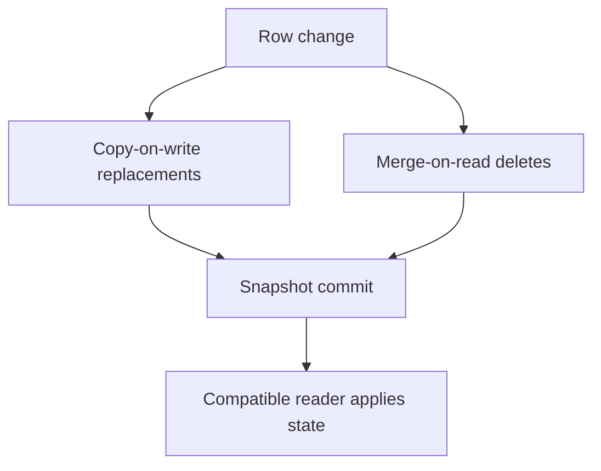

# 50 · Iceberg row-level changes

<ChapterMeta>

[Prerequisite](/iceberg/49-schema-partition-evolution) · [Lab 50](/labs/50-row-level-changes) · [evidence and boundaries](/labs/iceberg-evidence).

</ChapterMeta>

## Why this matters

Immutable Parquet files vẫn hỗ trợ row-level changes khi table metadata chọn replacements hoặc kết hợp data với delete representations. Strategy và supported readers quyết định interoperability.

## Scenario

id1 revenue100 is corrected to120; id2 must be deleted; id3 revenue50 arrives. Files cannot be updated in place. How can UPDATE/DELETE/MERGE produce exactly170?

## Learner reasoning

Trước khi đọc tiếp, ghi hypothesis và một observation có thể bác bỏ nó.

<details>
<summary>Compare your reasoning</summary>

Copy-on-write rewrites affected data files and commits replacements. Merge-on-read can preserve data files and write row deletions; reader applies them. Iceberg version and engine configuration decide actual representation. One SQL statement alone does not reveal the strategy.

</details>

## Mental model



Đây là learning model; physical/API details cần source và runtime-specific evidence.

## Core concepts

| Representation | Interpret at read | Version boundary |
|---|---|---|
| Copy-on-write | Read replacement data files | Engine-supported rewrite |
| Position delete | Remove specified file/row positions | Iceberg v2 |
| Equality delete | Remove matching field-ID values | Iceberg v2; reader limitations vary |
| Deletion vector | Binary positional removal representation | Iceberg v3; not run locally |

## Example data

Real COW contract updates100→110, deletes id2, then MERGE sets id1=120 and inserts id3=50. MOR delete on a separate table leaves id2=200 and metadata content1 position-delete files. Equality delete generation and v3 are conceptual here.

## How it works

Spark Iceberg extensions enable SQL row mutations. COW chooses rewritten file sets; MOR readers combine data and deletes according to sequence/applicability rules. Delete files are part of a snapshot, not free-standing business tombstones. MERGE still requires unique source keys and a business revision policy.

## Databricks implementation

Databricks current Iceberg supports versions1/2/3 but does not support v2 position/equality delete files; v3 deletion vectors provide its row-delete path. A local v2 MOR fixture is deliberately incompatible with that platform path. Snowflake and Fabric have different delete constraints.

Cloud execution: PENDING USER WORKSPACE. Không cấu hình credentials, tạo resources hoặc suy ra cloud readiness từ local evidence.

## Production failure

A BI engine ignores delete files and returns deleted id1. A valid MERGE uses an unscoped event_id and overwrites another app. Table ACID does not validate business grain.

## Debugging

| Symptom | Inspect | Fix |
|---|---|---|
| Deleted row visible | Snapshot plus delete content and client support | Block unsupported reader |
| Wrong corrected event | Scoped key, revision conflicts | Fix source contract and reconcile |

## BigQuery / Airflow mapping

Delta MERGE and BigQuery DML provide logical mutation analogies. Their physical delete representation and feature protocols cannot be inferred from Iceberg terminology.

## Code

[Lab 50](/labs/50-row-level-changes) owns the exercise. Runtime commands and selected artifacts: [Iceberg evidence](/labs/iceberg-evidence).


```powershell
python scripts/verify_iceberg.py
python scripts/test_iceberg.py
```

## Common mistakes

DELETE không luôn tạo delete file: engine có thể loại nguyên file hoặc rewrite. SQL MERGE không tự xác nhận source uniqueness/revision policy. Một engine đọc Parquet được chưa chắc áp dụng đúng equality/position deletes.

## Production notes

MOR can shift work from write to read and maintenance; COW can amplify writes. Choose from actual workload and compatibility, without toy speed rankings. Plan retention and compaction around reader horizons.

## Interview checkpoint

1. Why is SQL DELETE insufficient evidence of physical strategy?
2. What must a reader support to interpret MOR correctly?
3. Why does a valid format commit not guarantee correct ROAS?

## How to explain this in an interview

Tôi kiểm tra rewrite hay delete representation từ metadata, rồi xác nhận readers hiểu đúng. MERGE correctness vẫn cần scoped keys, versions và reconciliation.

Use your scenario, assumptions and evidence; do not memorize the wording.

## PASS criteria

PASS: complete the lab, defend the layer boundaries and submit a falsifiable acceptance decision. NOT YET: unsupported execution claims, no rejected alternative, or unresolved correctness/governance risk.

## Official references

Verified 2026-10-11. Apache latest docs identify1.12.0; local Spark 4.0.4/Scala 2.13, Iceberg formatv2. Databricks sources are AWS; Google is GCP; Snowflake/Fabric limitations depend on deployment and client.

- [spec](https://iceberg.apache.org/spec/).
- [writes](https://iceberg.apache.org/docs/latest/spark-writes/).
- [databricks](https://docs.databricks.com/aws/en/iceberg/).
- [snowflake](https://docs.snowflake.com/en/user-guide/tables-iceberg).
- [fabricIceberg](https://learn.microsoft.com/en-us/fabric/onelake/onelake-iceberg-tables).
