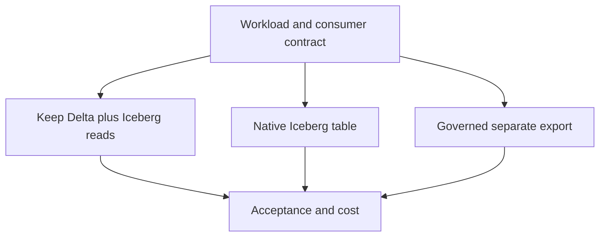

# 51 · Delta Lake versus Apache Iceberg

<ChapterMeta>

[Prerequisite](/iceberg/50-row-level-changes) · [Lab 51](/labs/51-delta-vs-iceberg) · [evidence and boundaries](/labs/iceberg-evidence).

</ChapterMeta>

## Why this matters

Chọn format từ transaction semantics, reader/writer ecosystem và ownership. Cả Delta và Iceberg là open table layers; integrated platform behavior là quyết định riêng.

## Scenario

ROAS uses Delta MERGE and streaming recovery already tested. A partner wants Iceberg access. Should the team rewrite all tables, expose read metadata, or keep a separately governed export?

## Learner reasoning

Trước khi đọc tiếp, ghi hypothesis và một observation có thể bác bỏ nó.

<details>
<summary>Compare your reasoning</summary>

First preserve scoped correctness and SLA. Both formats offer transactional table state over files, version/history, schema management and row operations. Compare specific engines/catalogs/protocol features, then evaluate the least disruptive access path.

</details>

## Mental model



Đây là learning model; physical/API details cần source và runtime-specific evidence.

## Core concepts

| Dimension | Delta | Iceberg |
|---|---|---|
| Metadata | Transaction-log actions and checkpoints | Metadata JSON, snapshots, manifest hierarchy |
| Catalog | Log identifies table state; catalog adds names/governance | Catalog resolves current metadata and commit coordination |
| Layout | Engine/version-specific partition and clustering features | Hidden transforms and spec evolution |
| Change processing | Delta streaming/CDF support is engine-feature-specific | Append incremental reads and row mutations have separate semantics |
| Governance | Platform responsibility | Platform responsibility |

## Example data

Existing Delta evidence verifies staged ROAS1250/700 and local data repair. Iceberg verifies snapshots/evolution on a different tiny fixture. These experiments cannot rank performance or prove a full workload migration.

## How it works

Delta clients interpret log protocol/features; Iceberg clients interpret format version, schemas/specs and delete files through catalog resolution. Delta OSS runs beyond Databricks. Iceberg ecosystem breadth still requires actual client/version feature tests. Delta partitioning/liquid clustering and Iceberg evolution solve different layout constraints.

Iceberg Spark streaming reads process append snapshots; overwrite/delete snapshots fail by default. Skip options deliberately ignore those changes and cannot substitute for business change capture. Streaming writes support append/complete, with complete replacing table contents per batch. Frequent commits create maintenance work for files/manifests/snapshots. These are sourced semantics, not an executed Iceberg streaming lab. Compare any proposed migration with the actual Delta streaming/replay contracts already learned.

## Databricks implementation

UniForm/Iceberg reads generates Iceberg metadata asynchronously alongside Delta metadata over the same Parquet files. Iceberg clients read that Delta-managed dataset; external Iceberg writes are not automatically permitted. Check converted_delta_version/timestamp, writer protocol, column mapping and client limitations before rollout.

Cloud execution: PENDING USER WORKSPACE. Không cấu hình credentials, tạo resources hoặc suy ra cloud readiness từ local evidence.

## Production failure

Partner reads a pinned old JSON path while Delta commits continue. Another engine writes through Iceberg to a read-only exposure. Retention cleans files the stale consumer needs.

## Debugging

| Symptom | Inspect | Decision |
|---|---|---|
| Reader lag | Converted Delta cutoff and consumer metadata path | Refresh/recover conversion |
| Unsupported writer | Protocol/features and exposure permissions | Keep one supported write authority |

## BigQuery / Airflow mapping

A BigQuery analyst can use an external open-table path without moving the whole warehouse. Airflow DAG conversion alone does not migrate table semantics or IAM.

## Code

[Lab 51](/labs/51-delta-vs-iceberg) owns the exercise. Runtime commands and selected artifacts: [Iceberg evidence](/labs/iceberg-evidence).


```text
Requirement -> importance -> architecture implication
Alternative -> rejection condition -> acceptance evidence
Decision -> owner -> reversal trigger
```

## Common mistakes

Delta không bị giới hạn ở Databricks; Iceberg không loại mọi coupling. Read metadata exposure không cấp quyền ghi qua Iceberg. Append streaming không tự capture mọi update/delete; format speed cần workload/engine cụ thể.

## Production notes

Do not treat open formats as no lock-in. SQL, catalog, governance, Jobs, observability and deployment can remain coupled. No generic faster-format claim is justified; measure a defined workload/runtime/maintenance policy.

## Interview checkpoint

1. When is Iceberg reads enough and when is a format rewrite required?
2. What separates format support from platform governance?
3. Which migration acceptance tests protect ROAS state?

## How to explain this in an interview

Tôi so metadata, mutations và client contracts trước. Delta cũng open source; Iceberg cũng có catalog/control-plane coupling. Tôi chỉ migrate khi lợi ích vượt chi phí chuyển đổi và vận hành.

Use your scenario, assumptions and evidence; do not memorize the wording.

## PASS criteria

PASS: complete the lab, defend the layer boundaries and submit a falsifiable acceptance decision. NOT YET: unsupported execution claims, no rejected alternative, or unresolved correctness/governance risk.

## Official references

Verified 2026-10-11. Apache latest docs identify1.12.0; local Spark 4.0.4/Scala 2.13, Iceberg formatv2. Databricks sources are AWS; Google is GCP; Snowflake/Fabric limitations depend on deployment and client.

- [delta](https://docs.delta.io/latest/delta-intro.html).
- [spec](https://iceberg.apache.org/spec/).
- [uniform](https://docs.databricks.com/aws/en/delta/iceberg-reads).
- [ucRest](https://docs.databricks.com/aws/en/external-access/iceberg).
- [Iceberg Spark streaming boundaries](https://iceberg.apache.org/docs/latest/spark-structured-streaming/).
