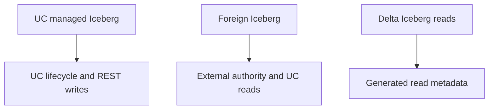

# 52 · Managed Iceberg on Databricks

<ChapterMeta>

[Prerequisite](/iceberg/51-delta-vs-iceberg) · [Lab 52](/labs/52-managed-iceberg) · [evidence and boundaries](/labs/iceberg-evidence).

</ChapterMeta>

## Why this matters

Managed Iceberg chọn Unity Catalog làm lifecycle và commit control plane. Foreign Iceberg giữ authority ở catalog bên ngoài; hai mô hình có quyền ghi và maintenance khác nhau.

## Scenario

Finance wants governed multi-engine tables; an existing Glue table must remain externally owned. The team labels both managed and lets every engine write directly to the bucket.

## Learner reasoning

Trước khi đọc tiếp, ghi hypothesis và một observation có thể bác bỏ nó.

<details>
<summary>Compare your reasoning</summary>

Managed describes who controls lifecycle, metadata, maintenance and access. It does not alone answer storage ownership, cloud costs or exit complexity. Foreign reference grants access to externally managed state without transferring ownership.

</details>

## Mental model



Đây là learning model; physical/API details cần source và runtime-specific evidence.

## Core concepts

| Pattern | Commit/lifecycle authority | External Iceberg access |
|---|---|---|
| UC managed Iceberg | Unity Catalog | Supported REST readers and writers |
| Foreign Iceberg | External catalog | UC path read-only, refresh required |
| Delta Iceberg reads | Delta writer and generated metadata | Read-only Iceberg exposure |

## Example data

Design-only namespace prod.marketing.events, Finance group reads, writer service owns updates. No real workspace, catalog, identities or grants created. Local Hadoop table is a separate educational runtime.

## How it works

For managed Iceberg, UC handles supported maintenance and governance while engine produces data changes. Current requirements include UC, DBR 16.4 LTS+ and serverless enabled with storage connectivity; predictive optimization must be enabled. External access additionally requires metastore setting, privileges and supported authentication.

## Databricks implementation

[Current support ledger](/iceberg/current-platform-support) records formats1/2/3, Parquet-only support, v2 delete limitations, current REST paths and partition restrictions. Managed materialized-view Iceberg support is Public Preview; do not infer GA for every related object.

Cloud execution: PENDING USER WORKSPACE. Không cấu hình credentials, tạo resources hoặc suy ra cloud readiness từ local evidence.

## Production failure

External engine bypasses UC and writes files or maintains a second pointer. A foreign reader assumes auto-refresh through REST and serves stale snapshot. Unified naming does not establish shared write authority.

## Debugging

| Symptom | Inspect | Action |
|---|---|---|
| Managed create blocked | UC, predictive optimization, compute/network | Complete approved workspace preflight |
| Foreign data stale | External commit and REFRESH FOREIGN TABLE | Define refresh SLA |

## BigQuery / Airflow mapping

BigQuery managed Iceberg also integrates storage management, but connection/IAM, metadata export and operations differ. Managed format is not an interchangeable platform contract.

## Code

[Lab 52](/labs/52-managed-iceberg) owns the exercise. Runtime commands and selected artifacts: [Iceberg evidence](/labs/iceberg-evidence).


```text
Requirement -> importance -> architecture implication
Alternative -> rejection condition -> acceptance evidence
Decision -> owner -> reversal trigger
```

## Common mistakes

Managed không có nghĩa storage/maintenance miễn phí. Foreign table không chuyển quyền ghi/lifecycle sang UC. Transform/evolution syntax chạy local chưa chứng minh tương thích managed Databricks.

## Production notes

Platform convergence: Databricks manages Delta/Iceberg; Snowflake has managed/external Iceberg; BigQuery has managed Iceberg; Fabric virtualizes open formats in OneLake. Choosing a format leaves governance, compute, orchestrator and developer operations unresolved.

## Interview checkpoint

1. Who owns expiration for managed versus foreign tables?
2. Why are Delta Iceberg reads not bidirectional writes?
3. Which serverless/network and access tests remain pending?

## How to explain this in an interview

Tôi chọn managed khi integrated governance và lifecycle giảm operational burden. Với foreign, tôi giữ external catalog authority và định nghĩa refresh/compatibility rõ ràng.

Use your scenario, assumptions and evidence; do not memorize the wording.

## PASS criteria

PASS: complete the lab, defend the layer boundaries and submit a falsifiable acceptance decision. NOT YET: unsupported execution claims, no rejected alternative, or unresolved correctness/governance risk.

## Official references

Verified 2026-10-11. Apache latest docs identify1.12.0; local Spark 4.0.4/Scala 2.13, Iceberg formatv2. Databricks sources are AWS; Google is GCP; Snowflake/Fabric limitations depend on deployment and client.

- [databricks](https://docs.databricks.com/aws/en/iceberg/).
- [ucRest](https://docs.databricks.com/aws/en/external-access/iceberg).
- [uniform](https://docs.databricks.com/aws/en/delta/iceberg-reads).
- [bqIceberg](https://docs.cloud.google.com/bigquery/docs/biglake-iceberg-tables-in-bigquery).
- [snowflake](https://docs.snowflake.com/en/user-guide/tables-iceberg).
- [fabric](https://learn.microsoft.com/en-us/fabric/onelake/onelake-overview).
