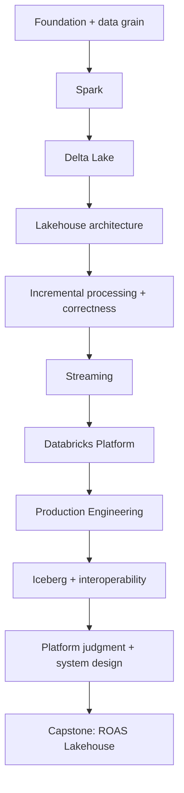

Production Data Engineering / Handbook 00

# Learn Databricks for Data Engineering

Từ BigQuery và Airflow đến Spark, Delta Lake và Lakehouse. Học qua tình huống production, kiểm chứng bằng lab, rồi giải thích được quyết định của mình.

<a class="start-link" href="./foundations/00-mental-model.html">Bắt đầu Chapter 00 →</a>

## Why this course exists

Bạn đã viết SQL, vận hành DAG, xử lý retry và debug số liệu. Điều cần học tiếp là một mô hình mới: compute xử lý dữ liệu phân tán, table format quản lý trạng thái trên object storage, và platform điều phối cùng governance.

| Bạn đã có | Bạn sẽ bổ sung | Năng lực cần thể hiện |
|---|---|---|
| Python + SQL | PySpark + Spark SQL | Đọc execution plan, giải thích shuffle |
| BigQuery + dbt | Delta tables + transformations | Chọn grain, keys và MERGE an toàn |
| Airflow + production experience | Lakeflow Jobs + platform governance | Thiết kế retry, backfill và observability |
| Đã debug pipeline | Lakehouse correctness | Chứng minh dữ liệu đúng sau replay |

## Learn · Build · Interview

| Mục tiêu | Cách làm | Bằng chứng |
|---|---|---|
| **Learn** | Scenario → failure → mental model → mechanics | Giải thích được nguyên nhân, không chỉ gọi tên |
| **Build** | Local-first lab, dữ liệu nhỏ, failure injection | Output có thể tái lập và assertions kiểm tra |
| **Interview** | Nêu giả định, lựa chọn và trade-off | Trả lời tình huống có retry, late data, skew |

## Learning path

Lộ trình đi từ cấu trúc dữ liệu đến cơ chế thực thi, rồi mới chọn công cụ platform. Grain và fan-out xuất hiện sớm để tránh mang lỗi mô hình vào Spark.

Xem [learning path đầy đủ](./guide/learning-path), gồm prerequisites và đầu ra cho từng nhóm. Streaming là nội dung core cần biết; dùng streaming trong capstone vẫn phải được chứng minh bằng requirements.

## Chọn độ sâu

| Nhãn | Ý nghĩa | Hành động |
|---|---|---|
| Foundation / Core / Advanced | Vị trí trong dependency order | Hoàn thành prerequisite trước khi đi sâu |
| MUST KNOW | Năng lực bắt buộc cho track này | Làm checkpoint bằng dữ liệu cụ thể |
| SHOULD KNOW | Hữu ích cho thiết kế và vận hành | So sánh trade-off, làm lab nếu phù hợp |
| AWARENESS | Nhận diện lựa chọn và giới hạn | Biết khi nào cần tra official docs |

Effort dùng **Short / Medium / Deep**, không cam kết thời lượng cố định. PASS ở cuối chương mô tả năng lực; website không theo dõi tiến độ cá nhân hay hiển thị phần trăm hoàn thành giả.

## Có thể đọc và chạy ngay

| Nội dung | Trạng thái | Bắt đầu |
|---|---|---|
| Chapter 00: Databricks & Lakehouse Mental Model | Có nội dung | [Đọc chương](./foundations/00-mental-model) |
| Lab 00: Files ≠ Table | FREE, Python standard library | [Chạy lab](./labs/00-files-and-tables) |
| Chapter 01: Grain, Keys & Fan-out | Foundation, MUST KNOW | [Đọc chương](./foundations/01-grain-keys-fanout) · [Lab 01](./labs/01-grain-fanout) |
| Chapter 02: Lake, Warehouse, Lakehouse & BigQuery Bridge | Foundation, MUST KNOW | [Đọc chương](./foundations/02-lake-warehouse-lakehouse) · [Lab 02](./labs/02-layout-contract) |
| Chapter 03: Spark architecture, DataFrames & SQL | Core, MUST KNOW | [Đọc chương](./spark/03-architecture-dataframes-sql) · [Lab 03](./labs/03-pipeline-execution) |
| Learning path, nguồn và cách học | Có hướng dẫn | [Cách học](./guide/how-to-learn) |
| Chapters 04-06: partitions, shuffle, joins/skew | Core, MUST KNOW | [Partitioning](./spark/04-partitioning) · [Shuffle](./spark/05-shuffle) · [Joins](./spark/06-joins-broadcast-skew) |
| Chapters 07-08: storage và table semantics | Core, MUST KNOW | [Parquet](./storage/07-parquet) · [Delta](./storage/08-delta-fundamentals) |
| Chapters 09-12: architecture, boundaries, retry và MERGE | Core; idempotency/MERGE CRITICAL MUST KNOW | [Medallion](./architecture/09-medallion) · [Incremental](./ingestion/10-incremental-boundaries) · [Idempotency](./correctness/11-idempotency) · [MERGE](./correctness/12-merge-correctness) |
| Chapters 13-15: time, late data và backfill | Core; late data/backfill CRITICAL MUST KNOW | [Time](./correctness/13-time-semantics) · [Late data](./correctness/14-late-lookback-reconciliation) · [Backfill](./correctness/15-backfill-reconciliation) |
| Mid Gate — Pipeline Correctness | Assessment, dataset riêng | [Làm assessment](./assessments/mid-gate-pipeline-correctness) |
| Chapters 16-24: continuous/stateful processing | Core, executable Spark/Delta labs | [Structured Streaming](./streaming/16-structured-streaming) · [Recovery](./streaming/24-recovery-runbook) · [Mid Gate](./assessments/mid-gate-streaming-correctness) |
| Chapters 25-30: Databricks platform | Docs/config và local SQL; workspace pending | [Compute](./platform/25-compute-mental-model) · [Boundaries](./platform/30-platform-boundaries) · [Free Edition](./setup/databricks-free-edition) · [Platform Gate](./assessments/mid-gate-platform-design) |

| Chapters 31-45: production hardening | Local performance/quality/rollback, bundle/CI; cloud pending | [Performance](./production/31-performance-mental-model) · [Release](./production/45-release-rollback) · [Evidence](./labs/production-evidence) · [Readiness Gate](./assessments/mid-gate-production-readiness) |

Portable Labs00-03 dùng Python standard library. Real Spark03-07 và Delta08 chạy FREE/local với [runtime setup](./setup/local-spark) và [actual evidence](./labs/runtime-evidence); không cần workspace/cloud. Fixture nhỏ xác nhận behavior, không dùng làm speed benchmark.

Labs09–15 nối ROAS grain → source boundaries → deterministic retry → mutable-state MERGE → late correction → staged backfill. [Correctness evidence](./labs/correctness-evidence) tách model outcomes và actual Delta execution. Labs16-24 chạy actual streaming state, watermarks, replay và sink-boundary failures. [Streaming evidence](./labs/streaming-evidence) giữ progress/target/checkpoint snapshots; [Mid Gate](./assessments/mid-gate-streaming-correctness) kiểm design reasoning.

## Architecture judgment

[Chapters46-60](/iceberg/46-why-iceberg) add real Iceberg metadata/evolution labs and platform choices based on requirements. [System design cases](/system-design/60-system-design-cases) include BigQuery and Fabric decisions; [sixth Mid Gate](/assessments/mid-gate-platform-lakehouse-system-design) accepts any justified platform.

## Capstone đích đến

**Near-real-time Advertising ROAS Lakehouse**: nhiều nguồn Ads, Adjust, callback events và attribution files; reporting freshness khoảng 15 phút; lịch sử attribution có thể đổi trong 72 giờ. Đây là giả định của bài tập, không phải SLA của các nhà cung cấp.

Bạn sẽ chọn grain, keys, replay strategy, lookback, watermark nếu cần, reconciliation và orchestration. Bài tập mở theo stages: requirements → learner decision → failure reveal → revision → implementation → validation → interview. Kiến trúc cuối chưa được cung cấp. Kafka hay streaming chỉ xuất hiện nếu quyết định thiết kế có căn cứ.

## Dùng như handbook

Tra sidebar theo chủ đề, dùng search để tìm thuật ngữ và TOC để đến failure/debugging. Mỗi chương có bảng mapping từ BigQuery/Airflow, code nhỏ và official references. Khi dùng trong production, kiểm tra cloud, runtime và ngày xác minh ở [Sources](./guide/sources).
