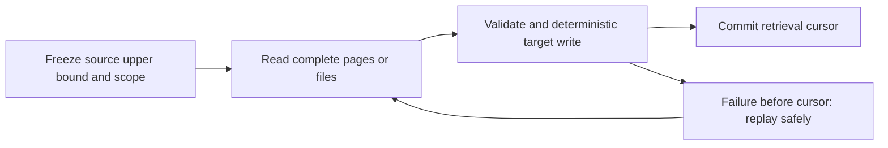

# 10 · Incremental Processing & Boundaries

<ChapterMeta>

[09 · Medallion](/architecture/09-medallion), [08 · Delta](/storage/08-delta-fundamentals). Tiếp: [11 · Idempotency](/correctness/11-idempotency).

</ChapterMeta>

## Why this matters

Source có 2 years history nhưng chỉ 15 minutes thay đổi. Incremental retrieval giảm scope xử lý khi boundary phản ánh **mọi changes cần biết**, kể cả correction và delete.

## Scenario

Run 1 đọc A/B/C và lưu max created_at. Run 2 có D mới, B thay đổi và E mới đến nhưng created_at hôm qua. Query `created_at > max_created_at` chỉ thấy D. E/B mất dù job success.

## Learner reasoning

<details><summary>Boundary có thể quan sát loại changes nào?</summary>

Created time nhận creation, không nhận mutable-state corrections. Updated time hữu ích nếu source cập nhật đáng tin, có tie/completeness contract. Cursor không là guarantee dữ liệu trước nó đã hết arrivals. Cần overlap/idempotent sink hoặc source change sequence và reconciliation.

</details>

## Mental model



### Batch high-water mark và streaming watermark

| Concept | Main question | State |
|---|---|---|
| Batch high-water mark / incremental cursor | Read source records nào tiếp? | Committed retrieval position |
| Lookback | Re-read recent history nào? | Overlapping query scope |
| Reconciliation | Target có còn khớp truth? | Coverage/content/metric checks |
| Structured Streaming watermark | Event-time state/late threshold giữ bao lâu? | Stateful streaming execution |

Streaming watermark dựa vào event-time progress và operation/output mode; không tự re-fetch API history. [Official semantics][watermarks]. Batch cursor và streaming watermark phải có tên riêng trong code/runbook.

## Core concepts

| Boundary | Source requirement | Failure to consider |
|---|---|---|
| Append-only / created_at | Immutable rows, observable creation order | Late arrival, corrections |
| updated_at | Every relevant mutation changes time | Ties, clock skew, delete invisibility |
| Ingestion timestamp | Every delivery captured durably | Business event old; ingestion != event time |
| Monotonic ID/sequence | Ordered source position, completeness guarantee | Gaps, namespace/reset, updates without new ID |
| File discovery | Stable file identity/version and completeness | Replaced files, replay, duplicate business data |
| Partition/date | Complete affected scope | Late changes outside selected dates |
| Change Data Feed | Enabled supported table changes/history | Retention/bootstrap/schema limitations |

[Delta CDF][cdf] là awareness về table changes, không là universal cursor cho external advertising APIs.

## Example data

Lab deterministic snapshots: run 1 A/B/C values 10; run 2 B→20,D10,E30. Naive created cursor retrieves D; updated boundary và snapshot diff thấy B/D/E. F xuất hiện sau với same updated timestamp tại upper bound; exclusive `>` bỏ F. Inclusive overlap nhận F nếu nằm trong guaranteed overlap.

Delete B cần tombstone/change feed hoặc **complete** snapshot comparison. Không dùng “missing from this page” để delete target. [Lab 10](/labs/10-incremental-failures) lưu input snapshots và decisions.

## How it works

Chọn upper bound trước read để có bounded unit; finish mọi pages, validate, commit deterministic target rồi publish cursor. Failure giữa target commit và cursor update dẫn replay; cần idempotent target vì hai commits này không tự atomic.

Timestamp tie có thể dùng composite `(updated_at, stable_id)` nếu source order/completeness hỗ trợ. Record cùng timestamp đến sau vẫn có thể nằm trước composite cursor; overlap hoặc stable change sequence cần contract riêng. Lookback hữu hạn không catch arbitrarily late changes.

Snapshot diff cần stable key, comparable full scope và cutoff. Full reconciliation bắt changes ngoài cursor/lookback nhưng tăng API/compute cost. Select strategy theo source behavior, deletion contract và retention, không mặc định MAX(timestamp).

## Databricks implementation

Delta sink là atomic table write; cursor ở store khác cần recovery design. [CDF docs][cdf] giải thích enabled change feed/retention; [batch docs][batch] giải thích writes. Lab mocks source snapshots; không gọi cost APIs hay configure ingestion service.

## Production failure

Advance cursor trước write; crash sau xử lý nửa batch làm remaining rows nằm trước cursor và bị bỏ. Cursor giữ old committed boundary cho retry; target operation giữ repeated input không tăng metrics. Clock-skewed old updated_at cần broader reconciliation.

## Debugging

| Symptom | Evidence | Treatment |
|---|---|---|
| New rows missing | Created vs arrival/update times | Chọn boundary theo source contract |
| Boundary ties lost | Compare equality/tie ordering | Inclusive overlap hoặc supported sequence |
| Deleted rows persist | Delete event/comparable snapshot | Explicit delete semantics, không page absence |
| Partial run marked done | Read/write/cursor checkpoints | Commit cursor sau durable target success |

## BigQuery / Airflow mapping

dbt incremental filter và Airflow data interval là computation selections, chưa chứng minh source completeness. Historical partition overwrite chỉ đúng nếu partition input đầy đủ. Query cost reduction không có nghĩa business changes đã được giữ hết.

## Code

```powershell
python scripts/run_correctness.py --lab 10
```

`model.py::incremental` compares strategies; `BatchJob` là fault model có after_read/after_write failures. [Lab 11](/labs/11-retry-batch) chuyển replay invariant sang actual Delta.

## Common mistakes

Gọi max event_time là safe cursor; đồng nhất file discovery với event dedup; ignore deletes; lưu cursor khi chỉ một page thành công. Những assumptions này phải trở thành explicit source contracts hoặc detectable failures.

## Production notes

Record source scope, upper/lower positions, page/file completeness, target version và cursor status. File comparator chạy cùng report grain/cutoff/currency. 15-minute cadence và 72h mutability là requirements của running case, chưa là API guarantee.

## Interview checkpoint

1. Created cursor bỏ B/E vì sao?
2. Updated cursor có thể mất timestamp ties/deletes không?
3. Target commit xong, cursor store fail: retry giữ metrics thế nào?
4. Có thể infer deletion từ incomplete API response không?

## How to explain this in an interview

“Tôi chọn retrieval position theo source mutations và completeness, không chỉ MAX(timestamp). Target write phải replay-safe trước khi cursor advance. Overlap catch bounded lateness; reconciliation bắt changes ngoài boundary. Streaming watermark quản lý event-time state, không là batch cursor.” Dùng concrete counterexample để bảo vệ strategy.

## PASS criteria

| PASS | NOT YET |
|---|---|
| Explain D-only failure và conditions của updated cursor | Coi MAX(updated_at) luôn đủ |
| Define cursor commit/replay boundary | Advance checkpoint trước target success |
| Tách cursor/lookback/reconciliation/watermark | Dùng 4 tên cho cùng mechanism |

## Official references

Verified 2026-10-11: Delta OSS docs, Spark 4.0.4 awareness, AWS Databricks mapping.

- [Delta Change Data Feed][cdf], [batch writes][batch].
- [Databricks watermarks][watermarks], [Spark guide](https://spark.apache.org/docs/4.0.4/streaming/apis-on-dataframes-and-datasets.html).

[cdf]: https://docs.delta.io/delta-change-data-feed/
[batch]: https://docs.delta.io/delta-batch/
[watermarks]: https://docs.databricks.com/aws/en/structured-streaming/watermarks
