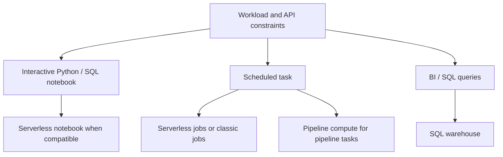

# 25 · Databricks compute mental model

<ChapterMeta>

[00 · Platform layers](/foundations/00-mental-model), [03 · Spark execution](/spark/03-architecture-dataframes-sql), [08 · Delta](/storage/08-delta-fundamentals). [Lab 25](/labs/25-compute-mental-model).

</ChapterMeta>

## Why this matters

Chọn compute theo workload và compatibility giúp tránh deploy job lên môi trường không hỗ trợ API của nó. Serverless vẫn có execution resources, quota và chi phí; Databricks nhận phần provisioning/scaling.

## Scenario

Stack hiện tại là Airflow → BigQuery. Một Data Engineer hỏi: “BigQuery quản lý compute cho tôi. Vì sao Databricks luôn nói về compute?” Cùng team cần Python notebook, hourly ETL, SQL dashboard và một thư viện dùng SparkContext. Liệu một compute choice đáp ứng cả bốn?

## Learner reasoning

Viết execution engine/API, latency, dependencies, network/data access và owner cho từng workload. BigQuery cũng dùng compute, thể hiện qua slots và workload controls; sự khác biệt nằm ở abstraction mà người dùng cấu hình.

## Mental model

Workspace là môi trường cộng tác cho notebooks, Jobs và SQL assets. Account quản lý organization-level identities/workspaces/metastores; Unity Catalog namespace có thể dùng từ nhiều workspace được gắn cùng metastore trong một region. Workspace files khác data tables.

AWS architecture phân biệt control plane chứa services/UI, serverless compute plane do Databricks quản lý, classic compute plane trong cloud account của khách hàng. Đây là cloud-scoped explanation, không là sơ đồ Free Edition networking.



## Core concepts

| Abstraction | Responsibility | Reader decision |
|---|---|---|
| Serverless notebook | Managed infrastructure for interactive Python/SQL | Compatible APIs/packages and data access |
| Serverless jobs | Managed execution for supported job tasks | Task type, dependencies, environment |
| Serverless pipeline | Managed pipeline execution | Dataset graph and update mode |
| Classic compute | Configurable resources and runtime | Required customization/compatibility |
| SQL warehouse | SQL/BI execution resource | Warehouse type, workload sizing and access |

Classic exists for runtime/config control, unsupported APIs, custom infrastructure dependencies and compatibility requirements. A classic jobs resource has a run lifecycle; an all-purpose resource is shared interactive compute. Detailed VM/IAM setup belongs to production operations.

## Example data

Ten workload cards are in [Lab 25](/labs/25-compute-mental-model). A dashboard needs SQL-serving compute; a library invoking SparkContext introduces a compatibility constraint. “Python ETL” alone does not establish package/network compatibility.

## How it works

### Compute decision table

| Workload | Likely compute | Why |
|---|---|---|
| Exploratory Python/SQL notebook | Serverless notebook | Interactive supported APIs, managed allocation |
| Python ETL job | Serverless jobs when supported | Automated task execution without node provisioning |
| SQL dashboard | Serverless SQL warehouse where available | SQL/BI workload management |
| JAR requiring RDD, Spark internals or native libraries | Classic jobs where required | Current serverless JAR restrictions |
| Lakeflow pipeline | Serverless pipeline when supported | Pipeline-managed execution |

The [Jobs compute overview](https://docs.databricks.com/aws/en/jobs/compute) recommends the first task choices. Its generic JAR row still lists classic. The [JAR task reference](https://docs.databricks.com/aws/en/jobs/tasks/jar) and [serverless JAR guide](https://docs.databricks.com/aws/en/jobs/how-to/use-jars-in-workflows) document serverless support with environment and public-API compatibility requirements. The narrower task reference controls this decision. A JAR extension alone is insufficient to choose classic.

### Serverless trade-off

The current [serverless overview](https://docs.databricks.com/aws/en/compute/serverless/) describes quicker startup/scaling and reduced idle resource management through on-demand allocation. These are platform benefits; actual startup, latency and cost still need representative-workload evidence.

Managed startup, allocation and autoscaling reduce infrastructure operations. Compatibility is a constraint: only supported Spark Connect APIs; no RDD API; restricted Spark configuration; no compute init scripts; automatic runtime management. Environment dependencies still need version control. Notebook/job Structured Streaming requires supported bounded triggers such as AvailableNow; a processingTime query from the local streaming labs cannot be moved unchanged. Pipeline continuous mode has its own managed behavior.

Production networking and regional availability need explicit verification. Free Edition outbound domains and usage quotas are additional learning restrictions. Compare latency, total cost and operating constraints for the actual workload rather than declaring serverless universally better.

## Databricks implementation

Scope: current AWS Databricks documentation, verified 2026-10-11. [Free Edition setup](/setup/databricks-free-edition) phân loại LOCAL LAB, DATABRICKS FREE EDITION LAB và PAID/PRODUCTION-ONLY CONCEPT. Workspace execution: `PENDING USER WORKSPACE`. Governance/access basics trong setup phải hoàn tất trước cloud lab, dù Chapter 28 đọc sau Jobs/pipelines.

## Production failure

Moving the local RDD partition-inspection lab onto a serverless notebook fails API compatibility. Treating automatic scaling as unlimited capacity also causes missed deadlines when quota or admission queues apply.

## Debugging

| Symptom | Investigation | Diagnosis / response |
|---|---|---|
| SparkContext/RDD error | Inspect required APIs | Use compatible DataFrame API or classic |
| Package fails | Inspect runtime/environment and dependency versions | Pin a compatible package; check native requirements |
| External API unreachable | Review permitted domains/networking | Keep ingestion in an authorized external service |
| Tasks wait | Separate queue, startup and execution time | Review concurrency/quota before resizing |

## BigQuery / Airflow mapping

BigQuery exposes managed SQL execution with on-demand or capacity-based slot choices. Databricks exposes several managed execution surfaces alongside configurable classic compute. Airflow selects/coordinates work; compute executes that work. Neither scheduler name establishes data placement or permissions.

## Code

[Compute classification lab](/labs/25-compute-mental-model) requires a reason and a condition that would change each answer.

```text
task contract → supported APIs/libraries → execution surface → quota/cost review
```

## Common mistakes

“Serverless means no compute” hides execution cost. “Job equals cluster” mixes scheduler and executor. “All JARs require classic” ignores current supported JAR tasks. “Local Spark proves DBR compatibility” skips platform-specific constraints.

## Production notes

Free Edition là learning environment. Một run thành công ở đó chưa chứng minh production scale, networking, enterprise administration, SLA, concurrency, production cost hoặc multi-workspace governance. Evidence phải ghi compute/environment và redact identifiers theo [evidence policy](/labs/platform-evidence).

## Interview checkpoint

1. Which requirement makes a public DataFrame JAR eligible for serverless, and which requirement sends it to classic?
2. A dashboard query is slow: which measurements separate data layout, queueing and compute capacity?
3. Why can a job contain both a notebook task and a pipeline task without one shared cluster?

## How to explain this in an interview

“Tôi chọn execution surface theo task type, API và data-access constraints. Serverless chuyển provisioning/scaling sang Databricks; compatibility, quotas và cost vẫn cần quyết định. SQL warehouse phục vụ BI, còn Jobs phối hợp tasks.”

## PASS criteria

PASS: classify all ten workloads, state missing facts for ambiguous cards and defend a compatibility-driven classic choice. NOT YET: selection relies only on file extension, scheduler name or a universal serverless claim.

## Official references

Verified 2026-10-11, current AWS docs and Google Cloud BigQuery:

- [Compute categories](https://docs.databricks.com/aws/en/compute/).
- [AWS account/workspace and plane boundaries](https://docs.databricks.com/aws/en/getting-started/high-level-architecture).
- [Serverless limitations](https://docs.databricks.com/aws/en/compute/serverless/limitations).
- [SQL warehouses](https://docs.databricks.com/aws/en/compute/sql-warehouse).
- [BigQuery administration and capacity](https://docs.cloud.google.com/bigquery/docs/admin-intro).

