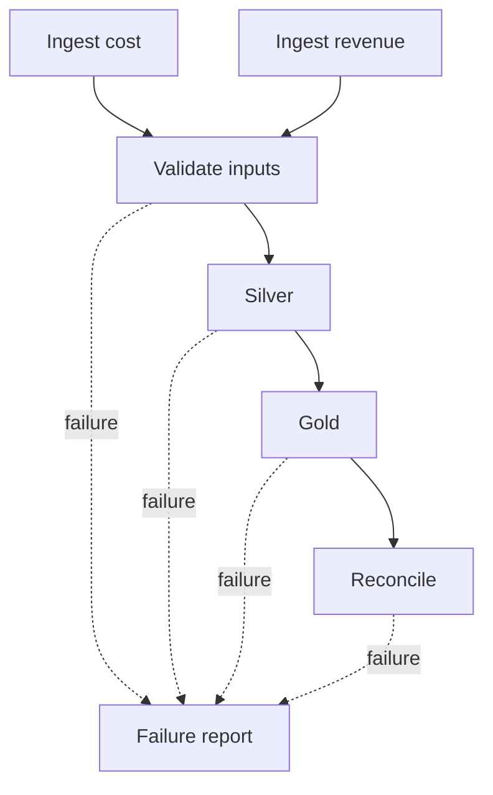

# 26 · Lakeflow Jobs and orchestration boundaries

<ChapterMeta>

[25 · Compute](/platform/25-compute-mental-model), [11 · Idempotency](/correctness/11-idempotency), [15 · Repair/reconciliation](/correctness/15-backfill-reconciliation), Airflow DAG experience. [Lab 26](/labs/26-lakeflow-jobs).

</ChapterMeta>

## Why this matters

Lakeflow Jobs coordinates task execution and recovery. A successful scheduler run needs a separate business reconciliation contract, especially when retries can repeat durable writes.

## Scenario

ROAS workflow: ingest cost, ingest revenue, validate inputs, transform Silver, build Gold, reconcile and notify failure. The validation task finds an equal-revision conflict. Predict which downstream tasks should run and whether successful ingestion should repeat.

## Learner reasoning

Draw data-producing tasks and control tasks separately. Define each task's input cutoff, durable output and retry identity. A deterministic validation error needs corrected data/config; retrying unchanged input only consumes quota.

## Mental model

A Job defines a workflow. Each Task selects a supported execution type and its compute. Dependencies and run conditions govern control flow; tables carry data across isolated executions.



The diagram's failure edges represent run-if control. They do not route failed datasets into Gold.

## Core concepts

| Object/control | Meaning | ROAS application |
|---|---|---|
| Job / Task / DAG | Workflow, execution unit and dependencies | Two ingests precede validation |
| Parameters | Named run inputs with task-specific passing rules | catalog, schema, validation failure flag |
| Schedule / trigger | Time cadence or event initiation | Hourly cost, scheduled callbacks or data-arrival signal |
| Retry / timeout | Repeat policy and bounded execution | Transient failures vs deterministic bad input |
| Task values | Small JSON-compatible metadata passed between tasks | Row count or validated cutoff; tables hold bulk data |
| If/else | Branch on a supported expression | Process only when valid new input exists |
| For each | Run a nested task for input-array items | Bounded account list, explicit loop concurrency |
| Notifications | Job/task failure or duration delivery to configured destinations | Alert owner with evidence and dedup policy |
| Repair run | Re-execute unsuccessful subset and dependents | Preserve successful ingests when inputs still valid |
| Concurrency / queue | Bound simultaneous runs and admission | Protect single-writer ownership of lab tables |
| Task compute | Execution selection independent of orchestration | Notebook, SQL warehouse or pipeline resource |

## Example data

Lab input has six revenue deliveries, four business identities, an E1 retry and newer E2 revision, plus three cost rows. Expected Silver total is 1250 USD cents; Gold has three full-grain rows and cost total 700. Persisted snapshot inputs are reused during repair.

## How it works

Default ALL_SUCCESS tasks wait for all successful dependencies. If validation fails, Silver/Gold/reconciliation are upstream-failed. The failure-report task uses AT_LEAST_ONE_FAILED. ALL_DONE would also run after successful dependencies and is appropriate only when that behavior is desired.

Retries belong to each task; the artifact gives validation zero retries and other tasks one retry. Timeout is 600 seconds for the sample. Job max_concurrent_runs=1 protects these snapshot tables; that setting does not serialize another job writing the same target.

Repair a multi-task run after fixing the cause. Repair re-executes tasks from the beginning using current settings; it does not undo partial writes or preserve arbitrary driver memory. Inspect selected tasks and retained-input consistency before accepting the repair. See [repair behavior](https://docs.databricks.com/aws/en/jobs/repair-job-failures).

Python taskValues are useful for bounded metadata; use dynamic references to consume values. Task-value passing is not a durable business checkpoint. For-each loops and If/else branches add control flow but preserve idempotency and concurrency obligations.

## Databricks implementation

Scope: current AWS Databricks documentation, verified 2026-10-11. [Free Edition setup](/setup/databricks-free-edition) phân loại LOCAL LAB, DATABRICKS FREE EDITION LAB và PAID/PRODUCTION-ONLY CONCEPT. Workspace execution: `PENDING USER WORKSPACE`. Governance/access basics trong setup phải hoàn tất trước cloud lab, dù Chapter 28 đọc sau Jobs/pipelines.

## Production failure

Set force_validation_failure=true in [Lab 26](/labs/26-lakeflow-jobs). Expected behavior is failed validation, blocked data tasks and executed failure report. After changing the flag to false, repair validation and its data dependents; preserve ingests only if the input snapshot is still valid. These are expected workspace outcomes, not captured runs.

## Debugging

| Symptom | Inspect | Action |
|---|---|---|
| Gold runs after invalid input | run_if and actual dependencies | Restore validation barrier |
| Duplicate writes after repair | Output mode, key/version and partial commit | Enforce scoped overwrite/MERGE semantics |
| Successful task cannot supply DataFrame | Session isolation | Persist a table, pass metadata only |
| Freshness misses deadline | Queue/startup/runtime and source cutoff | Separate scheduler and compute bottlenecks |

## BigQuery / Airflow mapping

### Airflow vs Lakeflow Jobs

| Concern | Airflow | Lakeflow Jobs |
|---|---|---|
| Databricks-native tasks | Provider/operators call Databricks | Native task types and run monitoring |
| External ecosystem | Broad provider integration | External calls possible, but APIs/networking require explicit design |
| Deployment model | DAG code plus Airflow environment | Workspace definitions/API/config; bundles can package resources |
| Scheduler ownership | Team or managed Airflow service operates scheduler | Databricks manages Jobs orchestration |
| Cross-platform workflows | Natural boundary for multiple external services | Useful when workflow ownership is mainly Databricks |
| Retries/repair | Task retries, clear/re-run and provider-specific semantics | Task retries and multi-task repair |
| Operational complexity | Scheduler/provider/executor operations | Fewer scheduler components, platform coupling and compute choices remain |

A workflow 90% inside Databricks may fit Jobs without a separate scheduler. A workflow coordinating Meta API, BigQuery, Salesforce and Databricks may keep Airflow as the outer coordinator. The [Airflow Databricks provider](https://airflow.apache.org/docs/apache-airflow-providers-databricks/stable/operators/run_now.html) supports submitting existing Jobs; exact retry/durable semantics depend on provider/Airflow versions. Choose one owner for each recurring schedule to avoid duplicate runs.

## Code

Repository: labs/platform/resources/roas.job.yml and src/roas_task.py. Config uses JSON syntax inside YAML files, valid YAML 1.2, so the standard-library checker can parse it without another dependency. It is a bundle representation, not a recorded API response.

```powershell
python -m unittest discover -s tests -v
# Workspace validation, only after learner-selected OAuth/profile and variables:
databricks bundle validate --strict --target dev --profile "<chosen-profile>"
```

Run the workspace command from labs/platform after setting catalog/schema bundle variables; [Lab 26](/labs/26-lakeflow-jobs) defines the prerequisites and evidence.

## Common mistakes

Treating Job as cluster; relying on memory shared between tasks; retrying deterministic validation indefinitely; repairing without checking partial target effects; scheduling the same boundary in Airflow and Jobs.

## Production notes

The sample failure_report prints a message. It sends no email/webhook. Production notifications need an explicitly configured destination and alert owner. Parameters at job level are pushed to supported key-value task types, not every task type indiscriminately; check the task reference.

This sample requires complete cost coverage for its retained revenue snapshot. Live publication must detect missing cost grains and preserve/report them according to the unknown-cost contract from the correctness track. The local snapshot output is not a general incremental ROAS implementation.

Free Edition là learning environment. Một run thành công ở đó chưa chứng minh production scale, networking, enterprise administration, SLA, concurrency, production cost hoặc multi-workspace governance. Evidence phải ghi compute/environment và redact identifiers theo [evidence policy](/labs/platform-evidence).

## Interview checkpoint

1. If only reconciliation fails after Gold writes, what must repair prove?
2. Why retain successful ingestion during repair, and when is it unsafe?
3. What changes in the boundary when Salesforce becomes part of the same SLA?
4. How do loop concurrency, run concurrency and shared-table writes interact?

## How to explain this in an interview

“Tôi dùng Lakeflow Jobs cho task DAG, compute chọn theo từng task. Retry và repair lặp lại task logic nên output phải idempotent. Nếu pipeline chủ yếu trong Databricks, Jobs có thể đủ; nếu phối hợp nhiều dịch vụ tôi giữ Airflow làm outer orchestrator.”

## PASS criteria

PASS: trace the failed-validation path, choose a repair subset from retained-input facts and defend Jobs vs Airflow ownership. NOT YET: repair is claimed to undo data or a Job is equated with a cluster. Workspace run proof can remain pending; label it separately.

## Official references

Verified 2026-10-11, current AWS docs:

- [Lakeflow Jobs](https://docs.databricks.com/aws/en/jobs/).
- [Task dependencies/run-if](https://docs.databricks.com/aws/en/jobs/run-if).
- [Task values](https://docs.databricks.com/aws/en/jobs/task-values).
- [For-each tasks](https://docs.databricks.com/aws/en/jobs/tasks/for-each).
- [Dynamic references](https://docs.databricks.com/aws/en/jobs/dynamic-value-references).
- [Repair runs](https://docs.databricks.com/aws/en/jobs/repair-job-failures).

