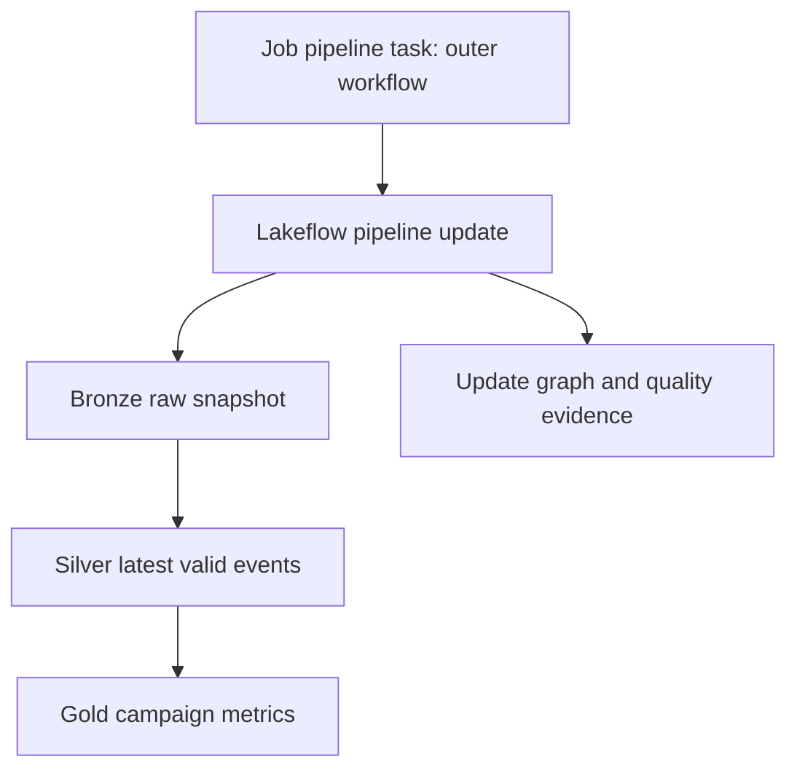

# 27 · Apache Spark Declarative Pipelines and Lakeflow pipelines

<ChapterMeta>

[09 · Medallion](/architecture/09-medallion), [24 · Recovery](/streaming/24-recovery-runbook), [25 · Compute](/platform/25-compute-mental-model), [26 · Jobs](/platform/26-lakeflow-jobs). [Lab 27](/labs/27-declarative-pipelines).

</ChapterMeta>

## Why this matters

Declarative dataset definitions let the pipeline engine derive dependencies and manage updates. Business identity, quality policy and recoverable source truth still belong to the engineer.

## Scenario

Imperative workflow: run Bronze, wait, run Silver, then run Gold if Silver succeeds. Declarative workflow: declare Bronze; declare Silver reading Bronze; declare Gold reading Silver. A bad-money row enters Bronze. Predict whether a quality rule should record, drop or fail, and what Gold can safely expose.

## Learner reasoning

Write dataset contracts and read dependencies before choosing decorators. A dependency graph orders dataflow; it cannot infer that event_id requires source/app scope or that a 72h correction must supersede an older version.

## Mental model

Apache Spark Declarative Pipelines (SDP) is the open framework for batch and streaming data pipelines in SQL/Python. Current Databricks documentation calls its platform product Lakeflow pipelines: built on SDP, runs on Databricks Runtime and adds platform features. Older Lakeflow Spark Declarative Pipelines/DLT labels may remain in URLs, skills and pages; they are not names for the OSS framework.



This simplifies planning: execution may analyze definitions multiple times, perform incremental refresh where supported, or recompute. An edge does not guarantee an atomic transaction across every output table.

## Core concepts

| Object | Represents | Boundary |
|---|---|---|
| Pipeline | Definitions/config and execution/update unit | Holds multiple dataflows |
| Flow | Query processing into a target | Batch or incremental; append flows can share a target |
| Streaming table | Persisted table fed using streaming processing | Checkpoints/source append and mutation semantics matter |
| Materialized view | Persisted result of a batch query | Incremental refresh when engine can support it; otherwise recomputation |
| Temporary view | Named query within graph without persisted serving data | Reused transformation logic |
| Sink | Destination receiving flow output | Destination-specific write/retry contract |

SDP and Lakeflow share authoring and dependency-resolution concepts. Databricks adds AUTO CDC, expectations and queryable event logs; these are not portable OSS APIs. A sink does not imply that a second destination commits atomically with the first. See [capability comparison](https://docs.databricks.com/aws/en/ldp/concepts/spark-declarative-pipelines).

## Example data

Lab 27 uses batch materialized views over the retained raw_events snapshot. Bronze keeps all six deliveries; Silver selects four business identities using full source/app/event key and highest revision; Gold has three campaign aggregates totaling 1250 cents. Gold here is campaign revenue, while the Jobs lab adds cost and ROAS serving.

## How it works

Python definitions return DataFrames. Decorators register datasets; platform analyzes references to build the graph. Keep API calls, writes, collect and other side effects out of dataset functions because planning may invoke them repeatedly. Use normal Spark reads/SQL for dependencies.

The bounded lab uses materialized views so newer revisions are recomputed from the retained snapshot. That is a batch design choice; it does not demonstrate live streaming state or AUTO CDC. For an append-only stream, streaming tables/flows use the checkpoint and state reasoning from Chapters 16-24. Mutable revisions need explicit update/CDC or bounded repair, not dropDuplicates on event ID.

The sample expectation on Bronze uses fail semantics for invalid money/identity. Expectations can retain and report invalid records, drop invalid rows, or fail the affected flow. A pipeline update can fail while independent flows or previously committed outputs remain; do not infer all-table rollback.

## Databricks implementation

Scope: current AWS Databricks documentation, verified 2026-10-11. [Free Edition setup](/setup/databricks-free-edition) phân loại LOCAL LAB, DATABRICKS FREE EDITION LAB và PAID/PRODUCTION-ONLY CONCEPT. Workspace execution: `PENDING USER WORKSPACE`. Governance/access basics trong setup phải hoàn tất trước cloud lab, dù Chapter 28 đọc sau Jobs/pipelines.

The pinned local runtime is Spark 4.0.4. The [OSS SDP guide](https://spark.apache.org/docs/4.1.0/declarative-pipelines-programming-guide.html) documents Spark 4.1.0 APIs. This repository does not upgrade the accepted runtime or execute SDP locally. AST validation and underlying SQL tests are separate from pipeline-engine execution.

## Production failure

In [Lab 27](/labs/27-declarative-pipelines), modify one retained input amount to negative and update the pipeline. The expected fail expectation must be inspected in graph/event details, along with output freshness and previously committed tables. Restore the input and update again; full refresh requires complete retained truth.

## Debugging

| Symptom | Investigate | Response |
|---|---|---|
| Graph lacks an expected edge | Dataset names and read references | Fix graph definition, validate again |
| Bronze quality failure | Violating input and expectation action | Repair source/policy; record quarantined scope |
| Gold remains older | Failed update and committed table state | Verify freshness before serving |
| Local import fails | Spark version and platform-only API | Label syntax-only check; execute in pipeline context |

## BigQuery / Airflow mapping

### Jobs vs pipelines

Jobs orchestrates heterogeneous tasks, including a pipeline update. Pipelines manages dataset/flow dependencies inside a declarative data-processing unit. Compose them when ingestion, pipeline refresh, reconciliation and external work have different owners.

### dbt bridge

| Concern | dbt | SDP / Lakeflow pipelines |
|---|---|---|
| Graph | Models reference other models | Dataset/flow query dependencies |
| Ingestion | Usually consumes loaded warehouse inputs | Batch/stream ingestion can be part of pipeline |
| Streaming | Depends on adapter/materialization; not equivalent to streaming state APIs | Explicit streaming tables/flows/stateful processing |
| Engine | Executes transformations through the target adapter | Spark-based processing; Lakeflow runs on DBR |
| Materialization | View/table/incremental/materialized-view strategies | Streaming tables and materialized views |
| Quality | Data tests/unit tests and dbt build behavior | Business tests still needed; Lakeflow expectations enforce row policies |
| Orchestration | Build ordering plus external/platform schedules | Pipeline update ordering, often composed with Jobs |

These are learning bridges, not “Jobs = Airflow” or “Pipelines = dbt” identities. [dbt models](https://docs.getdbt.com/docs/build/models) include SQL and Python; [data tests](https://docs.getdbt.com/docs/build/data-tests) return violating rows. A dbt project may continue serving transformations on a Databricks SQL warehouse.

## Code

Source: labs/platform/src/medallion.py; configuration: resources/medallion.pipeline.yml. Modern publishing uses schema, preferred over legacy target.

```python
from pyspark import pipelines as dp

@dp.materialized_view(name="gold_campaign_pipeline")
def gold_campaign_pipeline():
    return spark.sql("""
      SELECT source_system, app_id, event_date, campaign_id, currency,
             SUM(amount_cents) AS revenue_cents
      FROM silver_events_pipeline
      GROUP BY source_system, app_id, event_date, campaign_id, currency
    """)
```

This snippet is workspace pipeline source, not executable on the pinned local runtime. [Lab 27](/labs/27-declarative-pipelines) provides a static graph and failure exercise.

## Common mistakes

Calling decorated functions as procedural tasks; adding API writes/collect inside definitions; treating every materialized view refresh as incremental; putting Lakeflow-only expectations under an OSS portability claim; treating managed retry as business correctness.

## Production notes

Full refresh/rebuild depends on source completeness. Table ownership, pipeline run identity and output grants must be reviewed before updates; consumers need a freshness/reconciliation policy when some tables remain on older successful versions.

Free Edition là learning environment. Một run thành công ở đó chưa chứng minh production scale, networking, enterprise administration, SLA, concurrency, production cost hoặc multi-workspace governance. Evidence phải ghi compute/environment và redact identifiers theo [evidence policy](/labs/platform-evidence).

## Interview checkpoint

1. How can Jobs and pipelines share one workflow without duplicate responsibility?
2. Why can a materialized view be a reasonable bounded mutation lab?
3. What evidence distinguishes an inferred graph from a hand-drawn diagram?
4. Which part of this Python source prevents complete OSS portability?

## How to explain this in an interview

“SDP định nghĩa dataset/flow graph cho batch và streaming. Lakeflow pipelines chạy model đó trên Databricks Runtime và bổ sung expectations, AUTO CDC và event log. Jobs phối hợp pipeline update với tasks khác; business correctness và refresh boundaries vẫn cần thiết kế.”

## PASS criteria

PASS: distinguish OSS framework from platform extensions, explain each object and predict failure/retained-output behavior. NOT YET: Jobs and pipelines are treated as identical or static AST/SQL tests are claimed as pipeline-engine execution.

## Official references

Verified 2026-10-11:

- [SDP and Lakeflow capability boundaries](https://docs.databricks.com/aws/en/ldp/concepts/spark-declarative-pipelines).
- [Lakeflow pipelines](https://docs.databricks.com/aws/en/ldp/concepts).
- [Python definitions](https://docs.databricks.com/aws/en/ldp/developer/python-dev).
- [Pipeline properties](https://docs.databricks.com/aws/en/ldp/properties).
- [Expectations](https://docs.databricks.com/aws/en/ldp/developer/ldp-python-ref-expectations).
- [Spark 4.1.0 SDP](https://spark.apache.org/docs/4.1.0/declarative-pipelines-programming-guide.html).

