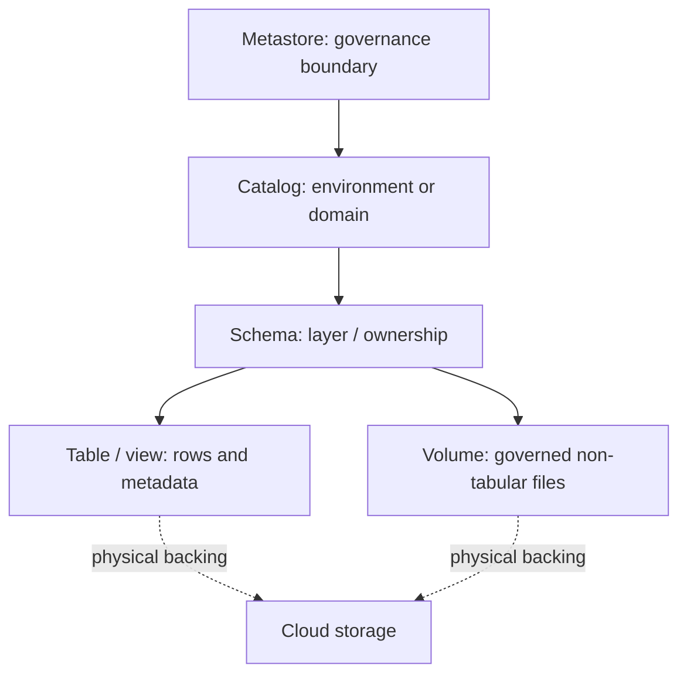

# 28 · Unity Catalog and governance design

<ChapterMeta>

[00 · Governance layer](/foundations/00-mental-model), [09 · Medallion](/architecture/09-medallion), [26 · Run identity](/platform/26-lakeflow-jobs), [27 · Pipeline outputs](/platform/27-declarative-pipelines). [Lab 28](/labs/28-unity-catalog).

</ChapterMeta>

## Why this matters

Unity Catalog provides governance for data and AI assets: access control, lineage, audit and discovery. A governance design must connect object ownership to identities and environments before a workflow writes production data.

## Scenario

Company has dev/staging/prod, Data Engineers, Analysts, Finance and sensitive donor/customer data. Marketing needs ROAS, Finance needs approved revenue metrics, the job needs write access. Who owns outputs, who can see PII, and how can someone trace a suspicious metric back to a callback?

## Learner reasoning

Write an access matrix first: principal, environment, object, operation and justification. Trace one metric from Gold to Silver to Bronze. Decide which team approves schema/grant changes and which identity executes the job.

## Mental model

Metastore contains catalogs; catalog.schema.object is the logical namespace. Tables, views and volumes are different securable objects under schemas. Cloud files live in storage; namespace names do not specify a bucket layout.



A workspace is a collaboration environment linked to a metastore. Multiple workspaces sharing a metastore require explicit catalog/workspace access decisions; a different workspace name alone is not an isolation proof.

## Core concepts

| Concept | Responsibility | Design question |
|---|---|---|
| User / group / service principal | Interactive identity, shared access role, workload identity | Who executes vs who owns? |
| Ownership | Control/management of securable object | Stable group ownership rather than departing user |
| Grants/privileges | Operations on securables plus namespace traversal | Narrow object/action and inherited rights |
| Lineage | Captured read/write dependencies, including column lineage where supported | Which changes can affect Gold? |
| Audit | Operation/access records available under the supported logging model | Who queried or changed access? |
| Discovery | Find assets/metadata through governed visibility | Browse metadata vs read rows |
| Managed data | Platform manages storage placement/lifecycle | Who controls deletion/lifecycle? |
| External data | Data at external storage with separate lifecycle ownership | Who protects outside access? |
| Storage credential | Governed identity to access cloud storage | Which cloud access is delegated? |
| External location | Storage path associated with credential | Which path may be used? |
| Volume | Governed file namespace | Non-tabular landing files and permissions |

Storage credentials/external locations govern cloud access through Databricks. They do not erase cloud IAM responsibilities or access through other engines. Managed and external objects both use Unity Catalog privileges; physical lifecycle and outside access differ.

## Example data

[Lab 28](/labs/28-unity-catalog) uses four role designs: Data Engineer, Marketing Analyst, Finance and workload Service Principal. Bronze callbacks, Silver events, Gold ROAS and restricted PII each have explicit ownership. Finance consumes approved aggregates without direct raw PII privileges.

## How it works

To read a table, a principal needs USE CATALOG, USE SCHEMA and SELECT, through direct grants/group membership/inheritance as appropriate. A SELECT grant on a table by itself is insufficient. USE privileges only traverse namespace. Parent SELECT grants can cover future children; a narrow REVOKE does not negate a broader inherited grant. Owners and administrators need separate consideration during effective-access review.

Write tasks require the relevant MODIFY/create privileges, source-read privileges and permission to use the selected execution resource. Object ownership and run identity are separate: a service principal may run pipelines while a steward group owns the data.

### Environment design

| Option | Structure | Benefits / cost |
|---|---|---|
| Environment catalogs | roas_dev, roas_staging, roas_prod with layer schemas | Obvious promotion/access boundary; domain organization needs a convention |
| Domain catalogs | marketing, finance, product with environment separation elsewhere | Clear domain ownership; environments need reviewed isolation and deployment rules |

Neither hierarchy is universal. Review isolation, organization, governance, CI/CD, access model and storage constraints. A dev writer must not inherit production write access through a parent/group grant.

### Lineage and audit

Lineage captured by supported Databricks execution helps trace Gold inputs; external API ingestion and external-engine steps require additional contracts/instrumentation. Audit answers activity questions rather than transformation semantics. Access to system tables or audit destinations is privileged and feature-specific; do not assume every Free Edition workspace exposes the enterprise observability subset.

## Databricks implementation

Scope: current AWS Databricks documentation, verified 2026-10-11. [Free Edition setup](/setup/databricks-free-edition) phân loại LOCAL LAB, DATABRICKS FREE EDITION LAB và PAID/PRODUCTION-ONLY CONCEPT. Workspace execution: `PENDING USER WORKSPACE`. Governance/access basics trong setup phải hoàn tất trước cloud lab, dù Chapter 28 đọc sau Jobs/pipelines.

## Production failure

An Analyst receives SELECT on the Gold table but lacks USE SCHEMA and gets denied. Another role retains SELECT through a schema grant after a table-level REVOKE. Moving raw PII under a schema-wide read grant leaks data even if the Gold query hides its columns.

## Debugging

| Symptom | Inspect | Response |
|---|---|---|
| Read denied | Traversal, action privilege, memberships and compute ACL | Grant only missing intended privilege |
| PII unexpectedly readable | Direct/inherited grants, owner/admin paths | Remove broad grants; isolate restricted schema |
| Lineage gap | Execution engine and supported capture | Document external edges/cutoff |
| Wrong environment written | Qualified names, run identity and grants | Stop writer, repair bounded scope; fix promotion policy |

## BigQuery / Airflow mapping

BigQuery project/dataset/table IAM is a useful namespace/access bridge, but privilege inheritance, object ownership and storage integration differ. Airflow connection identity is not automatically the Unity Catalog run identity. Use a reviewed workload identity, and distinguish scheduler authentication from data grants.

## Code

The design fixture lives in labs/platform/governance-policy.json. It is not deployed access control. The SQL sample requires existing approved groups and an administrator review:

```sql
GRANT USE CATALOG ON CATALOG roas_prod TO `marketing_analysts`;
GRANT USE SCHEMA ON SCHEMA roas_prod.gold TO `marketing_analysts`;
GRANT SELECT ON TABLE roas_prod.gold.roas TO `marketing_analysts`;
SHOW GRANTS ON TABLE roas_prod.gold.roas;
```

In Free Edition, [Lab 28](/labs/28-unity-catalog) uses learner-owned catalog/schema inspection only. Group/SP provisioning, IAM credentials and real least-privilege validation across personas remain PAID/PRODUCTION-ONLY CONCEPT unless an authorized workspace supports them.

## Common mistakes

Equating catalog with bucket; treating governance as GRANT statements only; making analysts object owners; using schema-wide SELECT where future PII can appear; treating SHOW GRANTS on one table as a full effective-access proof.

## Production notes

Free Edition là learning environment. Một run thành công ở đó chưa chứng minh production scale, networking, enterprise administration, SLA, concurrency, production cost hoặc multi-workspace governance. Evidence phải ghi compute/environment và redact identifiers theo [evidence policy](/labs/platform-evidence).

Lineage is not a backup. Audit retention/access and business-data retention need separate policies. Volumes store governed files rather than relational table rows; READ/WRITE VOLUME differs from SELECT/MODIFY on tables.

## Interview checkpoint

1. Which grants allow Marketing to query Gold while preventing PII access?
2. What does a table-level REVOKE fail to remove when a schema grant remains?
3. When do environment catalogs help, and what isolation remains outside namespace design?
4. Which lineage edge requires external ingestion evidence?

## How to explain this in an interview

“Tôi thiết kế principal, ownership và environment boundary trước grants. Unity Catalog quản lý namespace/access, lineage, audit và discovery; dữ liệu vật lý vẫn nằm trong storage. Effective access phải xét traversal, inheritance và group membership.”

## PASS criteria

PASS: submit hierarchy, ownership/access matrix and lineage gaps; explain two denied/leaked-access counterexamples. NOT YET: hierarchy alone is presented as governance or local policy-fixture tests are presented as enforced Unity Catalog access.

## Official references

Verified 2026-10-11, current AWS docs:

- [Unity Catalog](https://docs.databricks.com/aws/en/data-governance/unity-catalog/).
- [Privilege management](https://docs.databricks.com/aws/en/data-governance/unity-catalog/manage-privileges/).
- [Cloud storage connections](https://docs.databricks.com/aws/en/connect/unity-catalog/cloud-storage/).
- [Lineage](https://docs.databricks.com/aws/en/data-governance/unity-catalog/data-lineage).

