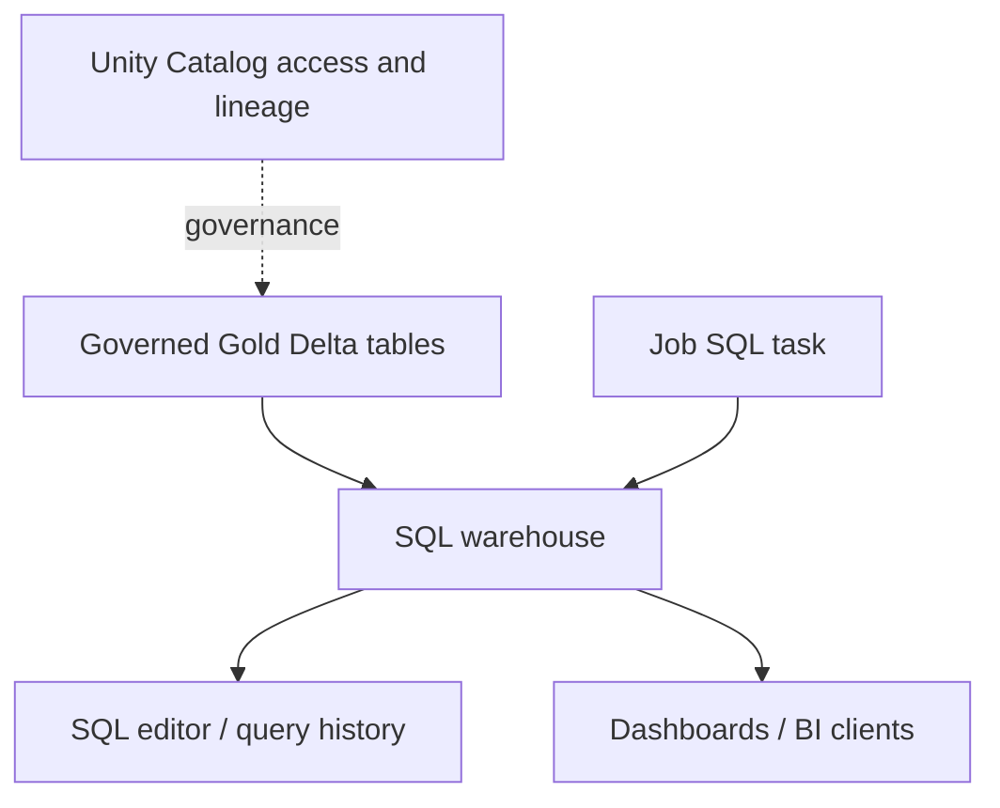

# 29 · Databricks SQL and the BigQuery bridge

<ChapterMeta>

[01 · Grain](/foundations/01-grain-keys-fanout), [25 · Compute](/platform/25-compute-mental-model), [28 · Governance](/platform/28-unity-catalog). [Lab 29](/labs/29-databricks-sql).

</ChapterMeta>

## Why this matters

Databricks SQL brings warehouse querying and BI serving to lakehouse tables through SQL warehouses. Gold consumers can use SQL interfaces and BI connections without operating a Spark notebook session.

## Scenario

Gold tables already exist. Analysts need interactive SQL, dashboard filters and low operations burden. Should each analyst start notebook compute? A ROAS dashboard aggregates three campaigns, then joins a dimension containing duplicate campaign keys.

## Learner reasoning

Separate serving compute from table storage and transformation ownership. Predict fan-out before evaluating latency. Define warehouse access, UC SELECT/traversal, dashboard audience and metric grain independently.

## Mental model

Databricks SQL is a cloud data warehouse on lakehouse architecture. SQL warehouses execute SQL workloads against governed tables; SQL editor, dashboards, BI clients and SQL job tasks are interfaces/consumers.



The warehouse is execution capacity, separate from the catalog namespace and persisted tables.

## Core concepts

| Surface | Purpose | Decision |
|---|---|---|
| SQL warehouse | SQL execution resource | Serverless where available, type/size/admission |
| Query editor | Author and run SQL | Catalog/schema and metric validation |
| ANSI SQL + extensions | Query/DDL semantics | Verify casts, dates, Delta-specific operations |
| Dashboards / BI | Serve metrics through governed query datasets | Audience, freshness and sharing model |
| SQL job task | Schedule SQL work on a warehouse | Outer DAG and retry/output ownership |
| Query history / profile | Inspect execution and workload behavior | Queue time, scan/plan and correctness |

## Example data

Local/Free Edition sample: a/A revenue1100 cost400; a/B revenue100 cost200; b/A revenue50 cost100, all USD cents on 2026-10-01. Aggregate ROAS is 1250/700, not the mean of campaign ratios. Dimension grain is source_system, app_id, campaign_id.

## How it works

Attach SQL queries to the existing accessible warehouse, select the intended catalog/schema and check both warehouse ACL and UC privileges. Run aggregation, filter, join and dashboard-oriented query in [Lab 29](/labs/29-databricks-sql).

Size controls per-query capacity; scaling/workload management handles demand and admission. A larger warehouse does not repair fan-out or missing data. Serverless uses managed workload/admission scaling; classic/pro warehouse controls differ. Inspect queue time, execution time, scans and query profile before changing size. Auto-stop limits idle usage, while ongoing workloads still consume resources.

Dashboard queries should expose a stable metric grain and freshness timestamp/cutoff, with currency separated. In production, investigate BI concurrency and query distribution with representative workloads; tiny fixtures measure neither platform throughput nor cost.

## Databricks implementation

Scope: current AWS Databricks documentation, verified 2026-10-11. [Free Edition setup](/setup/databricks-free-edition) phân loại LOCAL LAB, DATABRICKS FREE EDITION LAB và PAID/PRODUCTION-ONLY CONCEPT. Workspace execution: `PENDING USER WORKSPACE`. Governance/access basics trong setup phải hoàn tất trước cloud lab, dù Chapter 28 đọc sau Jobs/pipelines.

Free Edition documents one SQL warehouse limited to 2X-Small. Reuse it; do not create a second warehouse or increase size for this lab. Capture query outputs/history where available.

## Production failure

Duplicate dimension keys multiply Gold rows and inflate totals even though the query succeeds. Another failure gives warehouse permission without table privileges, causing UC denial. Cached or previously committed results can also hide a failed refresh unless freshness is explicit.

## Debugging

| Symptom | Investigation | Fix |
|---|---|---|
| Inflated ROAS | Row counts and join cardinality | Enforce dimension grain before join |
| Warehouse usable but query denied | UC traversal/SELECT and warehouse ACL | Correct intended access |
| Slow dashboard | Queue/execution split and query profile | Tune query/layout or capacity after measurement |
| Stale chart | Gold cutoff and last successful update | Surface freshness and reconcile |

## BigQuery / Airflow mapping

### BigQuery vs Databricks SQL

| Concern | BigQuery | Databricks SQL |
|---|---|---|
| Data location | Managed BigQuery storage; external/BigLake paths also exist | Lakehouse tables in governed storage, managed/external options |
| Compute abstraction | Managed execution using slots, on-demand or reservations | SQL warehouse, including serverless managed execution |
| SQL interface | GoogleSQL, APIs and BI integrations | ANSI SQL plus Databricks/Delta extensions, SQL editor/API/BI |
| Scaling | Managed slots and capacity controls | Managed serverless workload scaling or configured warehouse controls |
| Warehouse concept | No user-managed cluster for ordinary query submission; capacity reservations can isolate workloads | Named SQL execution resource with type/size/access controls |
| Lakehouse table access | External-table capabilities have format/location constraints | SQL serving shares governed lakehouse tables with engineering workloads |
| BI serving | BI clients query BigQuery | BI clients query SQL warehouse; Databricks dashboards available |
| Operations | Quotas, IAM, storage layout/query economics remain | UC/warehouse permissions, table layout, freshness and workload cost remain |

Both offer managed serverless execution. Databricks SQL adds a warehouse resource choice to the learner's operating model; this comparison does not reduce Databricks to Spark clusters. Airflow can coordinate a refresh and reconciliation without owning the serving warehouse.

## Code

Queries live in labs/platform/sql/serving.sql. Underlying SELECT logic runs in local Spark, while SQL warehouse execution/history remains pending.

```sql
SELECT event_date, currency,
       SUM(revenue_cents) AS revenue_cents, SUM(cost_cents) AS cost_cents,
       CASE WHEN SUM(cost_cents) = 0 THEN NULL
            ELSE CAST(SUM(revenue_cents) AS DOUBLE) / SUM(cost_cents) END AS roas
FROM gold_roas GROUP BY event_date, currency;
```

Zero-cost ROAS stays NULL. A business policy may label it undefined; do not silently coerce it to a successful zero ratio.

## Common mistakes

Using arithmetic mean of ratios; mixing currencies; selecting notebook compute just to serve BI SQL; assuming serverless requires no access/capacity decision; reporting tiny-sample query time as a performance benchmark.

## Production notes

The bounded ROAS fixture assumes every revenue grain has a known cost row; its Gold query is anchored on costs. For live data, validate this coverage or explicitly preserve revenue with unknown cost and a provisional status. Missing cost is different from measured zero cost; do not omit unmatched revenue and call the result complete.

Free Edition là learning environment. Một run thành công ở đó chưa chứng minh production scale, networking, enterprise administration, SLA, concurrency, production cost hoặc multi-workspace governance. Evidence phải ghi compute/environment và redact identifiers theo [evidence policy](/labs/platform-evidence).

## Interview checkpoint

1. How does warehouse access differ from data access?
2. Why does 1250/700 differ from the mean of the campaign ratios?
3. When would you keep BigQuery serving during a Databricks migration?
4. What measurements precede a warehouse resize?

## How to explain this in an interview

“Databricks SQL phục vụ warehouse workloads trên lakehouse tables bằng SQL warehouses, có serverless. Tôi tách compute serving khỏi UC data access và Gold correctness. Khi so với BigQuery tôi so data placement, capacity abstraction và operating model.”

## PASS criteria

PASS: execute/inspect four query types at the available evidence tier, prove grain and zero-cost behavior, explain warehouse and UC access. NOT YET: SQL syntax success is used as proof of dashboard correctness or tiny data as production performance evidence.

## Official references

Verified 2026-10-11:

- [Databricks SQL](https://docs.databricks.com/aws/en/sql/).
- [SQL warehouse interface](https://docs.databricks.com/aws/en/compute/sql-warehouse).
- [Sizing/scaling and queues](https://docs.databricks.com/aws/en/compute/sql-warehouse/warehouse-behavior).
- [BigQuery introduction](https://cloud.google.com/bigquery/docs/introduction).
- [BigQuery capacity controls](https://docs.cloud.google.com/bigquery/docs/admin-intro).

