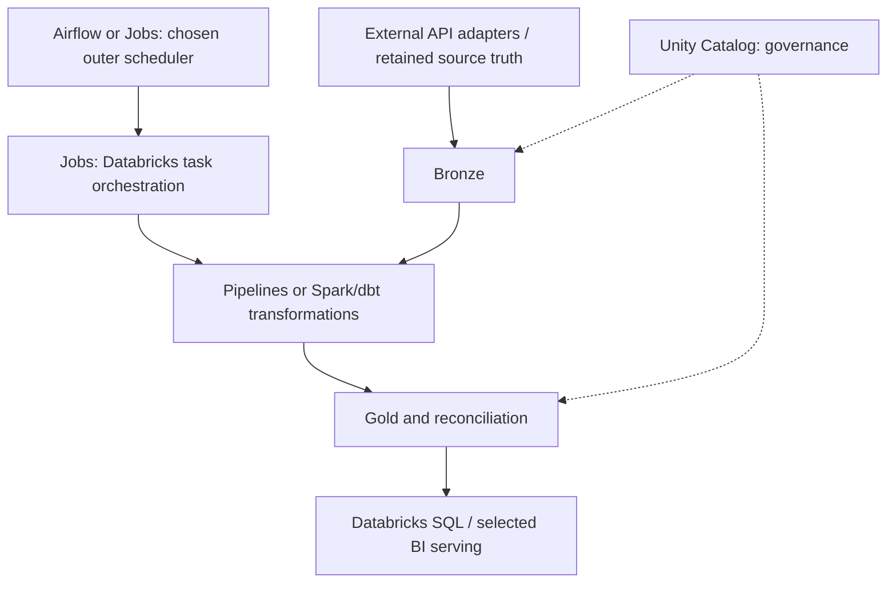

# 30 · Platform boundaries and hybrid architecture

<ChapterMeta>

[25 · Compute](/platform/25-compute-mental-model), [26 · Jobs](/platform/26-lakeflow-jobs), [27 · Pipelines](/platform/27-declarative-pipelines), [28 · Unity Catalog](/platform/28-unity-catalog), [29 · Databricks SQL](/platform/29-databricks-sql), both correctness gates. [Lab 30](/labs/30-platform-boundaries).

</ChapterMeta>

## Why this matters

An operable platform assigns one owner to each schedule, data contract and recovery boundary. The design succeeds when required freshness, correctness and governance are met, regardless of how many Databricks features it uses.

## Scenario

Company uses Meta API, Google Ads API, Airflow, GCS, Databricks, Salesforce and Looker. Callbacks need a 15-minute path, cost arrives hourly, attribution changes late, Finance needs lineage. Decide which responsibilities Databricks should own and which remain external.

## Learner reasoning

Map source ownership and API/network/auth constraints first. Then define retained truth, mutation/replay contracts, reporting grain and serving audience. Draw control dependencies separately from data movement and identify the team responding to each failure.

## Mental model

Each layer solves a different problem:



Compute underlies execution. Governance applies to assets and identities. The diagram's outer scheduler choice is an architectural decision, not permission to double-schedule the same workflow.

## Core concepts

| Layer | Owns | Does not establish by itself |
|---|---|---|
| Lakeflow Jobs | Workflow/task orchestration | Business idempotency, source truth |
| SDP / Lakeflow pipelines | Declarative data processing/dependencies | All external API orchestration or cross-table atomicity |
| Unity Catalog | Governance/catalog, lineage/audit/discovery | Physical source completeness or all external access |
| Databricks SQL | SQL warehouse/BI serving | Correct reporting grain and freshness |
| Compute | Execution resources/APIs | Workflow semantics or governance policy |
| External adapters/systems | API extraction and non-platform responsibilities | Databricks data grants or target reconciliation |

## Example data

Reuse the retained synthetic dataset to prove key/version semantics, but the architecture case adds real operational requirements: callback path15m, hourly cost, late arrivals and 72h mutations. Cost and revenue can have different freshness, so Gold should expose cutoffs/provisional status and reconciliation policy.

## How it works

### Architecture A: Databricks-centric

An external ingestion adapter owns API credentials, pagination and durable landing. Databricks Jobs owns internal cadence and coordinates input validation, pipeline update, Gold cost/revenue reconciliation and serving readiness. Pipelines manages the chosen Bronze/Silver/Gold processing graph. Unity Catalog owns object access/lineage; SQL warehouse serves Looker or Databricks dashboards.

The adapters can remain external even when transformation/orchestration is mostly Databricks. If ingestion runs inside a Databricks task, verify networking, libraries and API policies first. Free Edition restricted outbound access is not a production ingestion design.

### Architecture B: hybrid

Airflow coordinates API ingestion, retained GCS landing, Databricks Jobs submission, Salesforce work and downstream serving readiness. Databricks owns its internal task/pipeline graph and data assets. A provider/API call submits one bounded run with a stable business cutoff; outer retries inspect existing run state and target effects.

Keep dbt on the chosen SQL platform if existing tested models provide the required transformation semantics. A staged migration may preserve BigQuery/Looker serving until reconciliation and access checks pass. Name an owner for each control boundary and explicitly decide whether schemas/marts are mirrored.

### Trade-offs

| Concern | Databricks-centric | Hybrid |
|---|---|---|
| Simplicity | Fewer orchestration surfaces for internal workloads | Existing external coordination reused |
| Vendor coupling | More platform resource/config dependence | Multiple APIs/contracts to maintain |
| Operability | Native run/graph context for data team | Cross-service incidents require joined run/cutoff evidence |
| Skills | Databricks resources/UC plus ingestion adapters | Airflow/provider operations plus Databricks |
| Observability | Platform run data plus external ingestion evidence | Correlation IDs across scheduler/platform/services |
| Cost | Managed execution and serving usage | Scheduler operations plus platform/external usage |
| Portability | Spark/SQL may port; platform grants/config need adaptation | Outer DAG ports unevenly; providers and storage semantics differ |

Neither design automatically wins. Record which workload/organization facts would make you choose the other.

## Databricks implementation

Scope: current AWS Databricks documentation, verified 2026-10-11. [Free Edition setup](/setup/databricks-free-edition) phân loại LOCAL LAB, DATABRICKS FREE EDITION LAB và PAID/PRODUCTION-ONLY CONCEPT. Workspace execution: `PENDING USER WORKSPACE`. Governance/access basics trong setup phải hoàn tất trước cloud lab, dù Chapter 28 đọc sau Jobs/pipelines.

## Production failure

Airflow retries a submission after an uncertain acknowledgement while Jobs also retries a writer. Two runs publish the same scope and duplicate data. Prevent overlapping writers with target-specific ownership and business-idempotent publication; run_concurrency=1 in one job does not constrain another scheduler/job.

## Debugging

| Symptom | Correlate | Response |
|---|---|---|
| Duplicate logical run | Outer task, Jobs run, source cutoff and publish identity | Find scheduler overlap/uncertain submission; reconcile |
| Late correction missing | Bronze retention, event/update timestamps and repair window | Bounded historical repair from authoritative truth |
| Lineage stops at landing | Adapter manifests and platform lineage | Record external extraction edge/cutoff |
| BI fresh but cost stale | Separate revenue/cost watermarks | Expose provisional status or hold publication by policy |

## BigQuery / Airflow mapping

Airflow coordinates heterogeneous systems; BigQuery can remain a serving/transform target; dbt can remain a transformation framework. Databricks provides several composable platform layers. Map responsibilities rather than replacing product names one-for-one.

## Code

[Lab 30](/labs/30-platform-boundaries) requires two diagrams and a boundary table. [Mid Gate · Databricks Platform Design](/assessments/mid-gate-platform-design) evaluates the migration choices.

```text
Source contract + retention
  → chosen scheduler owner
  → task/pipeline processing with retry identity
  → reconciled Gold cutoff
  → governed SQL serving
```

## Common mistakes

Moving every API into the platform without networking/auth review; double scheduling; assuming governance fixes late data; using platform feature count as architecture quality; confusing local proof with workspace proof.

## Production notes

Free Edition là learning environment. Một run thành công ở đó chưa chứng minh production scale, networking, enterprise administration, SLA, concurrency, production cost hoặc multi-workspace governance. Evidence phải ghi compute/environment và redact identifiers theo [evidence policy](/labs/platform-evidence).

Production acceptance needs a representative load/failure plan, grant validation using real roles, source-retention proof and observable end-to-end cutoffs. Migration rollback requires a defined serving/source-of-truth boundary; dual writers need explicit coordination.

## Interview checkpoint

1. Which owner handles Meta pagination versus Gold reconciliation?
2. What evidence is needed after an uncertain Jobs submission?
3. How can a valid design keep Airflow and dbt?
4. What changes when the 15-minute SLA applies to finalized cost-adjusted ROAS rather than provisional revenue?

## How to explain this in an interview

“Tôi đặt Jobs ở workflow layer, pipelines ở data-processing layer, UC ở governance và SQL warehouse ở serving compute. Tôi chọn boundary theo nguồn, SLA và operating ownership; hybrid giữ Airflow khi cross-platform coordination cần nó. Migration phải bảo toàn replay và reconciliation contracts.”

## PASS criteria

PASS: defend both architectures, identify schedule/write/access owners and failure boundaries, then submit the platform gate. NOT YET: all products collapse into one service or feature count replaces causal reasoning.

## Official references

Verified 2026-10-11, current architecture/product sources:

- [AWS architecture](https://docs.databricks.com/aws/en/getting-started/high-level-architecture).
- [Lakeflow Jobs](https://docs.databricks.com/aws/en/jobs/).
- [Lakeflow pipelines and SDP](https://docs.databricks.com/aws/en/ldp/concepts/spark-declarative-pipelines).
- [Unity Catalog](https://docs.databricks.com/aws/en/data-governance/unity-catalog/).
- [Databricks SQL](https://docs.databricks.com/aws/en/sql/).
- [Airflow Databricks provider](https://airflow.apache.org/docs/apache-airflow-providers-databricks/stable/operators/run_now.html).

