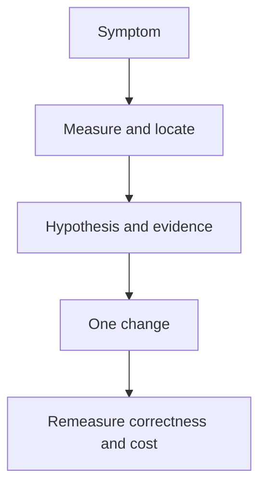

# 31 · Performance engineering mental model

<ChapterMeta>

Prerequisites: 03-08, 25-30. [Lab 31](/labs/31-performance-mental-model); [evidence and scope](/labs/production-evidence).

</ChapterMeta>

## Why this matters

Điều tra theo symptom → measure → locate bottleneck → hypothesis → evidence → change → measure again. Một thay đổi chỉ được giữ khi output đúng và metric mục tiêu cải thiện trong workload đại diện.

## Scenario

Pipeline từng chạy 8 phút, nay 35 phút. Jobs/Airflow báo SUCCESS, không có exception. Bạn cần xác định thời gian tăng ở queue, startup, scan, shuffle hay publication trước khi sửa cấu hình.

## Learner reasoning

So cùng source cutoff, query/code version, input volume, compute và concurrency. SUCCESS chỉ xác nhận run hoàn thành. Lập một giả thuyết có thể bác bỏ, chọn metric kiểm chứng rồi đổi một biến.

## Mental model



## Core concepts

| Layer | Evidence | Candidate change |
|---|---|---|
| Data layout | File count/size, stats, files scanned | Write pattern, compaction, clustering |
| Spark execution | Stages/tasks, shuffle, skew, spill | Join/aggregation strategy |
| Compute | Queue/startup, cores, memory, utilization | Capacity or workload isolation |
| Query design | Predicates, projection, fan-out, repeated scan | Narrow query and correct grain |
| Platform | Engine usage, maintenance history | Supported Photon/optimization |

## Example data

Hai runs có cùng 4 Silver identities và Gold revenue 1250 cents, cost 700 cents. Đối chiếu totals và row-level grain trước khi so performance. Một run đọc thêm 72 giờ attribution không tương đương run chỉ đọc hôm nay.

## How it works

Ghi baseline với scope, plan và stage metrics. Tách wall-clock thành queue, startup, execution và publication. Xếp hạng bottleneck theo critical path; tổng task time có thể lớn hơn wall time vì parallelism. Kiểm tra skew bằng max/median và bytes, không chỉ số partitions.

## Databricks implementation

Classic compute có Spark UI; SQL/serverless dùng query profile và run/query signals phù hợp. Cấu hình cache, repartition và autoscaling phải có hypothesis. Chưa có benchmark Databricks workspace.

Evidence tiers: PORTABLE, LOCAL SPARK, LOCAL DELTA, DATABRICKS WORKSPACE. Managed execution is `PENDING USER WORKSPACE`; see [production evidence](/labs/production-evidence).

## Production failure

Bật cache cho dataset chỉ dùng một lần tăng memory pressure mà không giảm repeated work. Repartition thêm Exchange khi downstream không cần phân phối mới.

## Debugging

| Symptom | First evidence | Decision |
|---|---|---|
| Duration increased | Same cutoff and queue/execution split | Locate changed layer |
| One slow task | Task bytes, key histogram, spill | Test skew hypothesis |
| Many scans | Plan and input bytes | Remove repeated wide work |

## BigQuery / Airflow mapping

BigQuery execution graph và slot/bytes metrics hỗ trợ cùng causal reasoning. Airflow duration có thể bao gồm waiting và retries; cần correlation với Databricks run và data cutoff.

## Code

[Lab 31](/labs/31-performance-mental-model) và [production evidence/run commands](/labs/production-evidence).

```powershell
python scripts/check_production_config.py
python scripts/test_production.py
```

## Common mistakes

Đổi nhiều knobs cùng lúc; coi tăng cores luôn giảm cost; lấy local elapsed time làm production speedup; bỏ correctness checks sau optimization.

## Production notes

Đặt performance budget theo freshness SLA và cost budget theo workload. Giảm duration có thể tăng DBU rate hoặc maintenance cost. Đo tổng usage, storage và operational effort, không chỉ seconds.

## Interview checkpoint

1. Với scenario trên, evidence nào phân biệt hai hypotheses?
2. Bật cache cho dataset chỉ dùng một lần tăng memory pressure mà không giảm repeated work. Repartition thêm Exchange khi downstream không cần phân phối mới. Invariant nào phải giữ?
3. Observation nào cần workspace và observation nào tái hiện local?

## How to explain this in an interview

Tôi bắt đầu bằng nơi thời gian tăng, đối chiếu input và compute, rồi dùng plan và stage metrics để kiểm tra giả thuyết. Tôi đổi một biến và xác nhận cả output lẫn performance.

Diễn giải bằng incident và evidence của bạn; không học thuộc câu trả lời.

## PASS criteria

PASS: hoàn thành Lab 31, nộp hypothesis/decision cùng evidence và bảo toàn scoped output. NOT YET: Đổi nhiều knobs cùng lúc; coi tăng cores luôn giảm cost; lấy local elapsed time làm production speedup; bỏ correctness checks sau optimization.

## Official references

Verified 2026-10-11. Current AWS Databricks pages; local runtime Spark4.0.4/Delta4.0.1. Version-specific managed capabilities are not local execution claims.

- [Spark performance tuning](https://spark.apache.org/docs/4.0.4/sql-performance-tuning.html).
- [profile](https://docs.databricks.com/aws/en/sql/user/queries/query-profile).
