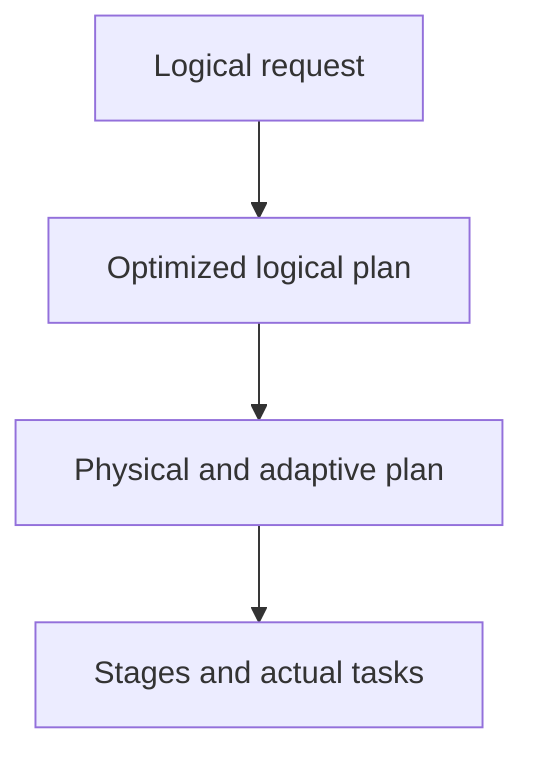

# 32 · Query plans and Spark UI reasoning

<ChapterMeta>

Prerequisites: 03-06, 31. [Lab 32](/labs/32-query-plans); [evidence and scope](/labs/production-evidence).

</ChapterMeta>

## Why this matters

Plan giải thích lựa chọn execution; task/stage metrics cho biết lựa chọn ấy thực sự tiêu tốn gì. Đọc data movement, join strategy và critical stage thay vì học thuộc operator names.

## Scenario

A filter/select, B groupBy, C shuffle join, D broadcast join, E hot-key aggregation. Dự đoán ví dụ nào cần movement trước khi mở actual plan.

## Learner reasoning

Theo scan → filter/project → join/aggregate → Exchange. Filter/select không tự yêu cầu shuffle. GroupBy cần đưa cùng key tới aggregation; broadcast chuyển build side tới executors thay vì shuffle cả hai phía theo join key.

## Mental model



## Core concepts

| Plan | Meaning | Evidence boundary |
|---|---|---|
| Logical | Requested relations/expressions | No execution metrics |
| Optimized logical | Catalyst rewrites | Predicate/projection choices |
| Physical | Selected operators/distribution | Exchange is movement boundary |
| Adaptive final | Runtime revised plan | Inspect after action |

## Example data

Local fixture 4000 rows, 20 campaign keys; dimension 20 rows. Broadcast threshold -1 makes shuffle join comparison explicit; D uses broadcast hint on the bounded dimension. This is a strategy experiment, not a large production join.

## How it works

Chạy action rồi capture extended explain. A physical plan không có Exchange, B/C có Exchange, D có BroadcastHashJoin. Run AQE riêng, đọc AdaptiveSparkPlan và final plan sau action. Link SQL execution IDs tới stages, rồi đọc per-task durations, shuffle bytes and spill.

## Databricks implementation

Spark UI classic: SQL/DataFrame graph → expensive stage → task distribution. Serverless/SQL warehouse: query profile. Exchange trong text không cho biết số bytes thực đọc; events cung cấp actual task metrics.

Evidence tiers: PORTABLE, LOCAL SPARK, LOCAL DELTA, DATABRICKS WORKSPACE. Managed execution is `PENDING USER WORKSPACE`; see [production evidence](/labs/production-evidence).

## Production failure

Chỉ nhìn initial AQE plan khiến bạn báo join/partition strategy đã thay đổi sau runtime. Một stage có median thấp nhưng max cao vẫn kéo dài critical path.

## Debugging

| Observation | Inspect | Next hypothesis |
|---|---|---|
| Exchange | Shuffle write/read bytes | Distribution work |
| Broadcast | Build-side size and memory | Small dimension fits |
| Straggler | Partition/key distribution | Skew or host behavior |

## BigQuery / Airflow mapping

BigQuery query execution stages tương tự để truy nguyên movement và skew; Spark partitions và broadcast thresholds có controls khác. Airflow chỉ thấy task boundary bên ngoài engine.

## Code

[Lab 32](/labs/32-query-plans) và [production evidence/run commands](/labs/production-evidence).

```powershell
python scripts/check_production_config.py
python scripts/test_production.py
```

## Common mistakes

Memorize operators; equate every Exchange with a bug; broadcast a dimension without size evidence; diagnose only from elapsed time.

## Production notes

Local AQE can revise partitions; actual dynamic choice depends on stats, settings and observed sizes. Zero spill in the tiny fixture proves only no observed spill in that run.

## Interview checkpoint

1. Với scenario trên, evidence nào phân biệt hai hypotheses?
2. Chỉ nhìn initial AQE plan khiến bạn báo join/partition strategy đã thay đổi sau runtime. Một stage có median thấp nhưng max cao vẫn kéo dài critical path. Invariant nào phải giữ?
3. Observation nào cần workspace và observation nào tái hiện local?

## How to explain this in an interview

Tôi tìm Exchange để hiểu data movement, kiểm tra build side của join và đọc stage/task distribution. Plan là hypothesis về execution; metrics xác nhận bottleneck.

Diễn giải bằng incident và evidence của bạn; không học thuộc câu trả lời.

## PASS criteria

PASS: hoàn thành Lab 32, nộp hypothesis/decision cùng evidence và bảo toàn scoped output. NOT YET: Memorize operators; equate every Exchange with a bug; broadcast a dimension without size evidence; diagnose only from elapsed time.

## Official references

Verified 2026-10-11. Current AWS Databricks pages; local runtime Spark4.0.4/Delta4.0.1. Version-specific managed capabilities are not local execution claims.

- [Spark performance tuning](https://spark.apache.org/docs/4.0.4/sql-performance-tuning.html).
- [profile](https://docs.databricks.com/aws/en/sql/user/queries/query-profile).
