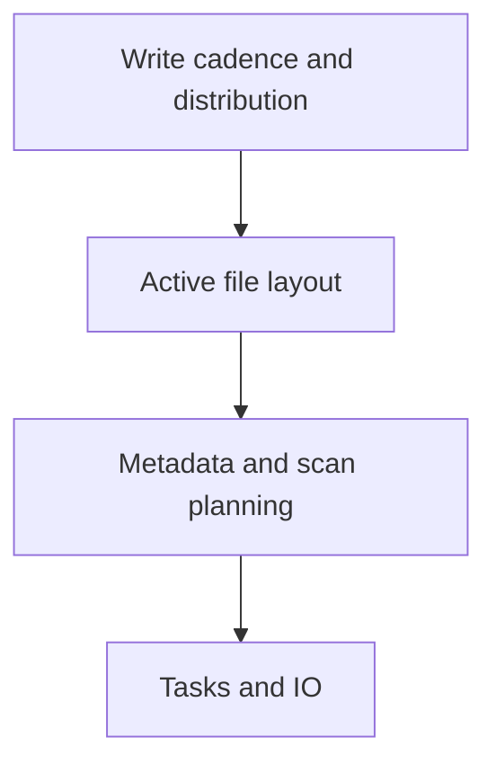

# 33 · File size and the small file problem

<ChapterMeta>

Prerequisites: 07-08, 31-32. [Lab 33](/labs/33-small-files); [evidence and scope](/labs/production-evidence).

</ChapterMeta>

## Why this matters

File count làm tăng metadata, open và scheduling work. Chọn write/compaction policy từ workload và observed layout; không có một ideal file size cho mọi table.

## Scenario

Delta table có 1,000,000 tiny files. Query chỉ đọc narrow date range. Metadata discovery và candidate file planning vẫn có thể tốn công ngay cả khi filter loại nhiều data.

## Learner reasoning

Tách active file count của snapshot khỏi số files còn nằm trên storage. Delta log chọn active files; file stats hỗ trợ skipping. Predicate hữu ích khi layout/statistics tạo được ranges có thể loại bỏ.

## Mental model



## Core concepts

| Concern | Measure | Trade-off |
|---|---|---|
| Metadata | Active files, log/planning | Compact vs maintenance cost |
| File opens | Candidate files and bytes | Open cost vs parallelism |
| Scheduling | Input partitions/tasks | Tiny work overhead |
| Write cadence | Files per batch | Latency vs fragmentation |

## Example data

4096 rows, event_day=id%8, same sum(id)=8386560. Local Delta writes 32 files versus 2 files; narrow event_day=1 selects 512 rows in both. File-size bytes are recorded, not prescribed as a target.

## How it works

Inspect add actions and stats in Delta commit, filesystem sizes, scan plans and planning input partitions. Input partitions can combine small files, so 32 files need not mean 32 read tasks. Both layouts must reconcile identical output.

## Databricks implementation

Compaction/OPTIMIZE and optimized writes are platform options with their own prerequisites. Predictive optimization may own maintenance for supported UC managed tables. Tiny local writes do not reproduce object-store million-file overhead.

Evidence tiers: PORTABLE, LOCAL SPARK, LOCAL DELTA, DATABRICKS WORKSPACE. Managed execution is `PENDING USER WORKSPACE`; see [production evidence](/labs/production-evidence).

## Production failure

Minute-level writes each create many partitions, producing fragments faster than maintenance can compact. Arbitrary repartition(1) then serializes a large production write.

## Debugging

| Symptom | Evidence | Candidate fix |
|---|---|---|
| Many tiny files | File distribution and write cadence | Bound output fragmentation |
| Long planning | Metadata/candidate file signals | Maintenance policy |
| Large scan | Predicates/stats/layout | Improve skipping |

## BigQuery / Airflow mapping

BigQuery hides physical file organization behind managed storage; exported GCS files and Spark ingest expose layout decisions. Airflow cadence can create small batches but does not control Spark file planning.

## Code

[Lab 33](/labs/33-small-files) và [production evidence/run commands](/labs/production-evidence).

```powershell
python scripts/check_production_config.py
python scripts/test_production.py
```

## Common mistakes

Universal 128MB/1GB rule; equate fewer files with proven speedup; conflate partition pruning and data skipping; compact without checking write/read cost.

## Production notes

Compare representative filters, concurrent writes, storage latency, maintenance DBUs and freshness. Large files can reduce parallelism or waste IO for weak skipping. Keep correctness invariants during rewrites.

## Interview checkpoint

1. Với scenario trên, evidence nào phân biệt hai hypotheses?
2. Minute-level writes each create many partitions, producing fragments faster than maintenance can compact. Arbitrary repartition(1) then serializes a large production write. Invariant nào phải giữ?
3. Observation nào cần workspace và observation nào tái hiện local?

## How to explain this in an interview

Tôi kiểm tra active files, size distribution và candidate scans. Tôi điều chỉnh write pattern hoặc maintenance dựa trên workload, rồi đo lại planning, IO và cost.

Diễn giải bằng incident và evidence của bạn; không học thuộc câu trả lời.

## PASS criteria

PASS: hoàn thành Lab 33, nộp hypothesis/decision cùng evidence và bảo toàn scoped output. NOT YET: Universal 128MB/1GB rule; equate fewer files with proven speedup; conflate partition pruning and data skipping; compact without checking write/read cost.

## Official references

Verified 2026-10-11. Current AWS Databricks pages; local runtime Spark4.0.4/Delta4.0.1. Version-specific managed capabilities are not local execution claims.

- [Spark performance tuning](https://spark.apache.org/docs/4.0.4/sql-performance-tuning.html).
- [Predictive optimization](https://docs.databricks.com/aws/en/optimizations/predictive-optimization).
