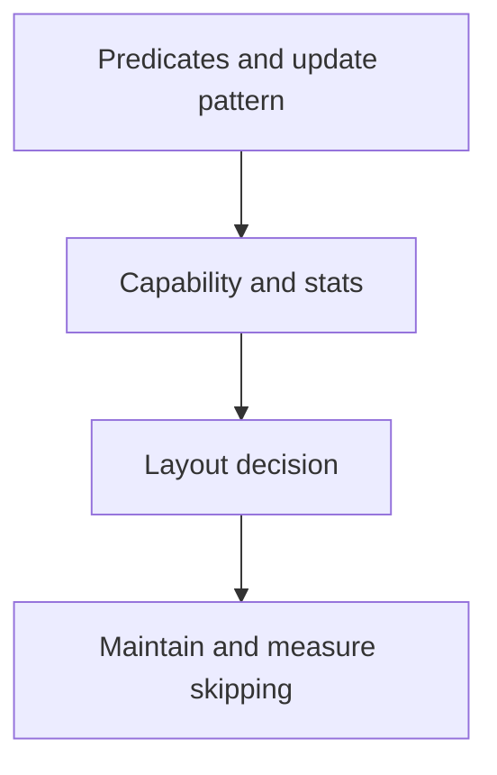

# 34 · Partitioning, liquid clustering and data skipping

<ChapterMeta>

Prerequisites: 04, 07-08, 33. [Lab 34](/labs/34-data-layout); [evidence and scope](/labs/production-evidence).

</ChapterMeta>

## Why this matters

Databricks hiện khuyến nghị liquid clustering trước custom partitioning cho supported tables. Quyết định layout vẫn phải xét predicates, size, cardinality, update pattern và capability; existing partitioned workloads cần bằng chứng migration.

## Scenario

Table partitioned by campaign có high cardinality, nhiều small directories; filters thay từ date sang app/campaign. Giữ rigid partitions hay chuyển flexible clustering?

## Learner reasoning

Traditional partitioning tạo physical boundaries và partition pruning. Data skipping dùng file statistics để loại candidate files. Liquid clustering tổ chức dữ liệu linh hoạt theo keys và incremental maintenance; cùng table không kết hợp partitioning hoặc ZORDER với liquid clustering.

## Mental model



## Core concepts

| Choice | Useful condition | Constraint |
|---|---|---|
| Existing date partitions | Bounded, simple date predicates | Measure before migration |
| CLUSTER BY (keys) | Supported table, known predicates | Maintain clustering |
| CLUSTER BY AUTO | UC managed Delta, DBR 15.4 LTS+ | Predictive optimization required |
| Data skipping | Useful stats and selective predicates | A broad predicate still scans much |

## Example data

Giả định campaign cardinality 500000, daily small batches, frequent app/campaign filters. Đây là design scenario. Local 32/2 file experiment proves stats/layout only, not liquid clustering or AUTO.

## How it works

Choose predicate columns as candidate keys; inspect statistics and files read. Run OPTIMIZE for clustering when self-managed. With predictive optimization, avoid duplicate scheduled maintenance. AUTO can choose no keys when benefits do not justify maintenance.

## Databricks implementation

SQL design: CREATE TABLE course_table (event_date DATE, app_id STRING, revenue_cents BIGINT) CLUSTER BY (event_date, app_id); supported AWS runtime required. AUTO variant uses CLUSTER BY AUTO. Predictive optimization: UC managed only, Premium+, supported region, SQL warehouse or DBR12.2LTS+; billed serverless jobs maintenance. Local engine execution pending.

Evidence tiers: PORTABLE, LOCAL SPARK, LOCAL DELTA, DATABRICKS WORKSPACE. Managed execution is `PENDING USER WORKSPACE`; see [production evidence](/labs/production-evidence).

## Production failure

Keep a ZORDER schedule after enabling liquid clustering, or assume ALTER keys instantly rewrites all old files. A wide predicate may gain little despite correct maintenance.

## Debugging

| Evidence | Diagnose | Decision |
|---|---|---|
| Many candidate files | Stats/predicate selectivity | Evaluate clustering |
| AUTO no keys | Workload/table size/history | Inspect selection reason |
| Cost rises | Maintenance plus query usage | Reevaluate net benefit |

## BigQuery / Airflow mapping

BigQuery partitioning/clustering concepts help predicate reasoning, but key selection, maintenance, billing and Delta feature compatibility differ. A valid bounded existing date table can remain partitioned after a measured decision.

## Code

[Lab 34](/labs/34-data-layout) và [production evidence/run commands](/labs/production-evidence).

```powershell
python scripts/check_production_config.py
python scripts/test_production.py
```

## Common mistakes

Partitioning obsolete everywhere; default ZORDER advice without current docs; promise AUTO always selects keys; equate compaction with skipping.

## Production notes

Verify supported Delta features/readers before enabling layout changes. Preview/newer capabilities such as partition conversion are version-specific; do not apply untested migration SQL. Retention for automatic VACUUM must preserve required repair/time-travel horizon.

## Interview checkpoint

1. Với scenario trên, evidence nào phân biệt hai hypotheses?
2. Keep a ZORDER schedule after enabling liquid clustering, or assume ALTER keys instantly rewrites all old files. A wide predicate may gain little despite correct maintenance. Invariant nào phải giữ?
3. Observation nào cần workspace và observation nào tái hiện local?

## How to explain this in an interview

Tôi chọn layout từ query predicates và write pattern. Liquid clustering giảm rigid boundaries trên supported workloads; tôi vẫn đo skipping và maintenance cost, và kiểm tra reader/runtime compatibility.

Diễn giải bằng incident và evidence của bạn; không học thuộc câu trả lời.

## PASS criteria

PASS: hoàn thành Lab 34, nộp hypothesis/decision cùng evidence và bảo toàn scoped output. NOT YET: Partitioning obsolete everywhere; default ZORDER advice without current docs; promise AUTO always selects keys; equate compaction with skipping.

## Official references

Verified 2026-10-11. Current AWS Databricks pages; local runtime Spark4.0.4/Delta4.0.1. Version-specific managed capabilities are not local execution claims.

- [Liquid clustering](https://docs.databricks.com/aws/en/tables/clustering).
- [Partitioning guidance](https://docs.databricks.com/aws/en/tables/partitions).
- [Predictive optimization](https://docs.databricks.com/aws/en/optimizations/predictive-optimization).
