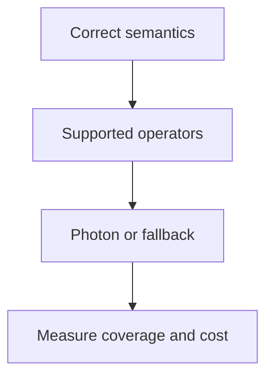

# 35 · Photon and engine optimization

<ChapterMeta>

Prerequisites: 25, 31-34. [Lab 35](/labs/35-photon); [evidence and scope](/labs/production-evidence).

</ChapterMeta>

## Why this matters

Photon là Databricks native vectorized execution engine cho supported SQL/DataFrame operations. Chọn engine sau khi xác nhận semantics và bottleneck; fast wrong output vẫn sai.

## Scenario

ROAS doubles after a dimension join. Team suggests enabling Photon because query also runs slowly. Which invariant must be fixed first?

## Learner reasoning

Join grain/fan-out tạo wrong rows trước engine acceleration. Photon xử lý columnar batches cho supported operators, có fallback cho unsupported portions. Nó không sửa business keys, pathological skew hay wrong SQL.

## Mental model



## Core concepts

| Layer | Photon effect | Still engineer-owned |
|---|---|---|
| Execution | Native/vectorized supported operations | Correct query semantics |
| Integration | Spark SQL/DataFrame API compatibility | Supported operation verification |
| Monitoring | Profile/UI shows engine participation | Representative cost/performance |

## Example data

Correct Gold revenue=1250, cost=700. Duplicated cost/dimension yields revenue=2500. Local reproduction shows semantic failure; the pinned Apache Spark container contains no Photon.

## How it works

Inspect engine coverage/fallback and task time. SQL warehouses/serverless enable Photon. Classic UI defaults differ from API creation: Clusters/Jobs API must explicitly set runtime_engine=PHOTON; classic pipeline API uses photon=true. Current documentation lists unsupported UDF/RDD/Dataset and stateful streaming portions.

## Databricks implementation

AWS official Photon scope verified 2026-10-11. Use query profile for SQL/serverless and Spark UI for classic supported compute. No engine speedup measured in this repository.

Evidence tiers: PORTABLE, LOCAL SPARK, LOCAL DELTA, DATABRICKS WORKSPACE. Managed execution is `PENDING USER WORKSPACE`; see [production evidence](/labs/production-evidence).

## Production failure

Vectorized execution quickly publishes a duplicated aggregate. A Python UDF can introduce fallback and repeated serialization, while adding compute cannot change the wrong grain.

## Debugging

| Symptom | Inspect | Response |
|---|---|---|
| Wrong totals | Join cardinality and keys | Fix correctness |
| Low Photon coverage | Unsupported operators/UDF | Evaluate supported expression |
| High cost | DBUs, duration, engine rate | Compare total workload cost |

## BigQuery / Airflow mapping

BigQuery also hides native execution behind SQL; product engine claims cannot substitute workload-specific measurement. Airflow configures workflow timing rather than the query engine.

## Code

[Lab 35](/labs/35-photon) và [production evidence/run commands](/labs/production-evidence).

```powershell
python scripts/check_production_config.py
python scripts/test_production.py
```

## Common mistakes

Enable Photon as full diagnosis; claim every streaming operation accelerated; quote vendor benchmarks as local evidence; ignore billing rates.

## Production notes

Compare queue/startup, execution and billed usage for identical input/output. A faster supported query can still cost more depending on resource rate and maintenance. Respect platform-specific capability limits.

## Interview checkpoint

1. Với scenario trên, evidence nào phân biệt hai hypotheses?
2. Vectorized execution quickly publishes a duplicated aggregate. A Python UDF can introduce fallback and repeated serialization, while adding compute cannot change the wrong grain. Invariant nào phải giữ?
3. Observation nào cần workspace và observation nào tái hiện local?

## How to explain this in an interview

Photon accelerates supported execution. Tôi vẫn kiểm tra grain, fan-out, skew và layout; sau đó đo coverage, elapsed time và total cost trên representative workload.

Diễn giải bằng incident và evidence của bạn; không học thuộc câu trả lời.

## PASS criteria

PASS: hoàn thành Lab 35, nộp hypothesis/decision cùng evidence và bảo toàn scoped output. NOT YET: Enable Photon as full diagnosis; claim every streaming operation accelerated; quote vendor benchmarks as local evidence; ignore billing rates.

## Official references

Verified 2026-10-11. Current AWS Databricks pages; local runtime Spark4.0.4/Delta4.0.1. Version-specific managed capabilities are not local execution claims.

- [Photon](https://docs.databricks.com/aws/en/compute/photon).
