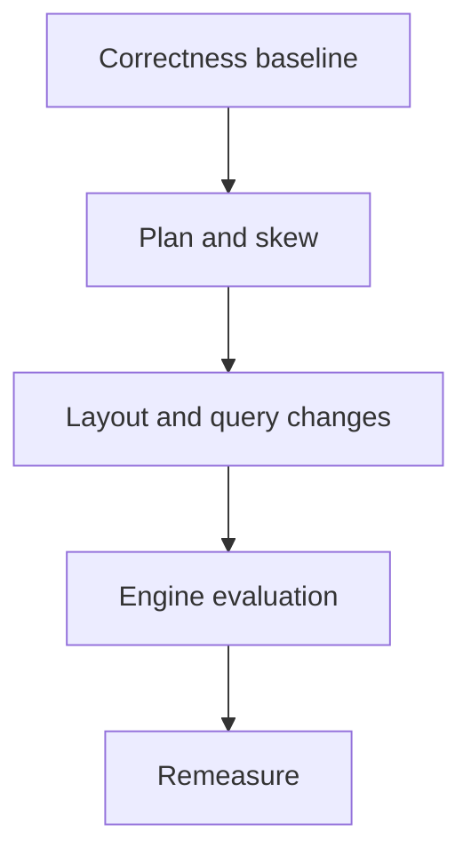

# 36 · ROAS performance case study

<ChapterMeta>

Prerequisites: 31-35, 01, 15. [Lab 36](/labs/36-performance-case-study); [evidence and scope](/labs/production-evidence).

</ChapterMeta>

## Why this matters

Ưu tiên fixes theo correctness và critical path. Case 40 phút cần một investigation sequence có evidence, output invariants và remeasurement plan.

## Scenario

Synthetic incident: 40-minute Gold run, 60GB shuffle, UNKNOWN campaign owns 82% rows, 180000 tiny active files, three wide scans, date filter selects 90% input. These are scenario facts, not measurements from the local fixture.

## Learner reasoning

Check join grain/revision/cutoff first. Then plan movement, skew distribution, file layout and selectivity. A date filter reading 90% naturally skips little; adding clustering alone cannot eliminate required rows.

## Mental model



## Core concepts

| Priority | Evidence | Acceptance |
|---|---|---|
| Correctness | Source/Gold reconciliation | Same scoped output |
| Query | Three scans, wide projection | Fewer required bytes/work |
| Skew | Hot key, task max/median | Balanced work preserving semantics |
| Layout | Tiny-file distribution | Maintenance benefit exceeds cost |
| Engine | Supported workload coverage | Measured net improvement |

## Example data

Local analogue uses 10000 rows, 9000 UNKNOWN, four hash partitions. A two-phase salted aggregation must preserve every campaign count and total10000. It demonstrates distribution/algebra, not the 40-minute incident.

## How it works

Push valid filters/projection early and preaggregate at the full reporting grain before joins. Broadcast only a proven small unique dimension. Split hot aggregation work where sum algebra supports it; joining salted data requires careful replication and semantics. Compare before/after plans and task distributions.

## Databricks implementation

Workspace plan/profile, layout metadata and maintenance/engine signals remain PENDING USER WORKSPACE. Cluster/Photon selection follows the measured workload and its compute constraints.

Evidence tiers: PORTABLE, LOCAL SPARK, LOCAL DELTA, DATABRICKS WORKSPACE. Managed execution is `PENDING USER WORKSPACE`; see [production evidence](/labs/production-evidence).

## Production failure

Drop UNKNOWN to balance partitions and lose legitimate unclassified revenue. Aggregate only by campaign_id across apps and silently merge distinct reporting grains.

## Debugging

| Evidence | Test hypothesis | Stop condition |
|---|---|---|
| One hot key | Partition/task bytes | Count/revenue mismatch |
| Three scans | Reuse/narrow work | Memory pressure or stale reuse |
| Tiny files | Write cadence/maintenance | Extra maintenance cost exceeds saving |

## BigQuery / Airflow mapping

BigQuery similarly needs hot-key/cardinality/query-stage reasoning. Airflow/Jobs decomposition can isolate repeated work, but extra tasks add operational boundaries.

## Code

[Lab 36](/labs/36-performance-case-study) và [production evidence/run commands](/labs/production-evidence).

```powershell
python scripts/check_production_config.py
python scripts/test_production.py
```

## Common mistakes

Photon-only answer; salt without proving aggregate algebra; cache every frame; remove UNKNOWN business data; benchmark different cutoffs.

## Production notes

Record proposed fixes separately from observed improvements. Keep old release and bounded repair contract while changing performance behavior. Use the unseen gate after completing the case.

## Interview checkpoint

1. Với scenario trên, evidence nào phân biệt hai hypotheses?
2. Drop UNKNOWN to balance partitions and lose legitimate unclassified revenue. Aggregate only by campaign_id across apps and silently merge distinct reporting grains. Invariant nào phải giữ?
3. Observation nào cần workspace và observation nào tái hiện local?

## How to explain this in an interview

Tôi xác nhận output trước, rồi xếp hạng scan, shuffle/skew và layout theo evidence. Tôi giữ UNKNOWN data và kiểm tra aggregate algebra khi phân tán hot work.

Diễn giải bằng incident và evidence của bạn; không học thuộc câu trả lời.

## PASS criteria

PASS: hoàn thành Lab 36, nộp hypothesis/decision cùng evidence và bảo toàn scoped output. NOT YET: Photon-only answer; salt without proving aggregate algebra; cache every frame; remove UNKNOWN business data; benchmark different cutoffs.

## Official references

Verified 2026-10-11. Current AWS Databricks pages; local runtime Spark4.0.4/Delta4.0.1. Version-specific managed capabilities are not local execution claims.

- [Spark performance tuning](https://spark.apache.org/docs/4.0.4/sql-performance-tuning.html).
- [profile](https://docs.databricks.com/aws/en/sql/user/queries/query-profile).
