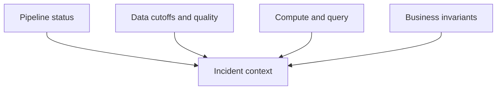

# 37 · Observability mental model

<ChapterMeta>

Prerequisites: 14-15, 26, 31. [Lab 37](/labs/37-observability-mental-model); [evidence and scope](/labs/production-evidence).

</ChapterMeta>

## Why this matters

Job health và data health là hai contracts riêng. Pipeline SUCCESS có thể phục vụ data stale hoặc sai; publication readiness phải có freshness, completeness và business reconciliation.

## Scenario

Run SUCCESS lúc12:00; revenue cutoff11:58, cost cutoff10:45. Dashboard hiển thị current ROAS dù cost trễ75 phút. Alert chỉ theo failure không phát hiện vấn đề.

## Learner reasoning

Correlate business cutoff, run/query IDs, release version and source delivery. Answer what happened, where, since when, affected scopes and what changed; avoid alerts without owners or actions.

## Mental model



## Core concepts

| Layer | Signals | Response owner |
|---|---|---|
| Pipeline | Status/duration/retries/failures | Workflow on-call |
| Data | Separate cutoffs, volume, quality/distribution | Data owner |
| Compute/query | Queue/execution, throughput, resource | Platform/workload owner |
| Business | Revenue/cost/ROAS, reconciliation | Data and Finance |

## Example data

Fixture freshness budget900 seconds. SUCCESS with a cost cutoff3600 seconds old must produce publish_ready=false. UTC timestamps and min(revenue_cutoff,cost_cutoff) protect the slower input contract.

## How it works

Separate observation time from event/source cutoff and completion time. Missing data can have normal job duration. Use per-source/per-app baselines and controlled thresholds; small cohorts and seasonality need different alert policies.

## Databricks implementation

Jobs run history plus data metrics and query/profile signals form incident context. Do not export raw system/event logs with sensitive user/query details; redact and retain access-controlled evidence.

Evidence tiers: PORTABLE, LOCAL SPARK, LOCAL DELTA, DATABRICKS WORKSPACE. Managed execution is `PENDING USER WORKSPACE`; see [production evidence](/labs/production-evidence).

## Production failure

A schema/volume alert passes because total row count is stable, while one app disappears and another duplicates. Scope-specific counts and sums reveal the offset.

## Debugging

| Symptom | Correlate | Action |
|---|---|---|
| SUCCESS but stale | Source vs pipeline lag | Hold/provisional publication |
| Wrong ROAS | Grain, source totals and release | Contain and reconcile |
| Alert flood | Scope/seasonality, owner policy | Tune with evidence |

## BigQuery / Airflow mapping

Airflow task state and BigQuery query history are control/compute observations. Add data cutoff/business signals across both systems; a green DAG is insufficient for data acceptance.

## Code

[Lab 37](/labs/37-observability-mental-model) và [production evidence/run commands](/labs/production-evidence).

```powershell
python scripts/check_production_config.py
python scripts/test_production.py
```

## Common mistakes

Treat execution status as freshness; one global threshold for all apps; alert without scope/owner/runbook; hide stale cost behind fresh revenue.

## Production notes

Freshness SLOs distinguish provisional and finalized metrics. Observe retry rates, backlog and business impact. Performance and cost budgets require independent measurements; no full FinOps stack is required.

## Interview checkpoint

1. Với scenario trên, evidence nào phân biệt hai hypotheses?
2. A schema/volume alert passes because total row count is stable, while one app disappears and another duplicates. Scope-specific counts and sums reveal the offset. Invariant nào phải giữ?
3. Observation nào cần workspace và observation nào tái hiện local?

## How to explain this in an interview

Tôi theo dõi pipeline, data, compute/query và business riêng. SUCCESS chưa cho biết nguồn đã đủ; serving gate dùng cutoffs và reconciliation có scope.

Diễn giải bằng incident và evidence của bạn; không học thuộc câu trả lời.

## PASS criteria

PASS: hoàn thành Lab 37, nộp hypothesis/decision cùng evidence và bảo toàn scoped output. NOT YET: Treat execution status as freshness; one global threshold for all apps; alert without scope/owner/runbook; hide stale cost behind fresh revenue.

## Official references

Verified 2026-10-11. Current AWS Databricks pages; local runtime Spark4.0.4/Delta4.0.1. Version-specific managed capabilities are not local execution claims.

- [jobs](https://docs.databricks.com/aws/en/jobs/).
- [System tables](https://docs.databricks.com/aws/en/admin/system-tables).
