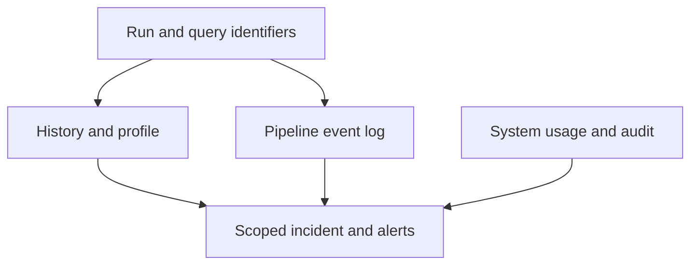

# 38 · Databricks observability signals

<ChapterMeta>

Prerequisites: 28-29, 37. [Lab 38](/labs/38-databricks-observability); [evidence and scope](/labs/production-evidence).

</ChapterMeta>

## Why this matters

Đối chiếu run history, pipeline event log, query history/profile và system tables theo cùng workload/cutoff. Availability và privileges phải được kiểm tra trước khi truy vấn.

## Scenario

Yesterday ROAS query5 phút, today25. Was query changed, input larger, warehouse queued/scaled, layout different, hot key introduced or upstream delayed? Durations are synthetic incident facts.

## Learner reasoning

Query history identifies statement/run timing and compute; profile locates operators/IO. Jobs history adds retries/startup; pipeline event log adds update/data-quality context. Billing describes usage, not a complete invoice by itself.

## Mental model



## Core concepts

| Signal | Investigates | Availability boundary |
|---|---|---|
| Jobs run history | Task duration/retries/failures | Access to job/runs |
| Lakeflow event log | Progress/quality/lineage/errors | Pipeline/log read privileges |
| SQL history/profile | Queue, operators, IO, engine | Supported compute and query access |
| system.lakeflow.job_run_timeline | Historical job usage | UC/system schema access |
| system.query.history | SQL/serverless statements | Supported source coverage |
| system.billing.usage | Billable usage/SKUs | Account/system access |
| system.access.audit | Security actions | Sensitive operational data |

## Example data

Use a synthetic incident sheet with old/new query hash, cutoff, bytes read, files scanned, queue/execution split, max/median task duration and release identifier. No live system rows are included.

## How it works

System catalog holds historical account operational datasets; table retention, regional/global scope and preview status differ. Lakeflow event_log table-valued function can query pipeline records in the documented publishing context. Alert freshness/reconciliation independently of run failures.

## Databricks implementation

AWS UC required for system tables; admin enablement, grants and region determine availability. Free Edition does not establish access to every system table. Work through run/query UI if permitted; mark unavailable sources explicitly.

Evidence tiers: PORTABLE, LOCAL SPARK, LOCAL DELTA, DATABRICKS WORKSPACE. Managed execution is `PENDING USER WORKSPACE`; see [production evidence](/labs/production-evidence).

## Production failure

Attribute all 25 minutes to SQL execution while20 are queue wait. Join billing tables naively to run timelines and multiply usage rows. Expose sensitive query/user text in published evidence.

## Debugging

| Observation | Signal | Diagnosis |
|---|---|---|
| Queue increased | History timing and concurrency | Capacity/workload contention |
| Bytes increased | Profile + input/layout | More data or less skipping |
| Cutoff stale | Upstream/run/quality | Source or processing delay |

## BigQuery / Airflow mapping

BigQuery INFORMATION_SCHEMA job data and Airflow task logs provide analogous control/usage evidence with different coverage. Cross-system correlation needs explicit identifiers and cutoffs.

## Code

[Lab 38](/labs/38-databricks-observability) và [production evidence/run commands](/labs/production-evidence).

Design-only queries in `labs/production/sql/observability.sql` separate total/execution/queue timing, inspect job timeline and aggregate billing quantity by SKU/unit. Verify available columns/grants and scope the approved workload before use. They have not queried a workspace.

```sql
SELECT statement_id, start_time, execution_status,
       total_duration_ms, execution_duration_ms, waiting_at_capacity_duration_ms
FROM system.query.history
WHERE start_time >= current_timestamp() - INTERVAL 1 DAY
ORDER BY start_time DESC LIMIT 20;
```

Databricks SQL alerts schedule a query and evaluate a condition, then notify the configured destination. A freshness/volume/reconciliation query should carry an owner and response. Current alerts own their query definition and use OK/TRIGGERED/ERROR states; legacy alerts have different behavior. No notification or alert was configured here.

```powershell
python scripts/check_production_config.py
python scripts/test_production.py
```

## Common mistakes

Assume all system tables in Free Edition; use DBU totals as exact cloud bill; claim event-log expectations observed from local predicate tests.

## Production notes

Reduce data exposure using aggregate scoped metrics and governed views. Cost improvement needs warehouse/job/maintenance usage, resource rate and duration. No system tables, alerts or query profiles were executed in a workspace here.

## Interview checkpoint

1. Với scenario trên, evidence nào phân biệt hai hypotheses?
2. Attribute all 25 minutes to SQL execution while20 are queue wait. Join billing tables naively to run timelines and multiply usage rows. Expose sensitive query/user text in published evidence. Invariant nào phải giữ?
3. Observation nào cần workspace và observation nào tái hiện local?

## How to explain this in an interview

Tôi nối run/query context với data cutoffs, dùng profile xác định phần execution đắt và system tables cho lịch sử/cost khi có quyền. Tôi ghi rõ coverage và latency của từng signal.

Diễn giải bằng incident và evidence của bạn; không học thuộc câu trả lời.

## PASS criteria

PASS: hoàn thành Lab 38, nộp hypothesis/decision cùng evidence và bảo toàn scoped output. NOT YET: Assume all system tables in Free Edition; use DBU totals as exact cloud bill; claim event-log expectations observed from local predicate tests.

## Official references

Verified 2026-10-11. Current AWS Databricks pages; local runtime Spark4.0.4/Delta4.0.1. Version-specific managed capabilities are not local execution claims.

- [System tables](https://docs.databricks.com/aws/en/admin/system-tables).
- [jobs](https://docs.databricks.com/aws/en/admin/system-tables/jobs).
- [query](https://docs.databricks.com/aws/en/admin/system-tables/query-history).
- [billing](https://docs.databricks.com/aws/en/admin/system-tables/billing).
- [history](https://docs.databricks.com/aws/en/sql/user/queries/query-history).
- [profile](https://docs.databricks.com/aws/en/sql/user/queries/query-profile).
- [Pipeline event log](https://docs.databricks.com/aws/en/ldp/monitor-event-logs).
- [Databricks SQL alerts](https://docs.databricks.com/aws/en/sql/user/alerts/).
