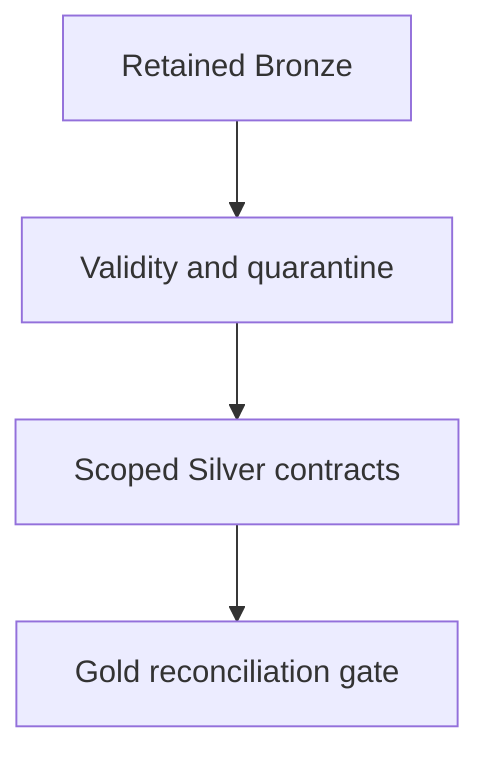

# 39 · Data quality and ROAS contracts

<ChapterMeta>

Prerequisites: 01, 11-15, 37. [Lab 39](/labs/39-data-quality); [evidence and scope](/labs/production-evidence).

</ChapterMeta>

## Why this matters

Quality rules phải có scope, business semantics và violation action. Test coverage của code chưa cho biết production input hôm nay còn đủ hoặc đúng.

## Scenario

Bronze parse rate99%, Silver event_id unique, Gold cost>=0. Team declares quality passed, but event_id collides across apps and a whole cost source is missing.

## Learner reasoning

Use scoped identity source_system/app_id/event_id, full reporting grain and separate source cutoffs. Negative completed revenue is invalid only under the stated non-refund contract; refunds require explicit signed transaction semantics.

## Mental model



## Core concepts

| Dimension | ROAS rule | Failure action |
|---|---|---|
| Freshness | Both inputs within budget | Hold/provisional |
| Completeness/volume | Expected source/scope cutoff and counts | Investigate source gap |
| Uniqueness | Scoped event and cost grain | Reject conflicting identities |
| Validity | Parse date, USD integer cents | Quarantine with reason |
| Consistency | Same currency/time/grain | Block mismatch |
| Referential integrity | Dimension/cost match | Retain unknown and expose gap |
| Distribution | UNKNOWN share or cohort shift | Warn/investigate |
| Business invariant | Source vs candidate totals | Block publication |

## Example data

Six deliveries become four Silver identities after retry/revision handling. Gold3 rows, revenue1250, cost700. Null ID, negative amount and invalid date add three quarantine rows; input accounting must remain9=6+3.

## How it works

Bronze records parse/retention evidence; Silver enforces identities/revisions; Gold proves join cardinality and monetary grain. Reconcile counts plus scoped amounts, and compare exact candidate keys where feasible. Equal totals alone can hide offsetting errors.

## Databricks implementation

Quality can be implemented as SQL/DataFrame checks or Lakeflow expectations. Rules across rows/tables, uniqueness and reconciliation need dataset-level logic beyond a per-record SQL constraint.

Evidence tiers: PORTABLE, LOCAL SPARK, LOCAL DELTA, DATABRICKS WORKSPACE. Managed execution is `PENDING USER WORKSPACE`; see [production evidence](/labs/production-evidence).

## Production failure

DROP invalid revenue makes input totals look lower rather than revealing loss. Unknown cost coerced to zero creates misleading ROAS; keep null/provisional or block publication by policy.

## Debugging

| Failure | Evidence | Response |
|---|---|---|
| Missing cost | Anti/full join unmatched keys | Block/provisional with owner |
| Duplicates | Key/revision payload groups | Retry dedup or conflict failure |
| Parse failures | Quarantine reasons and totals | Fix/replay retained raw |

## BigQuery / Airflow mapping

dbt/BigQuery uniqueness, relationships and freshness tests map to these contracts. Airflow retries do not implement uniqueness or source completeness.

## Code

[Lab 39](/labs/39-data-quality) và [production evidence/run commands](/labs/production-evidence).

```powershell
python scripts/check_production_config.py
python scripts/test_production.py
```

## Common mistakes

event_id globally unique assumption; nonnegative rule applied to legitimate refunds; total-only reconciliation; quality equated with unit-test percentage.

## Production notes

Quality metrics can contain sensitive payloads. Keep reason codes/counts and governed quarantine with retention/replay policy; define who resolves failures and how finalized reports are corrected.

## Interview checkpoint

1. Với scenario trên, evidence nào phân biệt hai hypotheses?
2. DROP invalid revenue makes input totals look lower rather than revealing loss. Unknown cost coerced to zero creates misleading ROAS; keep null/provisional or block publication by policy. Invariant nào phải giữ?
3. Observation nào cần workspace và observation nào tái hiện local?

## How to explain this in an interview

Tôi định nghĩa quality theo grain, keys, freshness và reconciliation. Tôi phân biệt invalid payload với legitimate late correction và giữ quarantine để sửa/replay có kiểm soát.

Diễn giải bằng incident và evidence của bạn; không học thuộc câu trả lời.

## PASS criteria

PASS: hoàn thành Lab 39, nộp hypothesis/decision cùng evidence và bảo toàn scoped output. NOT YET: event_id globally unique assumption; nonnegative rule applied to legitimate refunds; total-only reconciliation; quality equated with unit-test percentage.

## Official references

Verified 2026-10-11. Current AWS Databricks pages; local runtime Spark4.0.4/Delta4.0.1. Version-specific managed capabilities are not local execution claims.

- [expectations](https://docs.databricks.com/aws/en/ldp/expectations).
- [Expectation patterns](https://docs.databricks.com/aws/en/ldp/expectation-patterns).
