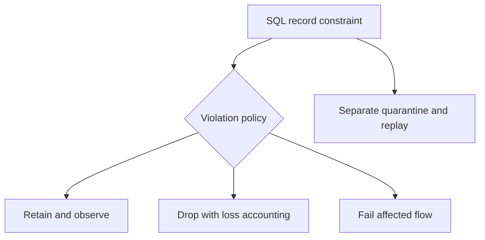

# 40 · Expectations and quality policy

<ChapterMeta>

Prerequisites: 27, 39. [Lab 40](/labs/40-expectations); [evidence and scope](/labs/production-evidence).

</ChapterMeta>

## Why this matters

Lakeflow expectations đánh giá SQL boolean constraints trên từng record. Chọn retain/warn, drop hoặc fail theo business loss/risk; quarantine cần graph và accounting riêng.

## Scenario

Input có null event_id, negative amount, duplicate event, UNKNOWN country và invalid timestamp. Chọn policy và giải thích vì sao không thể áp dụng một action cho mọi loại.

## Learner reasoning

UNKNOWN country có thể giữ tiền đúng và warn. Null critical identity có thể fail/hold; malformed input có thể quarantine. Duplicate retry khác conflicting same-revision mutation: uniqueness không phải chỉ một per-row expectation.

## Mental model



## Core concepts

| Policy | Python / SQL | Effect |
|---|---|---|
| Retain/warn | dp.expect / EXPECT | Invalid rows retained |
| Drop | dp.expect_or_drop / ON VIOLATION DROP ROW | Loss counted in metrics |
| Fail | dp.expect_or_fail / ON VIOLATION FAIL UPDATE | Flow/update failure |
| Quarantine | Separate filtered dataset | Preserve payload/reason/replay |

## Example data

Local mixed9 rows produce valid6/quarantine3. Separate expectation example checks identity, money and country; SQL predicate results are local observations, not managed expectation metrics.

## How it works

Decorator attaches named SQL expression to materialized_view/streaming table. Python example uses pyspark.pipelines as dp. Warn/drop expose tracking metrics; fail does not record those metrics because execution fails. Fail semantics depend on flow/update mode: triggered parallel flows can continue; continuous failure stops affected/dependent flows. Cross-table atomicity is not implied.

## Databricks implementation

Expectation file is a teaching example, not an unused resource in the release bundle. Optional workspace create a separate approved test pipeline/source config and capture update outcomes/event-log metrics; PENDING USER WORKSPACE.

Evidence tiers: PORTABLE, LOCAL SPARK, LOCAL DELTA, DATABRICKS WORKSPACE. Managed execution is `PENDING USER WORKSPACE`; see [production evidence](/labs/production-evidence).

## Production failure

DROP negative amounts silently discards a legitimate refund if contract allows refunds. Per-row event_id IS NOT NULL still lets duplicated identities through. A fail in one triggered flow is not proof all outputs stayed unchanged.

## Debugging

| Symptom | Inspect | Response |
|---|---|---|
| No fail metrics | Failure event/details | Do not assume no violations |
| Lost revenue | Dropped/quarantine count and sums | Hold and repair |
| Duplicate IDs | Dataset-level key contract | Dedup/reject by revision |

## BigQuery / Airflow mapping

dbt data tests usually evaluate datasets separately; expectations attach per-record policy to managed graph nodes. Airflow controls downstream barriers if validation and processing are separated into tasks/pipelines.

## Code

[Lab 40](/labs/40-expectations) và [production evidence/run commands](/labs/production-evidence).

```powershell
python scripts/check_production_config.py
python scripts/test_production.py
```

## Common mistakes

DROP always safest; fail rolls back every parallel table; local SQL tests prove expectation engine; universal policy without business semantics.

## Production notes

Quarantine must preserve access-controlled raw context and stable identity; reconcile accepted+dropped+quarantined counts without double-counting warn rows. Explicitly define repair and release gates.

## Interview checkpoint

1. Với scenario trên, evidence nào phân biệt hai hypotheses?
2. DROP negative amounts silently discards a legitimate refund if contract allows refunds. Per-row event_id IS NOT NULL still lets duplicated identities through. A fail in one triggered flow is not proof all outputs stayed unchanged. Invariant nào phải giữ?
3. Observation nào cần workspace và observation nào tái hiện local?

## How to explain this in an interview

Tôi chọn expectation policy theo business impact. Warn giữ record, drop tạo loss phải đo, fail chặn affected processing; quarantine giữ khả năng sửa và replay. Dataset-level reconciliation vẫn cần riêng.

Diễn giải bằng incident và evidence của bạn; không học thuộc câu trả lời.

## PASS criteria

PASS: hoàn thành Lab 40, nộp hypothesis/decision cùng evidence và bảo toàn scoped output. NOT YET: DROP always safest; fail rolls back every parallel table; local SQL tests prove expectation engine; universal policy without business semantics.

## Official references

Verified 2026-10-11. Current AWS Databricks pages; local runtime Spark4.0.4/Delta4.0.1. Version-specific managed capabilities are not local execution claims.

- [expectations](https://docs.databricks.com/aws/en/ldp/expectations).
- [Expectation patterns](https://docs.databricks.com/aws/en/ldp/expectation-patterns).
