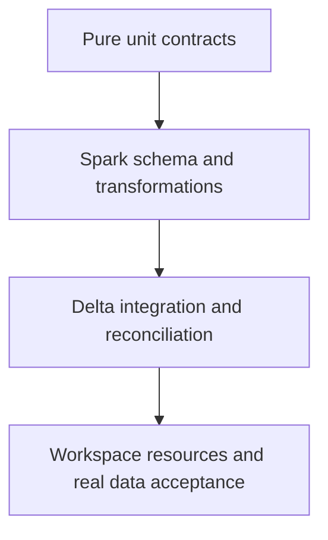

# 41 · Testing strategy and the ROAS test pyramid

<ChapterMeta>

Prerequisites: 39-40, 15. [Lab 41](/labs/41-testing-strategy); [evidence and scope](/labs/production-evidence).

</ChapterMeta>

## Why this matters

Code correctness, data correctness và platform configuration cần bằng chứng khác nhau. Dùng portable tests cho logic, actual Spark/Delta cho runtime semantics và workspace tests cho resources/access.

## Scenario

All unit tests pass; production job cannot read catalog and latest cost source is missing. Which test layers were absent?

## Learner reasoning

Small pure transformations make keys/revisions/refunds testable without credentials. Spark integration checks schema, null/cast/SQL behavior and IO; real data checks monitor today’s inputs. Mocks verify call contracts but cannot prove grants or runtime availability.

## Mental model



## Core concepts

| Test layer | Artifact | Proves / boundary |
|---|---|---|
| Unit | Pure model.py pytest | Transformation contract on fixtures |
| Spark/DataFrame | transforms.py expected rows/schema | Actual local Spark semantics |
| Contract/schema | Key/grain/type assertions | Fixture shape/invariants |
| Integration | Candidate and Delta serving | Local component boundaries |
| Data quality | Freshness/volume/reconciliation | Actual scoped input acceptance |
| End-to-end platform | CLI/resources/run/access | Workspace required |

## Example data

Fixture tests expect4 Silver identities and3 Gold grains with1250/700. Repeat raw deliveries leaves exact output unchanged. Duplicate costs and missing cost deliberately fail acceptance.

## How it works

Use pytest parametrization for null ID, negative amount and malformed date. DataFrame test compares canonical expected rows plus monetary types and grain; integration writes/reads Delta. Source hashes at startup link recorded evidence to executed implementations.

## Databricks implementation

Standard Python tests can run without workspace; Databricks notebook guidance supports pytest/mocking. Bundle course contracts and CLI schema checks are separate from strict workspace validation and Job execution.

Evidence tiers: PORTABLE, LOCAL SPARK, LOCAL DELTA, DATABRICKS WORKSPACE. Managed execution is `PENDING USER WORKSPACE`; see [production evidence](/labs/production-evidence).

## Production failure

Mocked Job API returns SUCCESS while notebook writes wrong catalog. A test asserting only row count misses duplicate dimension fan-out and incorrect sums.

## Debugging

| Failure | Test | Missing evidence |
|---|---|---|
| Same-revision conflict | Pure/Spark rejection | Actual source conflict frequency |
| Wrong grain | Uniqueness plus exact rows | Production schema evolution |
| Permission failure | Workspace negative access test | Local tests cannot prove grants |

## BigQuery / Airflow mapping

dbt tests are useful data contracts alongside Python unit/integration tests. Airflow DAG parsing/testing addresses orchestration config, not Spark transformation correctness.

## Code

[Lab 41](/labs/41-testing-strategy) và [production evidence/run commands](/labs/production-evidence).

```powershell
python scripts/check_production_config.py
python scripts/test_production.py
```

## Common mistakes

All fixtures pass means production safe; mocks prove service behavior; unit tests replace freshness; compare floats as money rather than integer/decimal cents.

## Production notes

Deterministic output/schema checks are preferable to tiny timing thresholds. E2E workspace tests need approved isolated namespaces and evidence redaction. Test the publication barrier and repair path, not just the happy path.

## Interview checkpoint

1. Với scenario trên, evidence nào phân biệt hai hypotheses?
2. Mocked Job API returns SUCCESS while notebook writes wrong catalog. A test asserting only row count misses duplicate dimension fan-out and incorrect sums. Invariant nào phải giữ?
3. Observation nào cần workspace và observation nào tái hiện local?

## How to explain this in an interview

Tôi tách pure unit, Spark/schema, integration, production-data và platform tests. Mỗi layer có failure cases riêng và tôi ghi rõ fixture/local proof không thay production acceptance.

Diễn giải bằng incident và evidence của bạn; không học thuộc câu trả lời.

## PASS criteria

PASS: hoàn thành Lab 41, nộp hypothesis/decision cùng evidence và bảo toàn scoped output. NOT YET: All fixtures pass means production safe; mocks prove service behavior; unit tests replace freshness; compare floats as money rather than integer/decimal cents.

## Official references

Verified 2026-10-11. Current AWS Databricks pages; local runtime Spark4.0.4/Delta4.0.1. Version-specific managed capabilities are not local execution claims.

- [PySpark testing](https://spark.apache.org/docs/4.0.4/api/python/getting_started/testing_pyspark.html).
- [Databricks Python testing](https://docs.databricks.com/aws/en/notebooks/testing).
- [pytest](https://docs.pytest.org/en/stable/how-to/usage.html).
