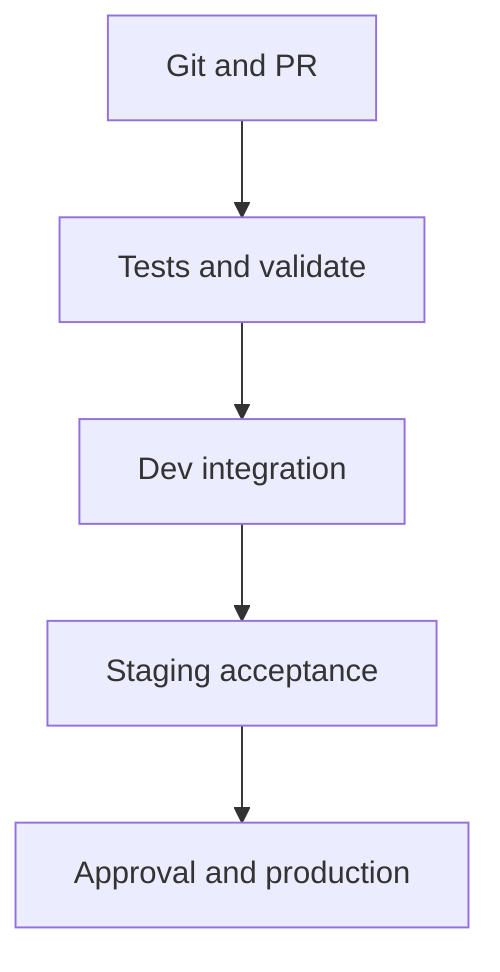

# 42 · CI/CD for data engineering

<ChapterMeta>

Prerequisites: 26, 28, 41. [Lab 42](/labs/42-ci-cd); [evidence and scope](/labs/production-evidence).

</ChapterMeta>

## Why this matters

Version source, resource config và environment policy cùng một release. Git review/tests phải đi trước deployment; data acceptance phải đi sau execution.

## Scenario

Engineer edits a production notebook manually. Yesterday’s code cannot be reconstructed; staging passes on a different schema while production overwrites Gold.

## Learner reasoning

Git → PR → tests → static/strict validate → deploy dev → integration → staging → approval → prod. Three environments are a worked example; smaller teams may choose two with documented isolation/risk.

## Mental model



## Core concepts

| Concern | Mechanism | Separate check |
|---|---|---|
| Source/artifact | Reviewed immutable commit | Exact tested commit deployed |
| Environment | Workspace/catalog/schema targets | Prevent shared writes |
| Identity | Deploy vs run service principal | Minimum resource/data permissions |
| Secrets | Workload identity/OIDC where supported | Federation trust and approval |
| Release | Serialized deploy and acceptance | Code and data repair plans |

## Example data

dev/staging/prod schema names are course_roas_dev_sandbox, course_roas_staging_sandbox and course_roas_prod_sandbox. These are synthetic sandbox environments, not real production catalogs.

## How it works

PR runs lint/compile, unit, local Spark/Delta, docs and static config. Trusted main commit runs approved workspace strict validation, plan review, deployment and integration. Promotion preserves commit and checks outputs/cutoffs. Production approval must be configured in GitHub environment settings.

## Databricks implementation

DABs are current recommended resource-as-code approach. Service principal runs are independent of deployer identity; user must provision approved scopes/groups and namespace permissions. No credentials or federation policy is configured here.

Evidence tiers: PORTABLE, LOCAL SPARK, LOCAL DELTA, DATABRICKS WORKSPACE. Managed execution is `PENDING USER WORKSPACE`; see [production evidence](/labs/production-evidence).

## Production failure

Environment name prod alone grants no approval gate. A broad OIDC subject or checkout of an unreviewed ref permits unintended release. Code passes while target grants point at the wrong catalog.

## Debugging

| Risk | Inspect | Control |
|---|---|---|
| Mixed environments | Resolved catalog/schema/root | Isolation contracts and grants |
| Concurrent release | Deployment lock and active runs | Serialize/stop by policy |
| Wrong data after deploy | Reconciliation and cutoffs | Hold serving and repair |

## BigQuery / Airflow mapping

Airflow/dbt CI follows the same review and environment pattern; DABs define Databricks resources rather than replacing every external deployment tool.

## Code

[Lab 42](/labs/42-ci-cd) và [production evidence/run commands](/labs/production-evidence).

```powershell
python scripts/check_production_config.py
python scripts/test_production.py
```

## Common mistakes

Manual notebook edit as preferred workflow; long-lived personal token forever; three environments mandatory everywhere; deploy success equals data correctness.

## Production notes

OIDC availability and exact trust subject need current provider/account checks. GitHub subject formats can contain immutable organization/repository IDs for newer repositories; inspect exact issuer/audience/sub rather than copying a string.

## Interview checkpoint

1. Với scenario trên, evidence nào phân biệt hai hypotheses?
2. Environment name prod alone grants no approval gate. A broad OIDC subject or checkout of an unreviewed ref permits unintended release. Code passes while target grants point at the wrong catalog. Invariant nào phải giữ?
3. Observation nào cần workspace và observation nào tái hiện local?

## How to explain this in an interview

Tôi version code và Databricks resources cùng release, kiểm tra từng target và dùng short-lived workload identity khi hỗ trợ. Approval và reconciliation là release gates riêng.

Diễn giải bằng incident và evidence của bạn; không học thuộc câu trả lời.

## PASS criteria

PASS: hoàn thành Lab 42, nộp hypothesis/decision cùng evidence và bảo toàn scoped output. NOT YET: Manual notebook edit as preferred workflow; long-lived personal token forever; three environments mandatory everywhere; deploy success equals data correctness.

## Official references

Verified 2026-10-11. Current AWS Databricks pages; local runtime Spark4.0.4/Delta4.0.1. Version-specific managed capabilities are not local execution claims.

- [Databricks CI/CD](https://docs.databricks.com/aws/en/dev-tools/ci-cd).
- [flows](https://docs.databricks.com/aws/en/dev-tools/ci-cd/flows).
- [GitHub OIDC federation](https://docs.databricks.com/aws/en/dev-tools/auth/provider-github).
- [githubEnvironments](https://docs.github.com/en/actions/how-tos/deploy/configure-and-manage-deployments/manage-environments).
