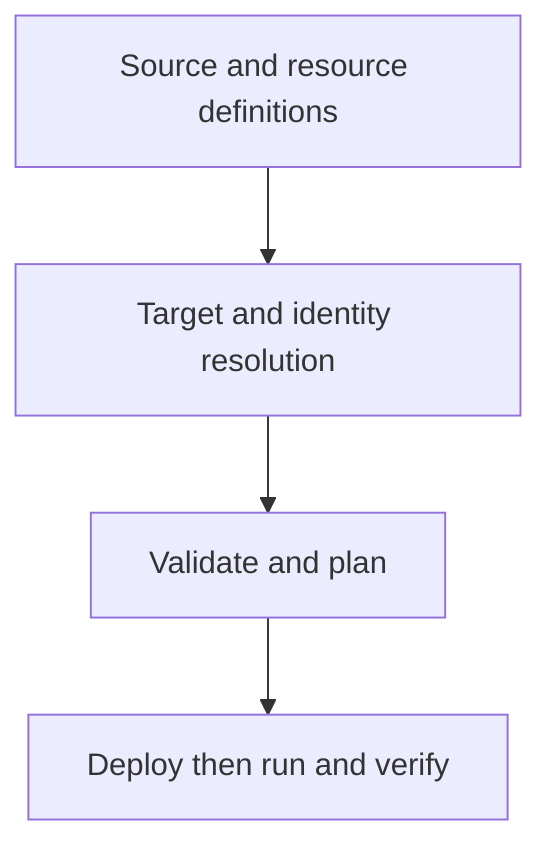

# 43 · Declarative Automation Bundles

<ChapterMeta>

Prerequisites: 26, 28, 41-42. [Lab 43](/labs/43-declarative-automation-bundles); [evidence and scope](/labs/production-evidence).

</ChapterMeta>

## Why this matters

Declarative Automation Bundles (formerly Databricks Asset Bundles) gắn source, Databricks resource definitions và deployment targets thành deployable project. Root configuration là databricks.yml.

## Scenario

Same ROAS code must run in three isolated targets with target-specific workspace, catalog/schema, identity and permissions. A config folder alone has no deployed Job.

## Learner reasoning

Repository + source + resource definitions + targets = deployable project. resources/src/tests are useful course organization, not universally required directory names. Resource paths resolve relative to the config file that declares them.

## Mental model



## Core concepts

| Element | Course example | Role |
|---|---|---|
| databricks.yml | Bundle, include, variables, targets | Root definition |
| resources/roas.job.yml | One sandbox Job | Only needed resource |
| src/ | Notebook, transformations, fixture | Source synced with bundle |
| tests/ | Portable contract pytest | Release verification |

## Example data

One task validates raw/cost, stages Silver/Gold, reconciles and publishes one owned snapshot. No pipeline resource is included because Jobs owns this batch example. Expectation teaching file is not an active pipeline library.

## How it works

Lifecycle: init → develop → validate → plan → deploy → run → destroy only when appropriate. CLI1.20.0 verified current release; bundle plan exists. Direct engine became default for new bundles1.3+, and1.20 removes Terraform engine. Capture schema/help from pinned CLI before migration, inspect plan for deletes and state identity.

## Databricks implementation

dev mode has development defaults; staging/prod use production mode. Modes are development/production only: staging is a target name. root_path contributes deployment identity, separate from output catalog/schema. Required host/catalog/run_identity/operator_group values have no defaults and must be supplied outside Git.

Evidence tiers: PORTABLE, LOCAL SPARK, LOCAL DELTA, DATABRICKS WORKSPACE. Managed execution is `PENDING USER WORKSPACE`; see [production evidence](/labs/production-evidence).

## Production failure

Same root/name/target/deployer identity across projects can collide. Different targets writing the same schema still contaminate data. Renaming/removing managed resources can delete/recreate resources rather than perform a harmless code update.

## Debugging

| Failure | Inspect | Response |
|---|---|---|
| Relative path wrong | Declaring resource location | Fix path and validate |
| Variable missing | Target resolution | Supply approved value |
| Unexpected deletion | Plan/state/previous config | Stop and review migration |

## BigQuery / Airflow mapping

DAB targets resemble environment-specific deployment config for Airflow/dbt. Bundle deployment manages Databricks resources; upstream cloud infrastructure/API credentials remain separate.

## Code

[Lab 43](/labs/43-declarative-automation-bundles) và [production evidence/run commands](/labs/production-evidence).

```powershell
python scripts/check_production_config.py
python scripts/test_production.py
```

## Common mistakes

Old primary product name; invented required folder layout; target name automatically grants isolation; destroy used as rollback; skip strict validation before deploy.

## Production notes

Portable checks here validate course contracts; CLI schema checks cover syntax fields; workspace strict validate/deploy/run prove different boundaries. Dev development mode disables deploy lock by default, so the example explicitly enables it. Sandbox fixture must be replaced by a reviewed retained-source connector before a real release.

## Interview checkpoint

1. Với scenario trên, evidence nào phân biệt hai hypotheses?
2. Same root/name/target/deployer identity across projects can collide. Different targets writing the same schema still contaminate data. Renaming/removing managed resources can delete/recreate resources rather than perform a harmless code update. Invariant nào phải giữ?
3. Observation nào cần workspace và observation nào tái hiện local?

## How to explain this in an interview

Tôi dùng DABs để version resource config và business logic cùng target-specific identities/namespaces. Tôi kiểm tra resolved config và plan trước deploy, rồi xác nhận run và data invariants.

Diễn giải bằng incident và evidence của bạn; không học thuộc câu trả lời.

## PASS criteria

PASS: hoàn thành Lab 43, nộp hypothesis/decision cùng evidence và bảo toàn scoped output. NOT YET: Old primary product name; invented required folder layout; target name automatically grants isolation; destroy used as rollback; skip strict validation before deploy.

## Official references

Verified 2026-10-11. Current AWS Databricks pages; local runtime Spark4.0.4/Delta4.0.1. Version-specific managed capabilities are not local execution claims.

- [bundles](https://docs.databricks.com/aws/en/dev-tools/bundles/).
- [settings](https://docs.databricks.com/aws/en/dev-tools/bundles/settings).
- [Bundle deployment modes](https://docs.databricks.com/aws/en/dev-tools/bundles/deployment-modes).
- [Bundle run identities](https://docs.databricks.com/aws/en/dev-tools/bundles/run-as).
- [Bundle CLI commands](https://docs.databricks.com/aws/en/dev-tools/cli/bundle-commands).
- [Direct deployment engine](https://docs.databricks.com/aws/en/dev-tools/bundles/direct).
