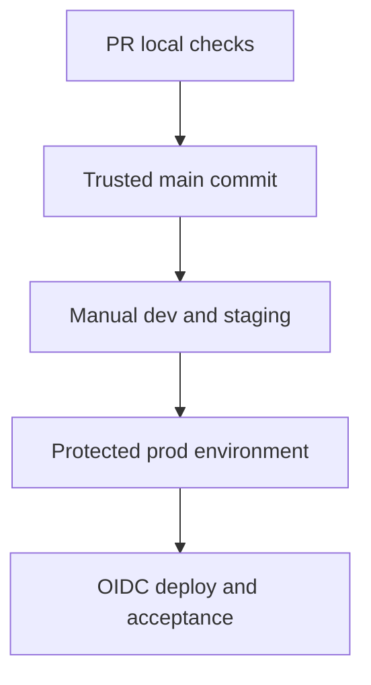

# 44 · GitHub Actions and safe release flow

<ChapterMeta>

Prerequisites: 41-43. [Lab 44](/labs/44-github-actions); [evidence and scope](/labs/production-evidence).

</ChapterMeta>

## Why this matters

PR checks run without Databricks credentials. Cloud release is a manual trusted-main workflow with sequential dev/staging/prod jobs and environment-scoped OIDC permissions.

## Scenario

A pull request from a fork changes the notebook and asks CI to deploy prod. The PR needs local checks; it must not receive a deployment identity.

## Learner reasoning

Existing Pages workflow keeps PR verification separate from publish. New roas-release workflow_dispatch uses no automatic push/PR cloud deployment. It runs portable and local Spark/Delta checks, then dev and staging; optional prod needs successful staging and protected prod environment.

## Mental model



## Core concepts

| Job | Permissions | Boundary |
|---|---|---|
| PR/portable | contents read | No Databricks auth |
| Dev/staging | contents read, id-token write | Scoped environment trust |
| Prod | Same narrow OIDC permission | Main, opt-in and required reviewer |
| All deploy jobs | Serialized workflow | Preserve tested commit |

## Example data

Action refs are pinned to verified commits; CLI version1.20.0. Environment variables supply host/client ID, catalog, run identity and observer group outside Git. None is a long-lived personal token.

## How it works

Validate required variables, bundle validate --strict, plan to JSON, deploy approved plan with --fail-on-active-runs, then run roas. Workflow version/source is shared by needs chain. GitHub environment reviewers/branch restrictions and exact federation issuer/audience/sub must be configured administratively before enablement.

## Databricks implementation

DATABRICKS_AUTH_TYPE=github-oidc uses provider token exchange with a service principal. id-token:write enables token issuance, not access by itself. No GitHub Actions or federation policy was executed/configured in this repository.

Evidence tiers: PORTABLE, LOCAL SPARK, LOCAL DELTA, DATABRICKS WORKSPACE. Managed execution is `PENDING USER WORKSPACE`; see [production evidence](/labs/production-evidence).

## Production failure

environment:prod without required reviewers deploys immediately. Unrestricted federation subject lets a different branch/environment impersonate the release identity. --force-lock defeats concurrency protection.

## Debugging

| Failure | Evidence | Response |
|---|---|---|
| OIDC denied | Exact issuer/audience/sub and policy | Correct bounded trust |
| Active run | Deployment fails before changes | Wait/contain by runbook |
| Integration fails | Run output and cutoffs | Stop promotion |

## BigQuery / Airflow mapping

Airflow/dbt CI can keep external orchestration; GitHub is the control plane for reviewed artifact promotion. The release example deploys only course sandbox resources.

## Code

[Lab 44](/labs/44-github-actions) và [production evidence/run commands](/labs/production-evidence).

```powershell
python scripts/check_production_config.py
python scripts/test_production.py
```

## Common mistakes

Long-lived token in config; pull_request_target executes fork code with privileges; believe YAML proves protection settings; mutable action refs or latest CLI without review.

## Production notes

Current GitHub OIDC sub format varies by repository creation/rename/transfer or opt-in; use observed exact trust claims. Persist/redact deployment plans, resolved config and outputs in private release evidence. Example plan file is not a portable artifact across identities/targets.

## Interview checkpoint

1. Với scenario trên, evidence nào phân biệt hai hypotheses?
2. environment:prod without required reviewers deploys immediately. Unrestricted federation subject lets a different branch/environment impersonate the release identity. --force-lock defeats concurrency protection. Invariant nào phải giữ?
3. Observation nào cần workspace và observation nào tái hiện local?

## How to explain this in an interview

Tôi cấp OIDC chỉ cho trusted deploy job và khóa trust theo repository/environment. Test gates, branch restriction và required reviewers bảo vệ promotion; YAML vẫn cần real settings acceptance.

Diễn giải bằng incident và evidence của bạn; không học thuộc câu trả lời.

## PASS criteria

PASS: hoàn thành Lab 44, nộp hypothesis/decision cùng evidence và bảo toàn scoped output. NOT YET: Long-lived token in config; pull_request_target executes fork code with privileges; believe YAML proves protection settings; mutable action refs or latest CLI without review.

## Official references

Verified 2026-10-11. Current AWS Databricks pages; local runtime Spark4.0.4/Delta4.0.1. Version-specific managed capabilities are not local execution claims.

- [GitHub OIDC federation](https://docs.databricks.com/aws/en/dev-tools/auth/provider-github).
- [github](https://docs.databricks.com/aws/en/dev-tools/ci-cd/github).
- [githubEnvironments](https://docs.github.com/en/actions/how-tos/deploy/configure-and-manage-deployments/manage-environments).
