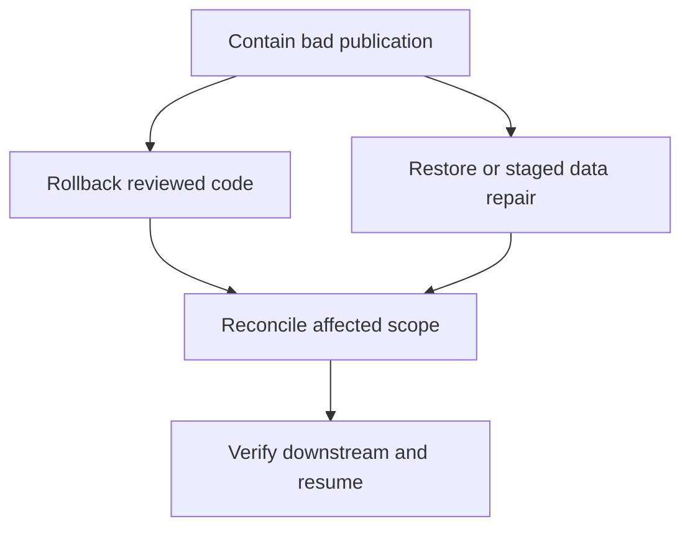

# 45 · Release safety, code rollback and data repair

<ChapterMeta>

Prerequisites: 08, 15, 24, 42-44. [Lab 45](/labs/45-release-rollback); [evidence and scope](/labs/production-evidence).

</ChapterMeta>

## Why this matters

Code rollback và data rollback là hai operations riêng. Redeploy good code không tự sửa committed wrong Gold; phục hồi cần containment, retained truth và reconciliation.

## Scenario

Deployment passes. Gold revenue doubles1250→2500. BI consumes it, downstream stream sees a new version. What can be stopped, repaired and republished safely?

## Learner reasoning

Hold bad downstream publication first; identify affected cutoffs/keys/releases. Restore a known code version for future writes, then choose Delta RESTORE, staged backfill or retained-source replay for data. Reconcile exact state and dependent reports before unblocking.

## Mental model



## Core concepts

| Boundary | Recovery | Limitation |
|---|---|---|
| Code/config | Redeploy reviewed release to same target/state | Old bad data remains |
| Delta table | RESTORE retained version | New commit, files/logs must exist |
| Multiple tables | Coordinated repair/publication | No general cross-table atomicity |
| Downstream | Recompute/reconcile and announce cutoff | Restore can be observed as new changes |

## Example data

Local Delta version0 has revenue1250, bad version1 has2500. Switching selected code leaves2500. restoreToVersion(0) creates version2 with1250; fixture files were retained and no VACUUM ran.

## How it works

Record code/config version, target/root identity and table versions before release. Inspect plan and compatibility before redeploy. Data repair stages candidate output; mismatch/failure must preserve serving. RESTORE creates a data-changing commit and can cause downstream processing to reobserve data; sink idempotency/rebuild policy remains required.

## Databricks implementation

History/time travel require both transaction history and referenced files. Databricks defaults include30-day log retention and7-day deleted-file retention; history is not a backup and7-day time travel should be assumed unless both retention settings were deliberately extended. Predictive VACUUM participates in that policy.

Evidence tiers: PORTABLE, LOCAL SPARK, LOCAL DELTA, DATABRICKS WORKSPACE. Managed execution is `PENDING USER WORKSPACE`; see [production evidence](/labs/production-evidence).

## Production failure

Rollback notebook and restart downstream append stream, which processes restored data again and duplicates results. Attempt RESTORE after required files were vacuumed; use retained-source repair instead.

## Debugging

| Symptom | Evidence | Recovery |
|---|---|---|
| Bad Gold commit | Exact affected version/scope | Hold serving, repair/reconcile |
| Missing old files | Retention/VACUUM history | Authoritative replay |
| Downstream duplicates | Restore commit + sink effects | Idempotent replay/rebuild |

## BigQuery / Airflow mapping

BigQuery time travel/snapshot semantics and Airflow backfill differ, but versioned code and repaired data still require separate acceptance. Scheduler rerun must preserve business replay identity.

## Code

[Lab 45](/labs/45-release-rollback) và [production evidence/run commands](/labs/production-evidence).

```powershell
python scripts/check_production_config.py
python scripts/test_production.py
```

## Common mistakes

bundle destroy as rollback; code redeploy repairs data; RESTORE is free of downstream effects; table history is indefinite backup.

## Production notes

Single-task sandbox publication demonstrates one table boundary and max_concurrent_runs1 protects only that Job. Real release requires writer coordination, source manifests, exact scoped reconciliation, access tests, retention and downstream recovery acceptance.

## Interview checkpoint

1. Với scenario trên, evidence nào phân biệt hai hypotheses?
2. Rollback notebook and restart downstream append stream, which processes restored data again and duplicates results. Attempt RESTORE after required files were vacuumed; use retained-source repair instead. Invariant nào phải giữ?
3. Observation nào cần workspace và observation nào tái hiện local?

## How to explain this in an interview

Tôi stop bad publication, rollback code cho future runs và sửa data theo retained truth/version khả dụng. Tôi reconcile affected scope và downstream before resume; code rollback không sửa committed data.

Diễn giải bằng incident và evidence của bạn; không học thuộc câu trả lời.

## PASS criteria

PASS: hoàn thành Lab 45, nộp hypothesis/decision cùng evidence và bảo toàn scoped output. NOT YET: bundle destroy as rollback; code redeploy repairs data; RESTORE is free of downstream effects; table history is indefinite backup.

## Official references

Verified 2026-10-11. Current AWS Databricks pages; local runtime Spark4.0.4/Delta4.0.1. Version-specific managed capabilities are not local execution claims.

- [Delta table history](https://docs.databricks.com/aws/en/tables/history).
- [restore](https://docs.databricks.com/aws/en/sql/language-manual/delta-restore).
- [Bundle CLI commands](https://docs.databricks.com/aws/en/dev-tools/cli/bundle-commands).
