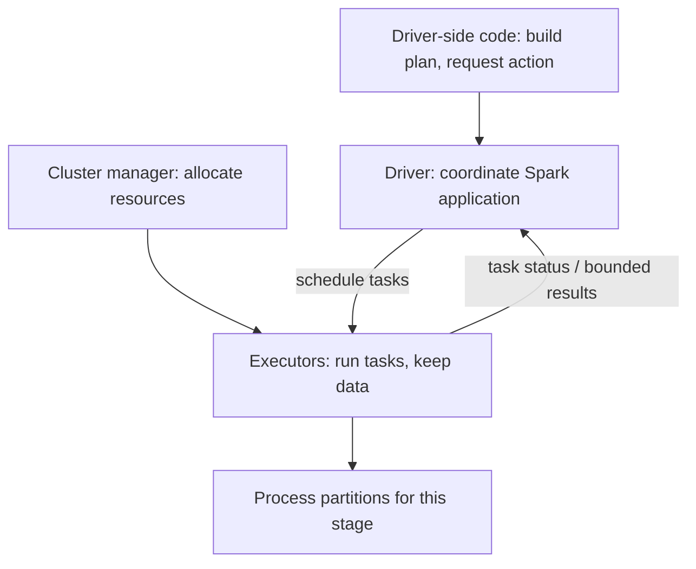

# 03 · Spark Architecture, DataFrames & Spark SQL

<ChapterMeta>

[Chapter 01](/foundations/01-grain-keys-fanout), [Chapter 02](/foundations/02-lake-warehouse-lakehouse), Python và SQL. Tuning Catalyst/joins chưa thuộc bài này.

</ChapterMeta>

## Why this matters

Một biến DataFrame xuất hiện trong notebook chưa chứng minh dữ liệu đã được xử lý. Muốn debug “không chạy”, chạy hai lần hoặc driver hết memory, bạn phải xác định code đang tạo plan hay yêu cầu execution. Grain contract từ Chapter 01 vẫn cần giữ khi chuyển sang distributed engine.

## Scenario

Bạn viết read → filter paid events → join campaign lookup → aggregate revenue → write report. Notebook cell định nghĩa `report` kết thúc nhanh. Sau đó `show()` và `write` đều mất thời gian. Team hỏi: “DataFrame đã chạy rồi, sao write phải làm lại?”

Hãy xác định hai yêu cầu cần **kết quả**. Nếu bạn gọi `collect()` trên toàn bộ raw events để debug, dữ liệu được đưa về process nào?

## Learner reasoning

| Phỏng đoán | Kiểm tra |
|---|---|
| Mỗi Python assignment đã xử lý full dataset | Cell đó có action/materialization không? |
| Preview lưu sẵn kết quả cho write | Có persistence phù hợp, còn available, và reused không? |
| Python loop chạy trên mọi executor | Là driver-side control code hay task expression? |

<details>
<summary>Đối chiếu execution boundary</summary>

Transformations xây computation. `show()` cần preview, write cần publish output; chúng có thể gây execution riêng. Không coi DataFrame variable là cache. `collect()` đưa toàn bộ result về driver nên chỉ dùng khi result nhỏ có giới hạn rõ.

</details>

## Mental model



Một Spark application gồm driver và execution resources. Executor là process, worker/node là machine; một machine không đồng nghĩa một partition. Hình minh họa classic cluster model. `local` mode không chứng minh multi-node networking/recovery, và Spark Connect có client/server boundary khác. [Cluster overview][cluster].

## Core concepts

| Term | Gắn vào scenario | Đừng đồng nhất với |
|---|---|---|
| Cluster | Resources để chạy applications | Một query hoặc một DataFrame |
| Application | User program với driver/executors | Một Lakeflow Job resource |
| Driver | Build/coordinate work và nhận collected result | Process giữ toàn bộ source data mặc định |
| Executor | Chạy tasks và giữ execution data | Notebook Python loop trên driver |
| Spark job | Parallel computation phát sinh để thực hiện action | Scheduler/job definition của Airflow/Lakeflow |
| Stage | Nhóm tasks có thể thực thi trước một dependency boundary | Một dòng DataFrame code |
| Task | Unit xử lý partition trong một stage | Một business event hoặc một table |
| Partition | Phần dữ liệu được xử lý phân tán | Luôn một file hoặc storage partition directory |

Glossary và process roles dựa trên [Spark cluster overview][cluster]. Cardinality/job counts thực tế phải đo, không đọc từ số dòng source.

| API/execution concept | Cách nhận diện | Boundary |
|---|---|---|
| DataFrame | Named columns + schema + computation plan | Không phải pandas frame đã có mọi rows trong local memory |
| Spark SQL | SQL expression trả structured result/DataFrame | Không phải engine độc lập với DataFrame API |
| Transformation | `filter`, `join`, `groupBy(...).agg(...)` | Tạo plan, chưa materialize full result |
| Action | `show`, `count`, `collect`, write | Yêu cầu result/output; có thể trigger nhiều jobs |
| Lazy evaluation | Defers data computation tới khi cần result | Read có thể vẫn làm metadata/schema work |
| DAG | Dependencies không có cycle | Logical operators và scheduler stages là hai góc nhìn khác nhau |

Spark SQL và DataFrame APIs dùng structured execution machinery chung theo [SQL guide][sql-guide]. Lazy transformations dựa trên [programming guide][lazy]; không suy ra `read`/schema inference hoàn toàn không làm I/O.

## Example data

`transactions`, grain một transaction, integer revenue:

| id | campaign | revenue | status |
|---|---|---:|---|
| T1 | A | 100 | paid |
| T2 | A | 200 | paid |
| T3 | B | 50 | paid |
| T4 | A | 900 | cancelled |

`campaigns`, grain một campaign, key unique:

| campaign | country |
|---|---|
| A | VN |
| B | US |

| Boundary | Expected rows | Expected revenue |
|---|---:|---:|
| Read transactions | 4 | 1250 |
| Filter paid | 3 | 350 |
| Join unique campaign lookup | 3 | 350 |
| Aggregate campaign/country | 2 | A/VN 300; B/US 50 |
| Write | 2 report rows | 350 total |

Thêm duplicate lookup `A, VN` làm report A thành 600. Spark thực thi nhanh cũng không sửa cardinality. [Lab 03](/labs/03-pipeline-execution) test cả baseline và failure này.

## How it works

### Code user thấy và execution engine thực hiện

| User code | Ý nghĩa khai báo | Engine có thể thực hiện |
|---|---|---|
| Read input | Chọn source + schema | Resolve metadata, plan scan |
| Filter | Giữ paid events | Push/combine predicates khi hợp lệ |
| Join | Enrich campaign country | Chọn physical join theo plan/runtime |
| Aggregate | Revenue theo campaign/country | Partial/final aggregate và exchange nếu cần |
| Write | Materialize report | Execute plan và sink write protocol |

Optimizer có thể đổi cách thực thi mà giữ query semantics. Code order không phải timeline của từng task. Bạn chỉ cần nhận diện scan/filter/join/aggregate/exchange trước khi học tuning.

### Jobs, stages, tasks

Với một **kế hoạch minh họa** dùng broadcast lookup và aggregate cần shuffle: upstream tasks đọc/filter/join/partial aggregate, rồi dữ liệu được trao đổi theo grouping keys. Downstream tasks hoàn tất aggregate và write. Mỗi stage xử lý các partitions của stage đó, có task attempts khi retry.

Đừng ghi “five operators = five stages” hoặc “one action = exactly one job”. Schema work, broadcast preparation, adaptive execution và sink behavior có thể thay đổi job/stage counts. Broadcast join không bắt buộc shuffle cả hai inputs. Hãy đọc actual plan và [Spark UI/event logs][monitor] để xác nhận.

### Plan inspection

`report.explain(mode="formatted")` in physical outline và node details theo [explain API][explain]. Nó không phải benchmark và không materialize report như write. Một plan ghi `Exchange` là boundary cần nghiên cứu tiếp; không vội tăng executors khi chưa biết dữ liệu đi đâu.

## Databricks implementation

Trong Spark-enabled notebook, dùng SparkSession được environment cung cấp và đọc table qua governed names. Chọn compute/runtime có hỗ trợ workload; Databricks SQL warehouse không phải tùy ý chạy notebook PySpark. [Compute docs][compute].

Các Spark jobs/stages trong execution UI không cùng nghĩa với Lakeflow Job/task. Một orchestrated task có thể chạy application tạo nhiều Spark jobs. Bài này không cấu hình authenticated workspace hoặc cloud compute.

## Production failure

| Trigger | Symptom | Boundary |
|---|---|---|
| Raw `.collect()` quá lớn | Driver memory failure dù executors còn resources | Result transfer tới driver |
| Preview và write không có reuse phù hợp | Scan/compute lặp lại | Action/materialization |
| Join dimension không unique | Revenue A thành 600 | Data contract, không phải scheduler |
| Side effect bên ngoài trong task bị retry | Callback/write ngoài sink bị lặp | Task execution không phải exactly-once business operation |

`cache()` là lựa chọn cần đo theo reuse và memory, không là lời chữa mọi repeated execution. Sink commit và business idempotency sẽ được đào sâu ở correctness/Delta chapters.

## Debugging

| Symptom | Investigation | Diagnosis | Fix |
|---|---|---|---|
| Cell tạo report nhanh, chưa có output | Có action/write chưa? | Mới tạo plan | Materialize đúng sink; kiểm tra output |
| `show` rồi write đều lâu | SQL executions, scan và reuse evidence | Hai requests chưa reused result | Bỏ redundant preview hoặc evaluate persistence |
| Driver chết | Collected result size, driver logs | Driver-side transfer/state quá lớn | Bounded debug, distributed aggregate/write |
| Nhiều tasks nhưng một task rất lâu | Task duration/input distribution | Có thể skew; chưa đủ kết luận | Đo partition distribution, xem chương sau |
| Metrics sai sau join | Counts và key uniqueness trước/sau join | Grain mismatch | Sửa contract từ Chapter 01 |

Plan giúp định vị operators; UI giúp đo actual work. Không dùng một screenshot plan làm bằng chứng performance improvement.

## BigQuery / Airflow mapping

| Kiến thức sẵn có | Bridge | Khác biệt |
|---|---|---|
| dbt compiled SQL | Spark SQL logical computation | DataFrame API là cách express structured work khác |
| BigQuery query execution details | Spark explain + SQL/jobs/stages UI | Engine boundaries/metrics không trùng tên |
| Airflow task | Outer orchestration boundary | Spark job là execution bên trong, không phải DAG task |
| Python list/pandas frame | DataFrame API quen cú pháp | Distributed plan, actions và driver transfer khác |

## Code

Reading example cho environment **đã có** SparkSession `spark`; CSV inputs theo schema của bảng example:

```python
from pyspark.sql import functions as F

tx = spark.read.schema(
    "id STRING, campaign STRING, revenue LONG, status STRING"
).option("header", True).csv("transactions.csv")
campaigns = spark.read.schema(
    "campaign STRING, country STRING"
).option("header", True).csv("campaigns.csv")
report = (tx.filter(F.col("status") == "paid")
    .join(campaigns, "campaign")
    .groupBy("campaign", "country")
    .agg(F.sum("revenue").alias("revenue")))
report.explain(mode="formatted")
report.show()  # bounded preview; requests execution
report.write.mode("errorifexists").option("header", True).csv("report-output")
```

API structure theo [DataFrame getting started][dataframes]. Snippet CSV này là reading example; [real Spark Lab 03](/labs/03-pipeline-execution#real-spark-variant) thực thi cùng pipeline/fixture bằng createDataFrame và Parquet report, với actual logical/physical plans và event logs. Relative local paths chỉ phù hợp local hoặc shared-access setup; distributed executors cần source/sink truy cập được. Không gọi CSV output là transactional table.

Để kiểm chứng relational metrics ngay, chạy lab portable:

```sh
python labs/spark/pipeline_model.py
```

Portable lab thực thi SQLite SQL và write CSV. Counter đo hai executions của **mô hình**, không đo Spark jobs/stages/tasks. [Spark setup](/setup/local-spark) và [Lab 03](/labs/03-pipeline-execution) cung cấp actual scheduler evidence. Tiếp theo: [04 · Partitioning](/spark/04-partitioning).

## Common mistakes

| Assumption | Consequence | Cách sửa reasoning |
|---|---|---|
| Mỗi assignment = action | Tìm execution không tồn tại | Identify result requests |
| SQL và DataFrames luôn là hai engines | Rewrite API để “tăng tốc” không có evidence | Compare plans và workload thực tế |
| Partition = file = executor | Sizing từ file count sai | Tách data layout, stage partitions và resources |
| Nhiều executors sửa driver collect | Driver vẫn nhận full result | Bound result hoặc write phân tán |

## Production notes

Log runtime/version, input scope, output grain và application/query IDs đủ để nối từ orchestration tới execution. UI sau application kết thúc cần persisted event logs/history support phù hợp environment. [Monitoring docs][monitor].

Task retry không bảo đảm external side effects idempotent. Với pipeline này, ưu tiên metric/key assertions trước publish; retry một phép tính sai chỉ tái tạo report sai. Local toy data không chứng minh throughput, shuffle behavior hoặc executor recovery.

## Interview checkpoint

1. Notebook tạo DataFrame nhanh nhưng write lâu. Bạn giải thích lazy evaluation thế nào, kèm giới hạn của “read không làm gì”?
2. Vì sao show và write có thể compute lại? Bạn cần evidence gì trước cache?
3. Driver hết memory trong collect. Tăng executors có sửa đúng boundary không?
4. Năm operators có buộc năm stages không? Broadcast lookup và aggregate ảnh hưởng reasoning thế nào?
5. Một Lakeflow task có nhiều Spark jobs. Vì sao không mâu thuẫn?
6. Revenue tăng sau lookup join. Bạn kiểm tra plan hay uniqueness trước, và tại sao?

## PASS criteria

| PASS | NOT YET |
|---|---|
| Vẽ driver/executor roles và phân biệt application/job/stage/task | Đồng nhất job với Airflow task |
| Identify transformations và actions trong snippet | Coi DataFrame variable là cached output |
| Tính output A/VN 300, B/US 50 và duplicate-lookup failure | Chỉ đọc code mà không kiểm metrics |
| Nêu giả thuyết stage boundary và yêu cầu actual UI evidence | Cam kết job/stage counts từ số operators |
| Phân biệt lab SQLite với Spark runtime evidence | Dùng model counter để báo Spark jobs |

## Official references

Đối chiếu **2026-10-10**. Các Apache Spark `latest` pages trả version **4.2.0** khi retrieved; không là version của một Databricks Runtime. Source-backed behavior và measured SQLite output được phân biệt ở lab.

- [Cluster overview][cluster]: roles và glossary.
- [Programming guide][lazy]: lazy transformations, actions và recomputation.
- [SQL/DataFrame guide][sql-guide], [getting started][dataframes]: structured APIs.
- [explain API][explain], [monitoring][monitor]: plan versus measured execution.
- [PySpark installation][install]: JVM/dependency requirements; chưa cài trong iteration này.
- [Databricks compute][compute]: platform execution surface.

[cluster]: https://spark.apache.org/docs/4.0.4/cluster-overview.html
[lazy]: https://spark.apache.org/docs/4.0.4/rdd-programming-guide.html
[sql-guide]: https://spark.apache.org/docs/4.0.4/sql-programming-guide.html
[dataframes]: https://spark.apache.org/docs/4.0.4/sql-getting-started.html
[explain]: https://spark.apache.org/docs/4.0.4/api/python/reference/pyspark.sql/api/pyspark.sql.DataFrame.explain.html
[monitor]: https://spark.apache.org/docs/4.0.4/monitoring.html
[install]: https://spark.apache.org/docs/4.0.4/api/python/getting_started/install.html
[compute]: https://docs.databricks.com/aws/en/compute/
