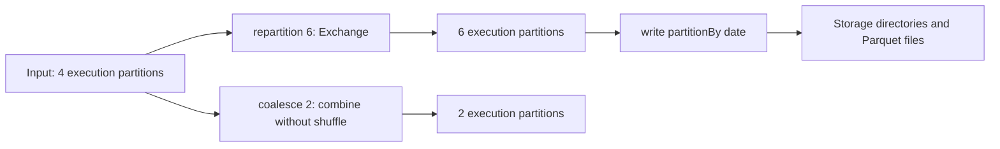

# 04 · Spark Partitioning

<ChapterMeta>

[03 · Architecture](/spark/03-architecture-dataframes-sql), [Spark local setup](/setup/local-spark). Tiếp theo: [05 · Shuffle](/spark/05-shuffle).

</ChapterMeta>

## Why this matters

Thêm CPU không tạo thêm parallel work khi stage chỉ có hai partitions. Ngược lại, hàng nghìn tasks xử lý vài KB có thể dành phần lớn công sức cho scheduling/setup. Partition count phải được đọc cùng kích thước và phân bố dữ liệu.

## Scenario

Dataset 100 GB vào một stage với 2 partitions. Cluster có 32 task slots. Một partition chứa 90 GB, partition còn lại 10 GB. Team đề nghị gấp đôi executors. Điều gì còn giới hạn? Scenario thứ hai: một triệu records được chia thành 10.000 tiny partitions; tăng partition count có luôn tốt?

## Learner reasoning

<details><summary>Dự đoán trước khi xem đáp án</summary>

Hai partitions chỉ cho hai tasks trong stage đó, chưa tính retries; thêm slots không chia task lớn. Phân bố 90/10 khiến task lớn có khả năng hoàn tất sau. Với tiny partitions, task startup/scheduling tăng so với useful work. Cần đo bytes, task durations và downstream requirements trước đổi layout.

</details>

## Mental model



Execution partition là đơn vị chia dữ liệu cho stage. Storage partition là layout theo giá trị, ví dụ `date=2026-10-01/`; một directory có thể chứa nhiều files và được đọc thành nhiều execution partitions. Không có mapping cố định directory = file = executor.

## Core concepts

| Concept | Điều cần quan sát |
|---|---|
| Input partition | Scan splitting phụ thuộc source, file sizes, reader settings |
| Output partition | Số partitions sau operator; có thể khác scan |
| Count vs size | 100 partitions không bảo đảm mỗi partition cùng bytes/rows |
| Parallelism | Tasks sẵn có và resource slots cùng giới hạn work đang chạy |
| `repartition(n)` | Redistribute qua shuffle; có thể tăng/giảm count |
| `repartition(n, key)` | Hash colocate key; hot key vẫn vào một bucket |
| `coalesce(n)` | Giảm bằng narrow dependency, không shuffle để balance; không tăng vượt input count |
| Storage partitioning | File layout/table metadata, không là scheduling command |

Theo [repartition API][repartition] và [coalesce API][coalesce]. AQE có thể thay đổi post-shuffle partitioning trong production; diagnostic lab tắt AQE để thấy boundary.

## Example data

Lab dùng 120 unique `id`, grain một id, input 4 partitions. Conservation invariant: mọi variant vẫn có 120 rows và cùng tập ids.

| Variant | Observed count | Rows/partition trong recorded run |
|---|---:|---|
| Input | 4 | 30, 30, 30, 30 |
| Repartition 6 | 6 | 20 mỗi partition |
| Coalesce 2 | 2 | 60, 60 |
| Coalesce 8 | 4 | Không tạo thêm partitions |

Đây là balanced synthetic range, không là guarantee cho input production. [Artifacts](/labs/runtime-evidence).

## How it works

`repartition` tổ chức shuffle để tạo output distribution mới. `coalesce` gom upstream partitions nên có thể giảm parallelism ở cả upstream work; drastic coalesce tới một partition có thể dồn computation vào một task. Có ít output files hơn chưa chứng minh end-to-end nhanh hơn.

`spark_partition_id()` cho partition của rows tại vị trí expression. Lab capture nó **trước** groupBy để thống kê; groupBy đo distribution lại tạo shuffle của riêng phép đo. Empty partitions không xuất hiện trong grouped rows; `rdd.getNumPartitions()` cho count đầy đủ trong classic Spark.

## Databricks implementation

Dùng explain và Spark UI trên compute/runtime có hỗ trợ Spark. Kiểm tra AQE/final plan trước đọc task count. [Databricks AQE][aqe] có runtime-specific behavior; không copy diagnostic AQE=false vào jobs production. Unity Catalog table partition columns cũng không bảo đảm cùng số tasks.

## Production failure

Writer gọi `coalesce(1)` để “có một file dễ dùng”; upstream work mất parallelism, task lớn có thể hết memory. Reader downstream không cần một file nếu hỗ trợ directory/table. Sửa consumer contract trước, rồi chọn file sizes/partition count theo evidence.

## Debugging

| Symptom | Investigation | Diagnosis / fix |
|---|---|---|
| CPUs idle | Stage task count và slots | Too few runnable tasks; xem split/repartition boundary |
| Một task lớn | Rows/bytes distribution | Skew; tăng count chưa chắc chia hot key |
| Nhiều tiny tasks | Input bytes, task setup/duration | Gom work có căn cứ; kiểm tra files và AQE |
| Output quá ít files | Plan trước write | Coalesce đã giảm work; đánh giá downstream layout |

## BigQuery / Airflow mapping

BigQuery table partition theo date gần storage partition concept; không tương đương `DataFrame.repartition`. Airflow task parallelism là orchestration slots, không chia Spark partition bên trong một application. Dùng đúng tầng khi sizing.

## Code

```powershell
python scripts/run_spark.py --lab 04
```

Trong executable `labs/spark/experiments.py`: `spark.range(120, numPartitions=4)`, `.repartition(6)`, `.coalesce(2)`, `.coalesce(8)`. [Lab 04](/labs/04-partitioning) yêu cầu dự đoán count/operator trước run.

## Common mistakes

“Một partition bằng một file” sai khi scan split, combine files hoặc partitioned writes. “Coalesce balance data” sai vì nó không redistribute rows như repartition. “Tăng partitions chữa skew” sai khi cùng hot key vẫn được hash colocated.

## Production notes

Tối ưu theo bytes và task distribution, không chỉ rows. Wide rows có memory footprint khác nhau. Fixture local không đo scheduling overhead production; số partitions trong lab phục vụ reasoning, không là magic tuning value.

## Interview checkpoint

1. 100 GB, 2 partitions, 32 slots: bạn điều tra gì trước tăng executors?
2. Vì sao coalesce 4→8 không tăng count và 4→1 có trade-off?
3. 365 date directories có buộc 365 tasks không?
4. Repartition theo campaign có sửa UNKNOWN chiếm 70% không?

## How to explain this in an interview

“Tôi phân biệt partitions của execution stage với table partition layout. Count giới hạn task parallelism nhưng phân bố bytes quyết định uneven work. Repartition redistribute qua shuffle; coalesce có thể giảm count mà không shuffle, đổi lại có thể giảm parallelism. Tôi kiểm tra plan và task metrics trước thay tham số.” Dùng ý chính để trả lời scenario, không học thuộc câu.

## PASS criteria

| PASS | NOT YET |
|---|---|
| Đọc 4→6/2/4 và chứng minh rows/ids được giữ | Chỉ chạy command mà không giải thích count |
| Chỉ ra Exchange vs Coalesce và trade-off | Cam kết coalesce luôn nhanh hơn |
| Phân biệt date directory với execution partition | Dùng file count để suy ra executor count |

## Official references

Verified 2026-10-10, OSS Spark 4.0.4; Databricks source AWS, không chọn DBR trong lab.

- [Repartition][repartition], [Coalesce][coalesce]: operator contracts.
- [Spark SQL tuning][tuning]: file/shuffle partition settings và AQE.
- [Databricks AQE][aqe]: platform mapping.

[repartition]: https://spark.apache.org/docs/4.0.4/api/python/reference/pyspark.sql/api/pyspark.sql.DataFrame.repartition.html
[coalesce]: https://spark.apache.org/docs/4.0.4/api/python/reference/pyspark.sql/api/pyspark.sql.DataFrame.coalesce.html
[tuning]: https://spark.apache.org/docs/4.0.4/sql-performance-tuning.html
[aqe]: https://docs.databricks.com/aws/en/optimizations/aqe
