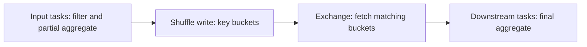

# 05 · Shuffle

<ChapterMeta>

[04 · Partitioning](/spark/04-partitioning), [03 · Architecture](/spark/03-architecture-dataframes-sql). Tiếp: [06 · Joins & skew](/spark/06-joins-broadcast-skew).

</ChapterMeta>

## Why this matters

Một pipeline giữ ít rows sau filter vẫn có thể tốn resources ở aggregate/join. Bạn cần xác định distribution yêu cầu, bytes được shuffle và skew trước đổi executors hoặc memory.

## Scenario

`filter → select` chạy trong các input partitions. Thêm `groupBy(campaign_id)` thì UI có shuffle read/write. “Cùng dữ liệu đầu vào, tại sao thêm một dòng code làm nhiều work?” Hãy xét campaign A xuất hiện ở mọi partition và cần một total chính xác.

## Learner reasoning

<details><summary>Campaign total cần dữ liệu ở đâu?</summary>

Filter quyết định độc lập trên từng row. GroupBy cần kết hợp contributions của cùng key từ nhiều partitions. Partial aggregation có thể giảm records trao đổi nhưng final grouping vẫn cần colocation theo key nếu distribution đầu vào chưa đáp ứng. Không suy ra cost từ số dòng code.

</details>

## Mental model



Shuffle tạo dependency giữa work upstream và downstream. Diagram bỏ qua retries, reuse và adaptive stages; không là cam kết một operator bằng một stage.

## Core concepts

| Term | Mechanics / consequence |
|---|---|
| Narrow transformation | Output partition phụ thuộc tập upstream nhỏ; filter/select thường không redistribute |
| Wide dependency | Downstream cần contributions từ nhiều upstream partitions |
| Exchange | Physical distribution boundary; ShuffleExchange và BroadcastExchange không cùng cơ chế |
| Shuffle partitions | Output buckets cho SQL shuffle; diagnostic lab đặt 4 |
| Spill | Intermediate state vượt usable memory phải ghi disk; không phải mọi shuffle đều spill |
| Stage | Scheduler work group theo dependency; count không bằng source operators |

Theo [Spark programming guide][guide] và [SQL tuning][tuning]. Existing compatible partitioning/reuse có thể tránh Exchange; “mọi join đều shuffle cả hai” không đúng.

## Example data

120 ids trong 4 partitions, `key = id % 3`, mỗi key 40 rows. Lab giữ fixture nhỏ và collect tối đa 120 rows để execute **đúng query plan**, không dùng count thay orderBy vì optimizer có thể bỏ sort không cần thiết.

| Query | Result rows | Observed plan |
|---|---:|---|
| Filter id≥60, select | 60 | Không Exchange |
| GroupBy key count | 3, mỗi count=40 | Hash Exchange |
| OrderBy key descending, id | 120 | Range Exchange + sort |
| Join với unique 3-key lookup, broadcast disabled | 120 | Exchanges + SortMergeJoin |

[Actual artifacts và stages](/labs/runtime-evidence).

## How it works

Records cần colocated → upstream serialize contributions theo buckets → write shuffle blocks → downstream fetch buckets và deserialize → aggregate/sort/join dùng memory. Trên cluster, fetch có network transfer; local vẫn có serialization, buffers và disk I/O. Memory pressure có thể dẫn tới spill và merge spilled runs; task retries/fetch failures có thể lặp work. Đây là chuỗi resource consequences, không chỉ “moves data nên chậm”.

Partial aggregates giảm payload khi có nhiều rows cùng key, nhưng high-cardinality grouping có thể giữ nhiều state. Global order cần range distribution và sort; range sampling có thể tạo thêm jobs. Không hứa one action = one job. `jobs.json` map actual IDs; `stages.json` ghi completed stage/task counts.

## Databricks implementation

Đọc Spark UI/SQL plan và AQE final plan trên compute tương ứng. [Databricks AQE][aqe] có thể coalesce shuffle partitions, đổi join hoặc xử lý qualifying skew. Diagnostic AQE=false/broadcast=-1 chỉ dùng để thấy mechanisms; không áp dụng thành tuning policy.

## Production failure

GroupBy một high-cardinality key, rows rộng, partitions quá ít: aggregation state lớn và spill/OOM có thể xuất hiện. Tăng partitions giảm work trung bình nhưng hot key hoặc unbounded state vẫn cần xử lý riêng. Không xóa groupBy nếu nó định nghĩa đúng output grain.

## Debugging

| Symptom | Investigation | Diagnosis / fix |
|---|---|---|
| Filter nhỏ, shuffle lớn | Projection/filter có trước Exchange? | Giảm payload khi semantics cho phép |
| Spill cao | Peak state, bytes/task, cardinality | Điều chỉnh distribution/state; kiểm memory sau |
| Một downstream task lâu | Key frequency và bytes distribution | Skew; chuyển Chapter 06 |
| Nhiều tiny shuffle tasks | Final AQE plan, task sizes | Evaluate coalescing và overhead |

## BigQuery / Airflow mapping

BigQuery distributed aggregation cũng cần combine data, nhưng Spark Exchange/stage settings không tương đương BigQuery partitioned tables. Airflow chỉ thấy outer task; cần application evidence để phân biệt source latency với shuffle work.

## Code

```powershell
python scripts/run_spark.py --lab 05
python scripts/run_spark.py --lab 05 --ui --hold-seconds 120
```

[Lab 05](/labs/05-shuffle) có prediction, artifacts và optional UI workflow. Code `labs/spark/experiments.py` khôi phục broadcast threshold sau experiment.

## Common mistakes

Nhìn mọi `Exchange` như hash shuffle làm nhầm broadcast preparation. Đếm lines để suy stages bỏ qua sampling, optimizer và AQE. Đo “groupBy nhanh hơn orderBy” từ 120 rows không cho benchmark đáng tin cậy.

## Production notes

Ghi bytes read/write, spill, distribution, task attempts cùng runtime/config. Local fixture xác nhận operator semantics và scheduler hoạt động; chưa chứng minh multi-node network cost, spill hay resource sizing. Không diễn giải zero spill ở tiny lab thành pipeline luôn fit memory.

## Interview checkpoint

1. Vì sao filter thường narrow còn groupBy thường cần shuffle?
2. Partial aggregation giảm gì, còn cần final colocation không?
3. Khi spill tăng, bạn đo gì trước tăng driver memory?
4. Vì sao orderBy có thể tạo nhiều jobs và count không test sort?

## How to explain this in an interview

“Shuffle xuất hiện khi computation cần redistribute contributions để cùng key được xử lý cùng nhau. Nó tạo serialization, fetch, buffering và memory pressure, có thể spill xuống disk. Tôi đọc distribution requirements và actual plan, rồi đo payload/skew/task sizes trước tuning.” Dùng lập luận theo workload thay vì học thuộc.

## PASS criteria

| PASS | NOT YET |
|---|---|
| Xác định Exchange ở aggregate/order/join và vắng ở narrow fixture | Nói mọi transformation tạo shuffle |
| Giải thích colocation → serialize/fetch/state/spill | Chỉ nói “move data” |
| Dùng stage artifacts và giới hạn local evidence | Suy benchmark từ explain output |

## Official references

Verified 2026-10-10, Spark 4.0.4; AWS Databricks mapping, không đo DBR.

- [Shuffle operations][guide], [SQL tuning][tuning].
- [Monitoring][monitor], [Databricks AQE][aqe].

[guide]: https://spark.apache.org/docs/4.0.4/rdd-programming-guide.html
[tuning]: https://spark.apache.org/docs/4.0.4/sql-performance-tuning.html
[monitor]: https://spark.apache.org/docs/4.0.4/monitoring.html
[aqe]: https://docs.databricks.com/aws/en/optimizations/aqe
