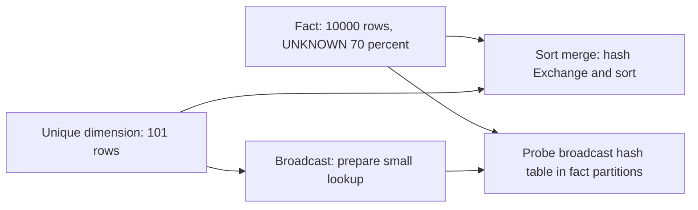

# 06 · Joins, Broadcast & Skew

<ChapterMeta>

[05 · Shuffle](/spark/05-shuffle), [01 · Grain & fan-out](/foundations/01-grain-keys-fanout). Tiếp: [07 · Parquet](/storage/07-parquet).

</ChapterMeta>

## Why this matters

Một join có thể giữ đúng grain nhưng tạo uneven work. Một broadcast join có thể tránh shuffle fact mà vẫn nhân đôi revenue nếu dimension trùng keys. Phải kiểm correctness và physical execution riêng.

## Scenario

Fact 500 GB, dimension 5 MB với unique campaign key. Có cần shuffle cả hai inputs? Sau đó biết `UNKNOWN` chiếm 70% fact. Hash partitioning theo campaign có chia đều không? Nếu dimension có hai UNKNOWN rows, việc tăng executors giải quyết gì?

## Learner reasoning

<details><summary>Hai axes cần kiểm tra</summary>

Dimension đủ nhỏ sau deserialize và join type hỗ trợ thì broadcast có thể tránh redistributing fact. Kích thước file 5 MB chưa chứng minh runtime memory footprint. Unique lookup giữ cardinality; duplicate UNKNOWN tạo fan-out bất kể strategy. Khi shuffle theo campaign, mọi UNKNOWN cùng key vào một bucket, có nguy cơ straggler.

</details>

## Mental model



Strategy đổi physical work; business join predicate và multiplicity vẫn quyết định output.

## Core concepts

| Concept | Useful boundary |
|---|---|
| Sort merge join | Compatible key distribution + sorted inputs; thường có shuffles/sorts |
| Broadcast hash join | Build lookup, distribute cho execution resources, probe streamed side |
| Join strategy | Phụ thuộc sizes/stats, join type, hints, existing distribution, AQE |
| Cardinality | Match multiplicity; unique dimension quan trọng hơn hint |
| Skew / hot key | Work phân bố lệch; count và bytes/task cần đo |
| Null keys | SQL equality không match NULL với NULL; null-safe equality thay semantics |
| UNKNOWN sentinel | Non-null shared value, có thể match và trở thành hot key |

Hints không bảo đảm mọi strategy vì join types có constraints. Theo [Spark SQL tuning][tuning].

## Example data

Lab tạo 10.000 ids, 7.000 UNKNOWN, 3.000 rows chia 100 campaigns. Dimension grain một campaign, 101 keys unique. Hai strategies đều 10.000 rows, `SUM(id)=49.995.000`.

Recorded hash repartition 4: **7.900, 630, 810, 660 rows**. UNKNOWN chỉ ở partition 0; 900 normal rows cũng hash vào bucket đó. Distribution minh họa skew, chưa đo task straggler latency. Thêm duplicate UNKNOWN dimension → **17.000 rows**. NULL equality fixture trả 1 row, null-safe trả 2. [Evidence](/labs/runtime-evidence).

## How it works

Sort merge path lab tắt auto broadcast/AQE để thấy key hash Exchanges + sort. Broadcast path dùng explicit `F.broadcast(dimension)`: physical plan có BroadcastHashJoin/BroadcastExchange, không có fact hashpartitioning. Broadcast vẫn có preparation/distribution cost và memory footprint, không có nghĩa “zero movement”.

Hash tăng từ 4 lên nhiều buckets vẫn colocate một hot key trong một bucket. Mitigation phải gắn semantics:

| Option | Khi phù hợp | Trade-off |
|---|---|---|
| Sửa key/data design | UNKNOWN do mapping lỗi | Cần sửa upstream và reconcile lịch sử |
| Split/filter hot key | Có business rule xử lý riêng | Không được silently bỏ 70% rows |
| Pre-aggregate | Output grain cho phép trước join | Có thể mất event-level columns cần downstream |
| Broadcast | Dimension thực sự nhỏ, supported join | Memory/timeout; không sửa duplicate keys |
| Salting | Cần chia hot-key work và maintain matches | Expand lookup, aggregate lại, risk fan-out |
| AQE | Qualifying skew join trong supported runtime | Threshold/plan dependent; không chữa mọi hot aggregate |

Salting không universal: salt cả hai sides tùy ý làm mất matches; replicate wrong side có thể tăng work. Tiny lab không kích hoạt/đo AQE skew optimization; xem [Databricks AQE][aqe] và final plan khi áp dụng.

## Databricks implementation

Đọc actual/final plan, table statistics và Spark UI trên chosen runtime. Với Photon/DBR strategy names và optimizations có thể khác OSS lab. Kiểm tra supported compute/features trong official docs trước map configuration. Không provision platform ở bài này.

## Production failure

Team thêm broadcast hint để chữa revenue tăng. Shuffle giảm nhưng duplicate lookup vẫn fan-out. Invariant đầu tiên: join unique dimension không được tăng fact rows; sum cần giữ nếu every fact matches exactly once. [Chapter 01](/foundations/01-grain-keys-fanout) cho logical diagnosis.

## Debugging

| Symptom | Investigation | Diagnosis / fix |
|---|---|---|
| Revenue tăng | Counts, uniqueness, unmatched keys | Grain/multiplicity; sửa contract trước strategy |
| Một task có nhiều input | Key histogram, partition bytes | Skew; chọn mitigation theo semantics |
| Broadcast timeout/OOM | Actual lookup footprint, broadcast metrics | Too large hoặc resource limits; cân nhắc strategy |
| Rows biến mất | NULL/unmatched keys, inner vs left | Predicate/business semantics; không thay NULL→UNKNOWN tùy ý |

## BigQuery / Airflow mapping

Logical join fan-out giống SQL engines khác. BigQuery cũng có distributed execution choices nhưng Spark hint/config không portable. Airflow retry không sửa lookup key duplication hoặc skew bên trong application.

## Code

```powershell
python scripts/run_spark.py --lab 06
```

[Lab 06](/labs/06-joins-skew) yêu cầu so hai plans rồi inject duplicate key. Code `labs/spark/experiments.py` dùng bounded synthetic range, không collect full fact.

## Common mistakes

Coi broadcast sửa correctness; coi NULL là UNKNOWN; coi thêm partitions luôn chia hot key; hoặc salting trước kiểm grain. Mỗi cách có thể tạo report sai dù physical plan trông hợp lý.

## Production notes

5 MB compressed dimension không bằng 5 MB hash state. Check projection/filter, stats, match cardinality, skew và memory headroom. Không báo broadcast nhanh hơn từ laptop fixture; evidence hiện tại chỉ strategy/distribution/output.

## Interview checkpoint

1. Fact 500 GB + dimension 5 MB: điều kiện nào cho broadcast?
2. Revenue sai nhưng plan không shuffle fact: bạn debug gì?
3. UNKNOWN 70%: vì sao hash 1000 buckets vẫn có hot bucket?
4. Chọn split, pre-aggregate hay salting dựa trên output grain thế nào?
5. NULL-safe equality thay đổi contract ra sao?

## How to explain this in an interview

“Tôi kiểm unique lookup và match cardinality trước, vì strategy không sửa fan-out. Với dimension đủ nhỏ và supported join, broadcast có thể tránh shuffle fact. Nếu hot key dominate, tôi đo partition distribution và chọn mitigation giữ semantics; AQE hoặc salting cần điều kiện riêng.” Trả lời theo evidence của scenario, không học thuộc.

## PASS criteria

| PASS | NOT YET |
|---|---|
| Chứng minh hai strategies giữ 10.000 rows và id sum | Chỉ nhận diện operator mà không kiểm output |
| Giải thích 17.000 duplicate-lookup output | Dùng hint để chữa cardinality |
| Chỉ ra hot bucket và hai mitigation có trade-off | Nói salting giải mọi skew |

## Official references

Verified 2026-10-10, Spark 4.0.4 và AWS Databricks docs, không đo DBR execution.

- [Spark joins/hints/AQE][tuning].
- [Databricks AQE][aqe].
- [SQL null semantics](https://spark.apache.org/docs/4.0.4/sql-ref-null-semantics.html).

[tuning]: https://spark.apache.org/docs/4.0.4/sql-performance-tuning.html
[aqe]: https://docs.databricks.com/aws/en/optimizations/aqe
