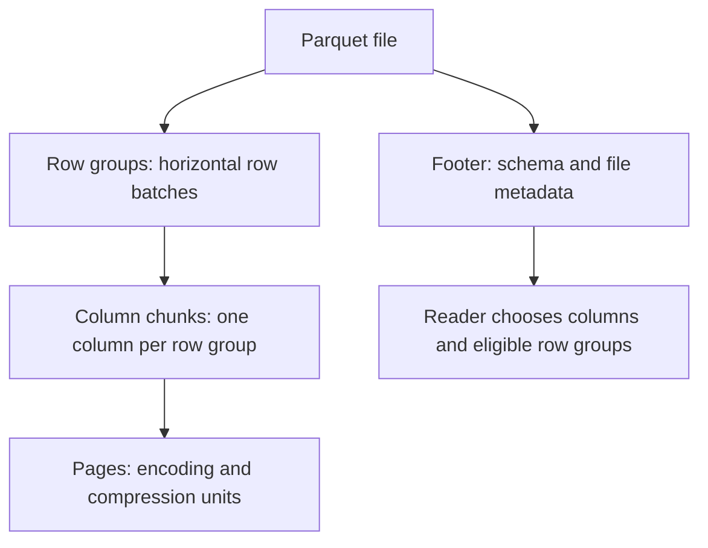

# 07 · Parquet

<ChapterMeta>

[06 · Joins](/spark/06-joins-broadcast-skew), [02 · Lakehouse](/foundations/02-lake-warehouse-lakehouse). Tiếp: [08 · Delta](/storage/08-delta-fundamentals).

</ChapterMeta>

## Why this matters

Analytics thường đọc vài columns trong wide events. File layout giúp reader giảm work khi biết columns và filters cần thiết. Nhưng file format không tự tạo transaction boundary cho một dataset nhiều files.

## Scenario

Events gồm id, campaign, revenue, date, payload. Query chỉ cần:

```sql
SELECT campaign_id, revenue FROM events WHERE date = '2026-10-01';
```

Nếu payload rất rộng, vì sao columnar layout có ích? Nếu writer sửa ba files và chết sau file thứ hai, footer của từng file có bảo đảm cả table được update atomically?

## Learner reasoning

<details><summary>File optimization và table correctness</summary>

Column chunks cho phép reader chọn cột; date vẫn có thể cần đọc để evaluate predicate. Statistics có thể loại row groups nếu đủ evidence. Nhưng mỗi file hợp lệ không chứng minh tập files đại diện một committed snapshot. Cần table transaction protocol cho multi-file state.

</details>

## Mental model



Layout theo [Apache Parquet format][format] và [concepts][concepts]. Footer không chứa toàn bộ table catalog/snapshot.

## Core concepts

| Concept | Query consequence |
|---|---|
| Columnar storage | Đọc campaign/revenue/date mà có thể bỏ payload |
| Row group | Batch rows có column chunks; skipping không đồng nghĩa per-row index |
| Pages/encoding | Representation bên trong chunks; không phải Spark partition |
| Compression | Theo pages/chunks; actual codec lab là SNAPPY |
| Schema | Types/names trong file metadata; dataset schema reconciliation là reader concern |
| Statistics | Có thể hỗ trợ pruning; effectiveness phụ thuộc data layout/reader |
| Predicate pushdown | Reader nhận filter; không chứng minh mọi row group bị skip |
| Column pruning | ReadSchema bỏ columns không cần |
| Immutable-file model | Pipeline thường ghi replacement files; không UPDATE rows tại chỗ như table semantics |

## Example data

Lab: 120 ids, 2 dates, 3 campaigns, `revenue=id*10`, payload cùng giá trị. Ghi 2 Parquet files. Recorded files 2.322/2.328 bytes, mỗi file 1 row group/60 rows và footer 1.250 bytes. Đây là **inventory**, không là benchmark compression hoặc speed.

Filter date01 → 60 rows. `ReadSchema` có campaign/revenue/date, bỏ id/payload; `PushedFilters` có date equality. Storage `partitionBy(date)` tạo hai directories; plan thứ hai có `PartitionFilters`. [Artifacts](/labs/runtime-evidence).

## How it works

Reader resolve schema/footer rồi chọn column chunks cần thiết. Predicate pushdown có thể dùng stats để tránh irrelevant work; residual filter vẫn cần bảo đảm query semantics. Không suy “60 returned rows = exactly half bytes read”. Một row group chứa mixed dates có thể không bị loại bằng min/max.

Storage partition pruning dùng directory/table partition values để chọn files trước đọc nội dung; khác Parquet predicate pushdown bên trong files. Lab kiểm hai plan riêng. Một date directory không bằng một row group hoặc một execution partition.

CSV/JSON lưu record-oriented representation và thường cần parse fields; Parquet có typed schema và column metadata. Spark CSV cũng có reader optimizations, nên không nói CSV bắt buộc luôn đọc mọi cột hay Parquet luôn nhanh hơn. Chọn theo interchange/analytics requirements.

## Databricks implementation

Databricks Delta dùng Parquet data files và thêm transaction layer. File reader optimization và table data skipping/layout không hoàn toàn cùng mechanism. Chọn features theo runtime/format; [Databricks Delta docs][dbdelta] không biến glob raw Parquet thành transactional read.

## Production failure

Writer replace hai trong ba files rồi crash; reader glob directory có thể thấy mixed old/new files. Footer schema hợp lệ không cung cấp table-wide commit, concurrent UPDATE/DELETE/MERGE semantics, snapshot history hoặc centralized table metadata. Storage/application commit protocol có thể thêm guarantees riêng, nhưng chúng không thuộc Parquet format. Đây là prerequisite của [Delta](/storage/08-delta-fundamentals).

## Debugging

| Symptom | Investigation | Diagnosis / fix |
|---|---|---|
| Scan đọc nhiều columns | ReadSchema + projection | Bỏ unused columns, kiểm expression dependencies |
| Filter ít rows nhưng scan lớn | PushedFilters, stats/layout | Mixed groups/unsupported pushdown; đo actual I/O |
| Schema mismatch files | Footer schema từng file | Enforce producer contract, đừng bật mergeSchema vô thức |
| Dataset partial update | Writer/reader publication boundary | Cần table transaction protocol |

## BigQuery / Airflow mapping

BigQuery native table storage không là directory raw Parquet; exported files không tự mang native table transaction semantics. Airflow success/failure cho whole task không ngăn readers nhìn intermediate files nếu publication không atomic.

## Code

```powershell
python scripts/run_spark.py --lab 07
```

[Lab 07](/labs/07-parquet) đọc magic bytes và footer qua Parquet JVM reader có sẵn trong Spark; không cần PyArrow dependency.

## Common mistakes

Coi row group bằng Spark partition; coi PushedFilters chứng minh bytes saved; coi schema trong file bằng table schema enforcement; coi raw files có snapshot history vì giữ backup directory. Chỉ báo guarantees của protocol thực sự dùng.

## Production notes

File count/size, row-group distribution, codec, schema và filters cần kiểm riêng. Tiny files có metadata overhead cao; fixture không cho target file size production. Không sửa/delete data files của Delta bằng file tools.

## Interview checkpoint

1. Query hai columns nhưng lọc date: ReadSchema cần gì?
2. PushedFilters có bảo đảm loại một row group không?
3. Storage pruning khác predicate pushdown thế nào?
4. Vì sao ba valid files không là atomic table snapshot?

## How to explain this in an interview

“Parquet tổ chức rows thành row groups với column chunks và metadata, nên reader có thể prune columns và dùng filters/statistics khi phù hợp. Đây là file format; transaction, concurrent mutations và snapshot history ở table scope cần một layer như Delta.” Giải thích qua query và failure scenario của bạn, không học thuộc.

## PASS criteria

| PASS | NOT YET |
|---|---|
| Inspect 2 files, footer, codec và row counts | Chỉ biết extension parquet |
| Đọc ReadSchema/PushedFilters/PartitionFilters đúng tầng | Coi returned rows là bytes scanned |
| Nêu được missing table guarantees của raw files | Coi Parquet có native MERGE |

## Official references

Verified 2026-10-10; Apache Parquet format, Spark 4.0.4 reader, AWS Databricks mapping.

- [Parquet format][format], [concepts][concepts].
- [Spark Parquet source][sparkparquet].
- [Databricks Delta][dbdelta].

[format]: https://parquet.apache.org/docs/file-format/
[concepts]: https://parquet.apache.org/docs/concepts/
[sparkparquet]: https://spark.apache.org/docs/4.0.4/sql-data-sources-parquet.html
[dbdelta]: https://docs.databricks.com/aws/en/delta/
