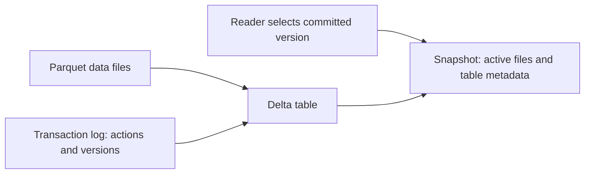

# 08 · Delta Lake Fundamentals

<ChapterMeta>

[07 · Parquet](/storage/07-parquet), [02 · Lakehouse](/foundations/02-lake-warehouse-lakehouse), [01 · Grain](/foundations/01-grain-keys-fanout). MERGE/idempotency implementation thuộc iteration sau.

</ChapterMeta>

## Why this matters

Dataset gồm `part-000.parquet`, `part-001.parquet`, `part-002.parquet` cần một định nghĩa committed state. Valid individual files chưa đủ để reader biết những files nào cùng một table version.

## Scenario

Pipeline update data, chết giữa chừng. Hai writers cùng đọc old state và ghi changes. Reader chạy khi một writer mới tạo replacement files; schema lại thay đổi, và finance cần version hôm qua. Bạn chọn files bằng glob hay đọc một committed snapshot?

## Learner reasoning

<details><summary>Commit boundary giải quyết gì?</summary>

Data files mới phải được ghi rồi published qua transaction protocol. Reader chọn committed version và active file actions. Optimistic conflict checks ngăn incompatible concurrent commits được silently coi thành success. Table transaction không thay business uniqueness/replay contract; append cùng batch hai lần vẫn có thể duplicate.

</details>

## Mental model



Delta table = Parquet data files + `_delta_log` và protocol. Log là sequence of actions/metadata, không là một file chứa toàn bộ rows. Checkpoints có thể summarize state để giảm replay; reader vẫn phải hỗ trợ table protocol/features. [Protocol v4.0.1][protocol].

## Core concepts

| Concept | Architecture consequence |
|---|---|
| Commit/version | Atomic publication của một set actions; successful write tạo version |
| Snapshot | Active files + metadata/protocol tại version được chọn |
| Add/remove | File membership changes; remove là tombstone, không immediate physical delete |
| ACID | Atomic commit; consistency theo enforced rules; isolated snapshots/conflict handling; durable committed state theo storage guarantees |
| Metadata | Schema, partition columns, properties; khác toàn bộ data |
| Schema enforcement | Reject incompatible writes; không bảo đảm unique business keys |
| Evolution | Explicit compatible schema change policy, không bật mọi evolution vô thức |
| Time travel | Read previous versions nếu log/data còn retained |

## Example data

Conceptual log simplification: v0 add A, add B → snapshot A+B. v1 remove A, add C → snapshot B+C. A có thể còn trên disk cho old versions. Đây là **minh họa hai commits**, không phải exact recorded lab numbering.

Actual Lab 08: v0 create ids1/2 revenues100/200; v1 append id3 revenue300; v2 UPDATE id1→150. v2 log remove original file, add replacement; append file vẫn active. Current rows `(1,150),(2,200),(3,300)`; version0 `(1,100),(2,200)`. Incompatible string revenue bị reject, không tạo v3. [Real logs](/labs/runtime-evidence).

## How it works

Writer đọc snapshot → chuẩn bị data files → validate conflicts/metadata → publish commit. Reader theo log protocol thấy valid snapshot; uncommitted/orphan files không tự trở thành active data. [Concurrency docs][concurrency] mô tả optimistic concurrency; không giả định mọi concurrent writes đều conflict hoặc được serialize bằng global lock.

UPDATE/DELETE là table operations. Trong lab, UPDATE rewrites affected file và publishes add/remove; không suy mọi runtime luôn rewrite toàn file: deletion vectors và supported features có thể đổi implementation. MERGE phối hợp matched/unmatched changes trong một transaction; deterministic matching, dedup và replay semantics sẽ học sau.

Time travel cần data files và history tương ứng; VACUUM/retention có thể làm old reads không còn khả dụng. Không hứa snapshot history là backup vĩnh viễn. Schema evolution cần reviewed contract, ví dụ opt-in mergeSchema cho additive columns theo [batch docs][batch], khác silently changing metric types.

| Capability | Raw Parquet | Delta |
|---|---|---|
| Columnar storage | Yes | Yes, Parquet data |
| Schema | Per-file schema | Yes + table management/enforcement |
| ACID transactions | No table-level transaction layer in format | Transaction protocol |
| UPDATE | Not native table semantic | Yes |
| DELETE | Not native table semantic | Yes |
| MERGE | No native table operation | Yes, matching rules still required |
| Snapshot history | No table-level history in format | Versioned snapshots, retention-dependent |
| Concurrent writers | Application/storage protocol problem | Conflict validation under supported protocol/storage |

## Databricks implementation

Databricks có integrated Delta support; use governed table names, supported runtime/compute và privileges. Không thêm OSS jars vào managed runtime tùy ý. [Databricks Delta][dbdelta] và [feature compatibility][features] xác định platform boundaries. OSS local lab không chứng minh cloud storage concurrency hoặc Unity Catalog behavior.

## Production failure

Reader dùng `spark.read.parquet(delta_directory)` đọc cả removed files vẫn còn cho time travel → stale/duplicate rows. Phải dùng Delta-aware reader. Editing `_delta_log` hoặc manual file deletion làm phá history/consistency. Replaying append cùng business events vẫn duplicate dù mỗi append là atomic.

## Debugging

| Symptom | Investigation | Diagnosis / fix |
|---|---|---|
| History có commit nhưng metric duplicate | Batch/key/match cardinality | Business replay problem; ACID không dedup |
| Schema write rejected | Incoming vs table schema | Validate producer, review explicit evolution |
| Conflict exception | Read/write scopes, operation, metadata changes | Retry with fresh snapshot và valid replay rules |
| Old version missing file | Retention/VACUUM history | Restore supported backup, review retention needs |
| Raw glob count sai | Active file membership | Read through Delta format |

## BigQuery / Airflow mapping

BigQuery tables cũng có transactional/history features nhưng không expose `_delta_log` protocol như Delta. Airflow retry là outer boundary; một table transaction không atomically update mọi external systems hoặc toàn multi-table DAG. Thiết kế publish/reconciliation riêng.

## Code

```powershell
python scripts/run_spark.py --lab 08
python scripts/test_spark.py --delta
```

[Lab 08](/labs/08-delta-log) chạy thật với Spark 4.0.4 + Delta 4.0.1; kiểm create/append/UPDATE/history/time travel/schema rejection. Không chạy MERGE trong iteration này.

## Common mistakes

Coi log lưu toàn rows; coi remove xóa file ngay; đọc Delta như raw Parquet; coi ACID enforce unique key; hoặc time travel là indefinite backup. Mỗi nhầm lẫn phá một production contract khác nhau.

## Production notes

Storage phải đáp ứng transaction protocol requirements. Theo dõi version, input batch IDs, schema và business metrics; log only không đủ để prove correctness. Local single-writer test chưa simulate concurrent writers, crashes, deletion vectors hoặc retention cleanup. Không VACUUM trong tiny learning lab.

## Interview checkpoint

1. v0 A+B, v1 removeA/addC: reader thấy gì và A có còn disk không?
2. Tại sao glob files khác Delta snapshot?
3. Atomic append hai lần có làm pipeline idempotent không?
4. Schema enforcement và evolution khác nhau ra sao?
5. Time travel cần retention conditions nào?

## How to explain this in an interview

“Delta thêm transaction protocol trên Parquet. Commit mô tả file/metadata actions; reader chọn snapshot theo version, không glob mọi files. Nó cung cấp table transactions và history theo retention, còn business keys, dedup và idempotent replay phải được thiết kế riêng.” Gắn lời giải với partial-write scenario, không học thuộc.

## PASS criteria

| PASS | NOT YET |
|---|---|
| Reconstruct active files sau add/remove | Coi log chứa full table rows |
| Verify current vs v0 và no-v3 rejected write | Chỉ xem history mà không kiểm rows |
| Tách ACID khỏi idempotency và retained history khỏi backup | Hứa replay append tự dedup |

## Official references

Verified 2026-10-10, Delta OSS 4.0.1 / Spark 4.0.4; AWS Databricks mapping không là local feature parity.

- [Compatibility](https://docs.delta.io/releases/), [quick start](https://docs.delta.io/quick-start/).
- [Protocol v4.0.1][protocol], [batch/time travel/schema][batch], [concurrency][concurrency].
- [Databricks Delta][dbdelta], [feature compatibility][features].

[protocol]: https://github.com/delta-io/delta/blob/v4.0.1/PROTOCOL.md
[batch]: https://docs.delta.io/delta-batch/
[concurrency]: https://docs.delta.io/concurrency-control/
[dbdelta]: https://docs.databricks.com/aws/en/delta/
[features]: https://docs.databricks.com/aws/en/tables/features/feature-compatibility
