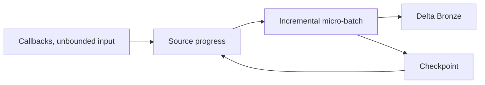

# 16 · Structured Streaming mental model

<ChapterMeta>

[03 · Spark execution](/spark/03-architecture-dataframes-sql), [11 · Idempotency](/correctness/11-idempotency), [13 · Time semantics](/correctness/13-time-semantics). [Lab 16](/labs/16-structured-streaming). Money: integer USD cents; lab timestamps: UTC.

</ChapterMeta>

## Why this matters

Callbacks đến liên tục. Một query đang sống giảm khoảng chờ giữa các lần xử lý, nhưng phải quản lý progress, retry và sink trong suốt vòng đời ứng dụng.

## Scenario

Batch hiện tại cứ 15 phút đọc dữ liệu mới, transform rồi write. Nếu chuyển sang query chạy liên tục, E1 E2 E3 đến trước, E4 E5 đến sau, cuối cùng E6: query phải finish sau nhóm đầu hay tiếp tục chờ?

## Learner reasoning

Một batch DataFrame mô tả input hữu hạn: read → transform → action → finish. Streaming DataFrame mô tả input chưa có điểm kết thúc: readStream → transform → repeated incremental execution → writeStream. SQL/DataFrame reasoning vẫn dùng được; execution và recovery contract thay đổi.

## Mental model

Unbounded table là mô hình logic. Micro-batch engine lấy một đoạn source progress, chạy incremental computation và ghi sink. Nhiều micro-batches thuộc cùng một continuously running query; không có cam kết mỗi batch chứa một số rows cố định.



## Core concepts

| Term | Câu hỏi nó trả lời |
|---|---|
| Source / transformation / sink | Đọc đâu, tính gì, ghi đâu? |
| Trigger | Khi nào engine thử bắt đầu lần xử lý tiếp? |
| Micro-batch | Đoạn input progress nào được xử lý trong lần này? |
| Progress | Batch ID, input rows, rates, duration và state đã quan sát là gì? |
| Checkpoint | Query tiếp tục và khôi phục state bằng metadata nào? |

## Example data

Lab 16 atomically publishes ba JSON files chứa 3, 2, 1 events. Source có explicit schema và maxFilesPerTrigger=1; vì input được publish từng phase và drain xong trước phase sau, lab quan sát nhiều positive-input batches. Đây là fixture điều khiển, không là quy luật row count của streaming.

## How it works

Processing-time trigger 1 second là nhịp yêu cầu, không là processing SLA. Nếu computation mất 12 seconds, query không hoàn thành mỗi second. Input rate vượt sustainable processing rate làm backlog tăng. Một batch có thể rỗng, nhỏ hoặc lớn tùy source admission controls và dữ liệu sẵn có.

## Databricks implementation

Executable scope: local OSS Spark 4.0.4 + Delta 4.0.1 qua [pinned runtime](/setup/local-spark), Linux Docker trên Windows host. Không là Databricks Runtime execution. AWS docs retrieved 2026-10-11 cho production guidance; runtime-specific feature phải kiểm trước dùng. Local query có explicit schema/checkpoint, typed event time và fully consumed foreachBatch output nếu dùng custom sink.

## Production failure

Đặt trigger thấp hơn processing duration rồi hứa freshness 1 second. Khi source delivery delay hoặc backlog cao, trigger setting không thể giữ lời hứa. Retry side effects có thể làm target sai dù query vẫn active.

## Debugging

| Symptom / signal | Điều tra và hướng xử lý |
|---|---|
| inputRowsPerSecond > processedRowsPerSecond kéo dài | So arrival, processing duration và source backlog, tìm bottleneck |
| durationMs.triggerExecution vượt trigger | Tách read, computation, sink và state commit |
| numInputRows=0 | Có thể source idle; so source offsets, chưa kết luận mất dữ liệu |
| Query active nhưng Gold stale | Kiểm sink, downstream refresh và source freshness riêng |

Query rates mô tả input được engine đọc, không trực tiếp đo toàn bộ upstream arrival rate. Admission limits có thể khiến rates đẹp trong khi source backlog vẫn tăng. Kiểm available-vs-processed source positions hoặc pending file count, cùng oldest unprocessed event age và arrival-to-target lag. Không suy ra backlog chỉ từ numInputRows của một batch.

## BigQuery / Airflow mapping

Airflow chạy lặp bounded jobs với data intervals; một streaming query có progress và state xuyên micro-batches. SQL familiarity chuyển được từ BigQuery, nhưng không thể áp một batch action hoặc warehouse schedule thành recovery guarantee.

## Code

Actual implementation: labs/streaming/experiments.py::lab16, common.py. Bounded collect chỉ dùng để inspect tiny fixture; production sink không collect unbounded output lên driver.

```python
df = source(spark, inputs).where("status = 'COMPLETED'")
query = writer(df, checkpoint).format('delta').start(str(target))
```

```powershell
python scripts/run_streaming.py --lab 16
python scripts/test_streaming.py test_16
```

[Lab 16](/labs/16-structured-streaming) hướng dẫn đọc observed progress, target states và checkpoint inventory; [streaming evidence](/labs/streaming-evidence) giữ selected JSON và hashes.

## Common mistakes

Coi readStream là chạy Spark SQL mỗi record; tin trigger là deadline; lấy query active làm completeness check; dùng rate source để khẳng định source replay production.

## Production notes

ROAS freshness phải tính source delivery, backlog và target update. Source retention, checkpoint ownership và sink retry contract là operational requirements của một continuously running query.

## When NOT to use Structured Streaming

Daily source chỉ update một lần/ngày, business SLA tính bằng giờ, cheap bounded batch đáp ứng đủ hoặc operational complexity vượt lợi ích: chọn batch có căn cứ. Streaming là trade-off latency và vận hành.

ROAS có thể dùng callbacks → streaming Bronze → Silver processing, trong khi cost API extraction và Gold reconciliation vẫn scheduled batch. Hai giờ arrival tolerance không giải quyết attribution mutations 72h.

## Execution modes ở mức awareness

[Spark 4.0.4 overview](https://spark.apache.org/docs/4.0.4/streaming/index.html) mô tả default micro-batch và continuous processing với guarantees khác. [Databricks real-time mode](https://docs.databricks.com/aws/en/structured-streaming/real-time/setup) có runtime/operator/compute requirements riêng. Lab này chỉ chạy micro-batch, không đo real-time latency hay suy ra feature parity.

## Interview checkpoint

1. Với input đến 3, 2, 1 rows, vì sao không thể đặt fixed row count là contract?
2. Trigger 1 second nhưng batch mất 12 seconds: freshness và backlog ra sao?
3. Daily cost export có đáng stream không? Vì sao callbacks và Gold có thể dùng lịch khác nhau?

## How to explain this in an interview

“Tôi giữ SQL/DataFrame mental model, nhưng input unbounded và engine lặp incremental execution với durable progress. Chọn streaming từ freshness và source behavior; trigger thấp chưa chứng minh SLA hoặc business correctness.”

## PASS criteria

PASS: Chỉ ra source/transform/sink, đọc positive-input batch IDs và rates, giải thích một query active qua nhiều batches rồi clean stop. NOT YET nếu chỉ kể thuật ngữ, query active hoặc command exit 0 mà chưa chứng minh target correctness và failure boundary.

## Official references

Verified 2026-10-11, OSS Spark 4.0.4 và current AWS Databricks docs; cloud/runtime scope ở implementation.

- [Spark streaming API, state, output and recovery](https://spark.apache.org/docs/4.0.4/streaming/apis-on-dataframes-and-datasets.html).
- [Databricks checkpoints](https://docs.databricks.com/aws/en/structured-streaming/checkpoints).
- [Databricks watermarks](https://docs.databricks.com/aws/en/structured-streaming/watermarks).
- [Databricks foreachBatch guarantees](https://docs.databricks.com/aws/en/structured-streaming/foreach).
- [Delta streaming sink and transactions](https://docs.delta.io/delta-streaming/).
