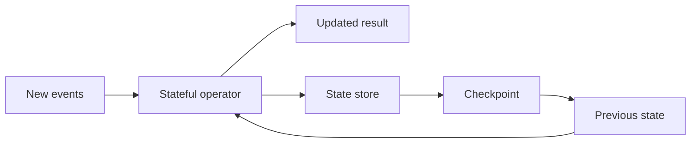

# 17 · Stateless vs stateful streaming

<ChapterMeta>

[16 · Structured Streaming mental model](/streaming/16-structured-streaming). [Lab 17](/labs/17-stateless-stateful). Money: integer USD cents; lab timestamps: UTC.

</ChapterMeta>

## Why this matters

State giữ thông tin từ input trước để xử lý input tương lai đúng. Không xác định state lifetime khiến latency, memory hoặc checkpoint cost tăng cùng lịch sử.

## Scenario

Filter status=COMPLETED xử lý từng row độc lập. Count purchases per user cần nhớ count trước đó khi purchase tiếp theo đến. Hai query dùng cùng source nhưng có recovery và capacity needs khác nhau.

## Learner reasoning

Có thể tính output của row mới chỉ từ chính row và bounded/static side data không? Nếu có, transformation là stateless theo stream. Nếu cần events trước, phải giữ state. Static enrichment vẫn cần nghĩ tới snapshot/version của side data khi retry.

## Mental model

Stateful operator đọc và cập nhật state store. Durable checkpoint cho phép phục hồi state tại progress phù hợp. State store là architecture boundary; backend cụ thể không quyết định business identity.



## Core concepts

| Operation | Cần giữ gì giữa batches? |
|---|---|
| Filter, select, parse | Không giữ prior stream rows |
| Bounded static enrichment | Không giữ unbounded matching stream history |
| Running aggregation | Aggregate theo key |
| Deduplication | Seen identity / expiry |
| Window / stream-stream join | Open windows / unmatched candidates |
| Custom state | User-defined state và timeout contract |

## Example data

Lab 17: E1 U1=10, E2 U2=20; batch sau E3 U1=5. Running result U1=(15,2), U2=(20,1). Sau stop và restart cùng checkpoint, E4 U2=7 phải tạo U2=(27,2), không đếm lại E1-E3. Amount là integer USD cents, event_time typed UTC timestamp.

## How it works

groupBy(user_id) sum(amount), count(*) giữ running aggregate. Complete output emits entire result; foreachBatch fully consumes rows rồi overwrite snapshot Delta. Đây là toy single-writer snapshot sink, không multi-table transaction. State checkpoint và numRowsTotal cho thấy query có state.

## Databricks implementation

Executable scope: local OSS Spark 4.0.4 + Delta 4.0.1 qua [pinned runtime](/setup/local-spark), Linux Docker trên Windows host. Không là Databricks Runtime execution. AWS docs retrieved 2026-10-11 cho production guidance; runtime-specific feature phải kiểm trước dùng. Local query có explicit schema/checkpoint, typed event time và fully consumed foreachBatch output nếu dùng custom sink.

## Production failure

Deduplicate forever theo event_id với infinite distinct IDs: state tăng theo số identities chưa bị loại, không theo kích thước một micro-batch. Running per-user aggregates cũng tăng theo số keys. Chỉ thêm watermark vào non-event-time group không tự tạo lifetime hữu hạn.

## Debugging

Đọc stateOperators: numRowsTotal, numRowsUpdated, numRowsRemoved, memoryUsedBytes, commitTimeMs nếu có. State tăng trong khi input ổn định gợi ý key cardinality/lifetime thiếu bound; bytes là signal của backend, không exact business size.

## BigQuery / Airflow mapping

Batch GROUP BY có thể kết thúc và giải phóng executor state. Stateful streaming cần state để xử lý input chưa đến. Airflow task success không lưu running aggregate correctness; warehouse table persistence cũng không tự là streaming operator checkpoint.

## Code

Actual implementation: labs/streaming/experiments.py::lab17, common.py. Bounded collect chỉ dùng để inspect tiny fixture; production sink không collect unbounded output lên driver.

```python
result = aggregate(source(spark, inputs))
query = writer(result, checkpoint, 'complete').foreachBatch(table_sink(target)).start()
```

```powershell
python scripts/run_streaming.py --lab 17
python scripts/test_streaming.py test_17
```

[Lab 17](/labs/17-stateless-stateful) hướng dẫn đọc observed progress, target states và checkpoint inventory; [streaming evidence](/labs/streaming-evidence) giữ selected JSON và hashes.

## Common mistakes

Coi filter là stateful vì nó chạy lâu; coi mọi join đều stream-stream; cho rằng checkpoint chứa toàn bộ business truth; đặt complete mode rồi trông chờ watermark evict aggregate history.

## Production notes

Lab ghi observed spark.sql.streaming.stateStore.providerClass trong streaming-config.json, không mặc định gán RocksDB cho mọi runtime. [Databricks stateful guidance](https://docs.databricks.com/aws/en/structured-streaming/stateful-streaming) có version-specific capabilities; source của provider ở local là actual configuration. Không cần đọc/đổi raw state files.

Fixture aggregates immutable, distinct purchases. Mutable ROAS revisions cần latest-version Silver contract từ Chapter 12; cộng mọi callbacks sẽ đếm cả retries và corrections.

## Interview checkpoint

1. Vì sao cùng row filter và running count có state needs khác nhau?
2. Dedup forever có 10 triệu distinct IDs/ngày: state lifetime là gì?
3. Restart aggregate từ checkpoint mới có thể thiếu gì nếu source đã hết retention?

## How to explain this in an interview

“State là prior information cần cho future correctness. Tôi xác định keys, lifetime và recovery boundary trước khi chọn backend. Tôi đo state metrics và kiểm target sau restart; state tồn tại không chứng minh source đủ hoặc revisions đúng.”

## PASS criteria

PASS: Phân loại operations, chứng minh aggregate sau restart và chỉ ra unbounded state-growth mechanism. NOT YET nếu chỉ kể thuật ngữ, query active hoặc command exit 0 mà chưa chứng minh target correctness và failure boundary.

## Official references

Verified 2026-10-11, OSS Spark 4.0.4 và current AWS Databricks docs; cloud/runtime scope ở implementation.

- [Spark streaming API, state, output and recovery](https://spark.apache.org/docs/4.0.4/streaming/apis-on-dataframes-and-datasets.html).
- [Databricks checkpoints](https://docs.databricks.com/aws/en/structured-streaming/checkpoints).
- [Databricks watermarks](https://docs.databricks.com/aws/en/structured-streaming/watermarks).
- [Databricks foreachBatch guarantees](https://docs.databricks.com/aws/en/structured-streaming/foreach).
- [Delta streaming sink and transactions](https://docs.delta.io/delta-streaming/).
