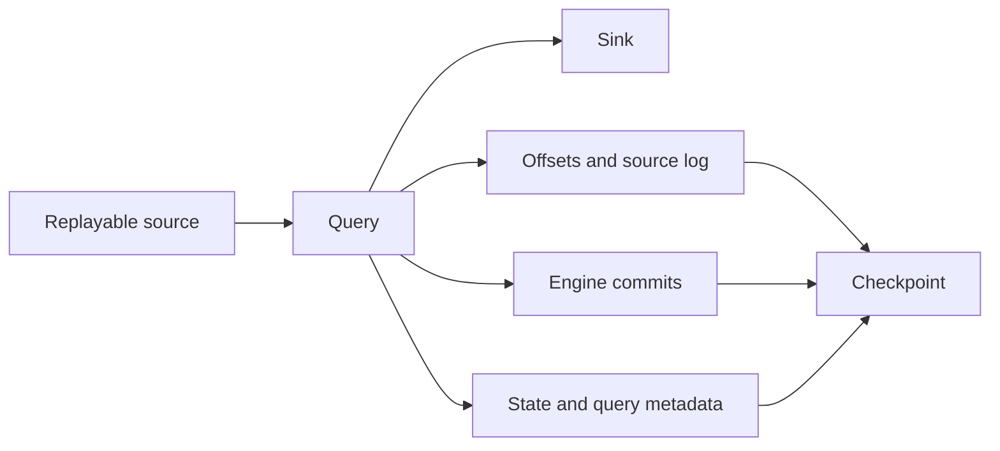

# 18 · Checkpoints and restart boundaries

<ChapterMeta>

[17 · Stateless vs stateful streaming](/streaming/17-stateless-stateful), [11 · Idempotency](/correctness/11-idempotency). [Lab 18](/labs/18-checkpoints). Money: integer USD cents; lab timestamps: UTC.

</ChapterMeta>

## Why this matters

Sau failure, engine cần source position, completed batch boundary và đúng prior state. Một checkpoint path tồn tại chưa đủ chứng minh nó phù hợp query hoặc target.

## Scenario

Batch 0, 1, 2 đã xử lý rồi process crashes. Làm sao phân biệt batch đã ghi sink với batch đã bắt đầu nhưng chưa commit? Nếu đổi grouping key rồi restart tại folder cũ, state cũ có còn đúng nghĩa?

## Learner reasoning

Đọc durable progress thay vì tin last console message. Sink có thể commit trước engine commit, nên retry vẫn có thể xảy ra. Query semantics và state schema phải phù hợp với metadata được phục hồi.

## Mental model

Checkpoint là recovery metadata của query. Bronze là retained business input theo ingestion contract. Source of truth là authority theo business agreement. Ba trách nhiệm này cần retention và ownership riêng.



## Core concepts

| Component | Trách nhiệm |
|---|---|
| offsets / source log | Progress và file discovery theo source |
| commits | Engine completed batch boundary |
| state | Stateful operator recovery |
| metadata | Query identity; config còn nằm trong offset metadata |
| Bronze / target tables | Business data, không được backup bởi checkpoint |

## Example data

Lab 18 ghi E1/E2 rồi E3, stop với target 3 rows. Same checkpoint không có new input giữ hash; E4 làm target 4. New checkpoint discovery lại retained files làm append target 8 rows. Quan sát này chỉ chứng minh JSON file-source behavior của fixture.

## How it works

### Compatibility table

[Spark 4.0.4 recovery rules](https://spark.apache.org/docs/4.0.4/streaming/apis-on-dataframes-and-datasets.html#recovery-semantics-after-changes-in-a-streaming-query) và [Databricks checkpoints](https://docs.databricks.com/aws/en/structured-streaming/checkpoints) là contract tham chiếu.

| Change | Reuse old checkpoint? | Why |
|---|---|---|
| Filter hoặc non-stateful projection, same output schema | Có thể được phép; kiểm meaning và downstream | Old rows không tự được recompute |
| Projection đổi output schema | Conditional | Sink phải accept schema; không đồng nghĩa migration an toàn |
| Aggregation: đổi number/type grouping keys hoặc aggregates | Không trong Spark 4.0.4 generic rules | State schema đổi |
| Dedup: đổi number/type dedup columns | Không; cùng type nhưng đổi business key cũng cần migration có chủ đích | State meaning không tương đương |
| Stream-stream join: đổi state schema, equi-join columns, inner/outer type | Không | State recovery incompatible; other predicate changes ill-defined |
| Add/remove/modify stateful operators | Không theo generic recovery rules | Operator/state mapping đổi |
| Rate limit / trigger | Có permitted changes; kiểm source và supported trigger transition | Admission control khác state schema |
| Source count/type hoặc subscription/path | Spark generic rules cấm hoặc unpredictable | Source positions không còn tương đương |
| New checkpoint | New query state/progress | Phải chọn source start, replay và target policy lại |

Current Databricks docs có source-evolution feature khi bật source naming; availability/configuration phải theo runtime docs. Ngoại lệ đó không mở rộng compatibility của local Spark 4.0.4. Đừng đổi state-store/shuffle/global-watermark configuration tùy tiện qua restarts.

## Databricks implementation

Executable scope: local OSS Spark 4.0.4 + Delta 4.0.1 qua [pinned runtime](/setup/local-spark), Linux Docker trên Windows host. Không là Databricks Runtime execution. AWS docs retrieved 2026-10-11 cho production guidance; runtime-specific feature phải kiểm trước dùng. Local query có explicit schema/checkpoint, typed event time và fully consumed foreachBatch output nếu dùng custom sink.

## Production failure

Checkpoint mới được dùng với append sink cũ: source replay tạo duplicate effects. Checkpoint cũ với changed keys: incompatible schema hoặc sai meaning. Checkpoint đúng không cứu business key sai hoặc target đã bị sửa ngoài query.

## Debugging

So query ID/run ID, offsets và commits tại failed batch; kiểm source input retention, target history và code/config compatibility. Engine commits và Delta transactions là hai logs khác nhau. Không edit raw checkpoint để ép query chạy.

## BigQuery / Airflow mapping

Airflow metadata nhớ task/run state, không tương đương Spark per-source offsets và operator state. Một BigQuery backup giúp business data, không chứa Structured Streaming recovery protocol.

## Code

Actual implementation: labs/streaming/experiments.py::lab18, common.py. Bounded collect chỉ dùng để inspect tiny fixture; production sink không collect unbounded output lên driver.

```python
query = writer(source(spark, inputs), checkpoint).format('delta').start(str(target))
# Restart giữ checkpoint; new checkpoint là một recovery generation khác.
```

```powershell
python scripts/run_streaming.py --lab 18
python scripts/test_streaming.py test_18
```

[Lab 18](/labs/18-checkpoints) hướng dẫn đọc observed progress, target states và checkpoint inventory; [streaming evidence](/labs/streaming-evidence) giữ selected JSON và hashes.

## Common mistakes

Checkpoint=only offsets; checkpoint=business backup; folder tồn tại=compatible; new checkpoint luôn bắt đầu từ earliest ở mọi connector; reused checkpoint sẽ áp new filter cho all historical rows.

## Production notes

Mỗi query có checkpoint riêng trên durable storage với access và retention policy. Same checkpoint continuation cần compatible query và source/sink assumptions; retention gaps vẫn phải xử lý. Lab dùng local storage trong container-mounted evidence, không mô phỏng cloud fault-tolerance. Controlled stop/restart không được gọi là process kill.

## Interview checkpoint

1. Có offsets/N nhưng thiếu commits/N và target đã tăng revenue: retry thế nào?
2. Đổi groupBy(user_id) thành groupBy(user_id,platform) có reuse cp không?
3. New cp với file source và append target khác gì new cp với configured Kafka offsets?

## How to explain this in an interview

“Checkpoint gắn với query semantics, gồm source progress, commits, state và metadata. Restart cùng cp có thể retry chưa-completed batch. Khi cần cp mới tôi chọn replay/start boundary và target reconciliation, không gọi cp là Bronze backup.”

## PASS criteria

PASS: Đọc checkpoint inventory, so exact target/hash qua restart và bảo vệ compatibility decision bằng source và state schema. NOT YET nếu chỉ kể thuật ngữ, query active hoặc command exit 0 mà chưa chứng minh target correctness và failure boundary.

## Official references

Verified 2026-10-11, OSS Spark 4.0.4 và current AWS Databricks docs; cloud/runtime scope ở implementation.

- [Spark streaming API, state, output and recovery](https://spark.apache.org/docs/4.0.4/streaming/apis-on-dataframes-and-datasets.html).
- [Databricks checkpoints](https://docs.databricks.com/aws/en/structured-streaming/checkpoints).
- [Databricks watermarks](https://docs.databricks.com/aws/en/structured-streaming/watermarks).
- [Databricks foreachBatch guarantees](https://docs.databricks.com/aws/en/structured-streaming/foreach).
- [Delta streaming sink and transactions](https://docs.delta.io/delta-streaming/).
