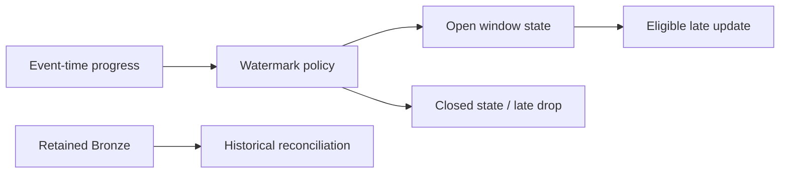

# 19 · Event-time windows and watermarks

<ChapterMeta>

[13 · Time semantics](/correctness/13-time-semantics), [14 · Late data](/correctness/14-late-lookback-reconciliation), [17 · Stateless vs stateful streaming](/streaming/17-stateless-stateful), [18 · Checkpoints and restart boundaries](/streaming/18-checkpoints). [Lab 19](/labs/19-windows-watermarks). Money: integer USD cents; lab timestamps: UTC.

</ChapterMeta>

## Why this matters

Watermark đặt policy cho late event-time eligibility và retained state. Policy quá ngắn có thể mất valid revenue; quá dài giữ state lâu và tốn resources.

## Scenario

A event=10:00 arrival=10:01, B event=10:02 arrival=10:03, C event=09:50 arrival=10:20. Window 10 minutes: C thuộc [09:50,10:00). C có còn được tính không, hay state của window đã đóng?

## Learner reasoning

Arrival=10:20 không tự quyết định eligibility. Cần biết observed event-time progress, delay policy, operator/output mode và window còn open hay đã qua eviction boundary. Nếu stream mới thấy max event=10:02, kết quả khác stream đã thấy 10:30.

## Mental model

Watermark là event-time progress threshold giúp engine giới hạn late-data state lifetime. Nó không là ingestion cursor. Delay guarantee bảo vệ dữ liệu trong declared lateness range; dữ liệu vượt range có thể bị xử lý hoặc bỏ, không có universal drop-if-age rule.



## Core concepts

| Mechanism | Câu hỏi |
|---|---|
| Batch high-water mark | Fetch source records nào tiếp? |
| Lookback | Re-read recent history nào? |
| Reconciliation | Target có khớp defined truth không? |
| Streaming watermark | Giữ event-time state eligible đến khi nào? |
| Window | Business time interval nào nhận event? |

## Example data

Lab ghi A/B trước, rồi PROGRESS event=10:30 để thực sự advance watermark, cuối cùng C=09:50. Chạy update aggregation ba variants: no watermark, 5 minutes, 2 hours. Arrival order được file phases điều khiển; arrival timestamps trong scenario là explanation, không wall-clock timer của test.

## How it works

Spark theo dõi maximum observed event time; max-event-time minus delay giải thích candidate progress, nhưng effective watermark dùng qua batch boundaries và operator rules. Progress JSON là observation đáng kiểm. Với multiple inputs, default global policy min chịu tác động slow/idle source; max ưu tiên fast source và có thể mất slower-stream data.

Aggregation state cleanup cần append/update, watermark trước aggregate trên đúng event-time column và group có event time/window. Complete giữ entire aggregate state. Với 2h policy, data ít hơn 2h behind latest processed event time được bảo vệ theo documented one-sided guarantee; quá 2h không chắc luôn drop.

## Databricks implementation

Executable scope: local OSS Spark 4.0.4 + Delta 4.0.1 qua [pinned runtime](/setup/local-spark), Linux Docker trên Windows host. Không là Databricks Runtime execution. AWS docs retrieved 2026-10-11 cho production guidance; runtime-specific feature phải kiểm trước dùng. Local query có explicit schema/checkpoint, typed event time và fully consumed foreachBatch output nếu dùng custom sink.

## Production failure

Dùng 2h watermark thay cho 72h attribution repair: correction thuộc event_time cũ có thể bị loại dù updated_at mới. Future-dated malformed event có thể đẩy event-time progress xa, làm valid events trở thành late. Validate clock contract trước stateful operators.

## Debugging

Kiểm eventTime.max/watermark, stateOperators.numRowsDroppedByWatermark/numRowsRemoved/numRowsTotal và exact result window. Drop metric khác filter/dedup count. Idle source không kéo watermark theo wall clock; rate thấp không chứng minh window đã final.

## BigQuery / Airflow mapping

Batch lookback chủ động re-read lịch sử; watermark chỉ quản lý state trong streaming operator. Một warehouse reconciliation vẫn có thể repair older window từ retained truth sau khi stream state đã evict.

## Code

Actual implementation: labs/streaming/experiments.py::lab19, common.py. Bounded collect chỉ dùng để inspect tiny fixture; production sink không collect unbounded output lên driver.

```python
result = windowed(source(spark, inputs), '5 minutes')
query = writer(result, checkpoint, 'update').foreachBatch(
    table_sink(target, 'update', ['window_start', 'window_end'])).start()
```

```powershell
python scripts/run_streaming.py --lab 19
python scripts/test_streaming.py test_19
```

[Lab 19](/labs/19-windows-watermarks) hướng dẫn đọc observed progress, target states và checkpoint inventory; [streaming evidence](/labs/streaming-evidence) giữ selected JSON và hashes.

## Common mistakes

watermark=batch cursor; latest wall time minus delay; mọi late row chắc drop; withWatermark luôn bound running count theo user; complete mode evict historical aggregate; threshold 2h là universal recommendation.

## Production notes

Short policy thường ít retained state và có thể giảm resource cost hoặc append-finalization delay, đổi lại late tolerance thấp. Long policy giữ state nhiều hơn; đo distributions và source guarantees để chọn. Freshness 15 phút có thể dùng provisional update results, còn final append window bị watermark delay chi phối. Hybrid Gold reconciliation sửa lịch sử theo business contract.

## Interview checkpoint

1. C có hợp lệ nếu max observed event mới là 10:02? Nếu đã advance 10:30?
2. Vì sao latest event minus delay chưa mô tả đầy đủ effective eligibility?
3. Vì sao 72h mutation vẫn cần reconciliation dù WM=2h?

## How to explain this in an interview

“Tôi chọn watermark từ lateness contract và cost của state. Nó bảo vệ late input trong documented range, không fetch history và không thay reconciliation. Tôi kiểm effective watermark và actual drops, rồi tách provisional freshness khỏi final window completeness.”

## PASS criteria

PASS: Tách bốn mechanisms, giải thích one-sided guarantee và chứng minh actual drop/state eviction bằng metrics. NOT YET nếu chỉ kể thuật ngữ, query active hoặc command exit 0 mà chưa chứng minh target correctness và failure boundary.

## Official references

Verified 2026-10-11, OSS Spark 4.0.4 và current AWS Databricks docs; cloud/runtime scope ở implementation.

- [Spark streaming API, state, output and recovery](https://spark.apache.org/docs/4.0.4/streaming/apis-on-dataframes-and-datasets.html).
- [Databricks checkpoints](https://docs.databricks.com/aws/en/structured-streaming/checkpoints).
- [Databricks watermarks](https://docs.databricks.com/aws/en/structured-streaming/watermarks).
- [Databricks foreachBatch guarantees](https://docs.databricks.com/aws/en/structured-streaming/foreach).
- [Delta streaming sink and transactions](https://docs.delta.io/delta-streaming/).
