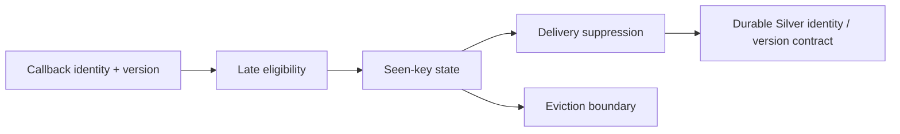

# 20 · Streaming deduplication

<ChapterMeta>

[11 · Idempotency](/correctness/11-idempotency), [18 · Checkpoints and restart boundaries](/streaming/18-checkpoints), [19 · Event-time windows and watermarks](/streaming/19-windows-watermarks). [Lab 20](/labs/20-streaming-dedup). Money: integer USD cents; lab timestamps: UTC.

</ChapterMeta>

## Why this matters

Seen-key state không thể giữ mọi callback identity mãi trong một unbounded stream. Bounded dedup giải quyết một correctness horizon, không tạo permanent business idempotency.

## Scenario

Webhook retry E123, E123, E123. Sau khi watermark evict E123, một delivery cũ với original event_time và một delivery mang refreshed event_time có cùng behavior không?

## Learner reasoning

Dedup cần stable namespace/key và declared event clock. Old timestamp có thể bị late filter bỏ; refreshed timestamp có thể vượt state horizon và được nhận lại. Tách duplicate delivery của cùng revision khỏi legitimate business mutation.

## Mental model

Watermark-bounded dedup giữ seen identity trong state rồi giải phóng khi operator xác định đủ progress. Permanent latest-version target contract phải ở durable business layer. State expiry không xóa business history và không sửa identity sai.



## Core concepts

| Contract | Ý nghĩa |
|---|---|
| Business identity | source_system + app_id + event_id |
| Delivery duplicate | Cùng identity và version/content |
| Mutation | Same identity, newer version; phải xử lý theo Chapter 12 |
| Streaming seen state | Temporary duplicate suppression |
| Durable idempotency | Replay không tạo thêm business effect ở target |

## Example data

Lab 20 dùng dropDuplicatesWithinWatermark(KEY), delay 10 minutes: E123 10:00; retry E123 10:01 và distinct E124 10:02; ADVANCE 11:00; original-time E123; refreshed-time E123 11:02. Refreshed event deliberately vi phạm immutable event-time contract để thấy finite dedup horizon.

## How it works

Spark supports dedup không watermark với unbounded seen state, và bounded forms với event-time policy. dropDuplicatesWithinWatermark cho key không cần chứa event_time, phù hợp delivery timestamps biến thiên trong declared horizon; delay phải bao phủ timestamp distance của duplicates theo [Spark API guide](https://spark.apache.org/docs/4.0.4/streaming/apis-on-dataframes-and-datasets.html#streaming-deduplication). Chưa đủ bảo đảm version-aware Silver state.

## Databricks implementation

Executable scope: local OSS Spark 4.0.4 + Delta 4.0.1 qua [pinned runtime](/setup/local-spark), Linux Docker trên Windows host. Không là Databricks Runtime execution. AWS docs retrieved 2026-10-11 cho production guidance; runtime-specific feature phải kiểm trước dùng. Local query có explicit schema/checkpoint, typed event time và fully consumed foreachBatch output nếu dùng custom sink.

## Production failure

Dedup mutable callbacks theo event_id alone làm mất legitimate revision 2 trong horizon. Đổi event_time thành retry arrival có thể khiến same purchase sống lại sau eviction. Dedup theo random delivery UUID không nhận ra business replay.

## Debugging

So exact identity/version/content trước và sau, observed watermark, late-drop metrics và state removals. Target rows cùng key nhưng timestamp khác là clue sai clock contract. Distinct-key count không thay sum/revision reconciliation.

## BigQuery / Airflow mapping

Batch ROW_NUMBER/version resolution nhìn bounded input đầy đủ. Streaming dedup chỉ nhớ retained state; target MERGE/idempotency của Chapter 11-12 vẫn cần cho arbitrary replay và late mutations.

## Code

Actual implementation: labs/streaming/experiments.py::lab20, common.py. Bounded collect chỉ dùng để inspect tiny fixture; production sink không collect unbounded output lên driver.

```python
df = source(spark, inputs).withWatermark('event_time', '10 minutes')
df = df.dropDuplicatesWithinWatermark(KEY)
```

```powershell
python scripts/run_streaming.py --lab 20
python scripts/test_streaming.py test_20
```

[Lab 20](/labs/20-streaming-dedup) hướng dẫn đọc observed progress, target states và checkpoint inventory; [streaming evidence](/labs/streaming-evidence) giữ selected JSON và hashes.

## Common mistakes

State eviction=all duplicates now safe; all very late duplicates survive; event_id globally unique thiếu namespace; dedup bỏ mọi revisions; cp mới nhưng trông chờ seen keys cũ còn nhớ.

## Production notes

ROAS Bronze giữ raw deliveries và audit timestamps. Silver phải chọn business revision hoặc content contract trước dedup. Event-time watermark của immutable purchase processing không được dùng làm cổng duy nhất cho 72h corrections; historical repair đọc retained updates và reconcile.

## Interview checkpoint

1. Late duplicate original time và refreshed time sau eviction khác thế nào?
2. Vì sao key cần version khi callback có corrections?
3. New checkpoint làm mất dedup state thì target bảo vệ replay ở đâu?

## How to explain this in an interview

“Streaming dedup có bounded memory và bounded correctness horizon. Tôi giữ stable business identity, phân biệt delivery retry với mutation, và dùng durable idempotent target plus reconciliation cho replay ngoài state horizon.”

## PASS criteria

PASS: Giải thích cả within-horizon suppression, old-time late drop và refreshed-time repeat effect, cùng legitimate mutation path. NOT YET nếu chỉ kể thuật ngữ, query active hoặc command exit 0 mà chưa chứng minh target correctness và failure boundary.

## Official references

Verified 2026-10-11, OSS Spark 4.0.4 và current AWS Databricks docs; cloud/runtime scope ở implementation.

- [Spark streaming API, state, output and recovery](https://spark.apache.org/docs/4.0.4/streaming/apis-on-dataframes-and-datasets.html).
- [Databricks checkpoints](https://docs.databricks.com/aws/en/structured-streaming/checkpoints).
- [Databricks watermarks](https://docs.databricks.com/aws/en/structured-streaming/watermarks).
- [Databricks foreachBatch guarantees](https://docs.databricks.com/aws/en/structured-streaming/foreach).
- [Delta streaming sink and transactions](https://docs.delta.io/delta-streaming/).
